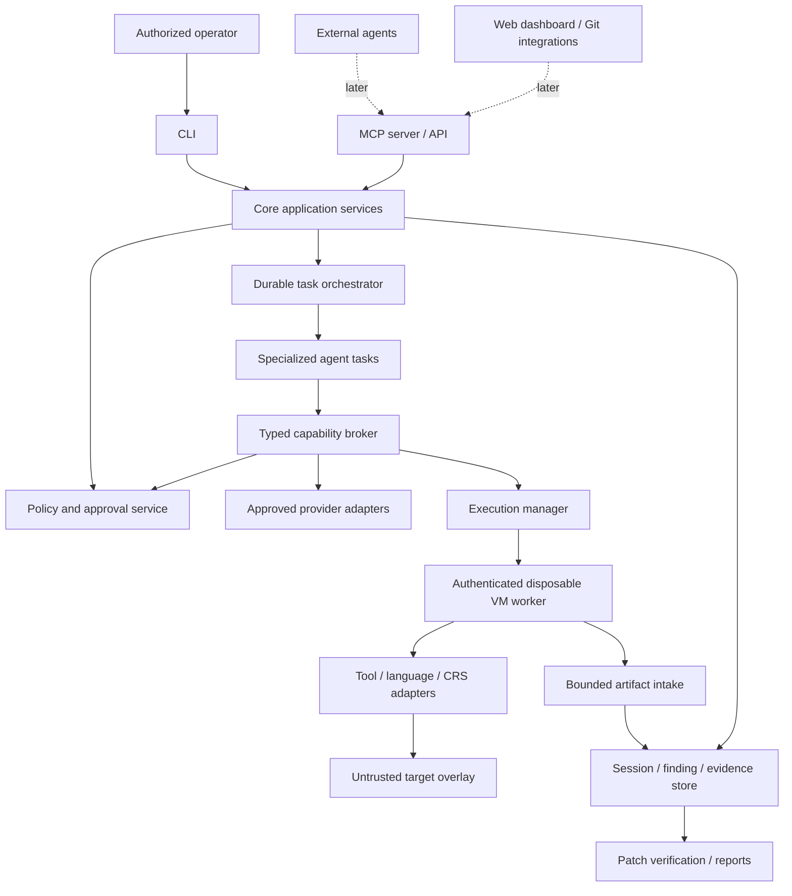

# Architecture

Sentra is an autonomous AI security research and remediation platform built with a modular, local-first control plane in Safe Rust (`#![forbid(unsafe_code)]`). Policy enforcement, state transitions, and evidence admission are strictly handled by deterministic application services. Scoped AI agents propose actions; they never obtain direct authority over the host, approvals, or verified finding status.

Inspection is **domain-state read-only**: the SQLite metadata repository operates under WAL mode (`BEGIN IMMEDIATE` transactions and integrity PRAGMAs) with deterministic state management. Admission uses OS-level atomic locks, and storage boundaries fail closed. See [user-facing storage semantics](README.md#inspection-storage-permissions).

Incomplete initialization recovery is governed by [ADR-0010](docs/adr/0010-explicit-initialization-recovery.md), ensuring that incomplete session states are preserved without destructive automatic resets or unowned file overwrites.

## Shape of the platform

Use a modular local control plane with a reusable core and CLI first. Keep policy enforcement, state transitions, and evidence admission in deterministic application services. AI agents propose bounded actions; they never obtain direct authority over the host, approvals, or verified finding status.

The diagram shows logical modules, not a commitment to one process per box. Initially the core, policy, scheduler, and local store may share one trusted process. Target-facing parsers and analysis tools run as constrained workers. Third-party subprocess separation alone is not a security sandbox.

## Component responsibilities

| Component | Owns | Boundary |
| --- | --- | --- |
| Core Engine | Project identity, use cases, domain invariants, schema versions | No CLI-specific business rules |
| CLI | Human interaction, plan preview, approval presentation, local export | Calls core services; cannot override policy implicitly |
| Policy/approval service | Authorization scope, capabilities, egress, limits, signed or locally protected approval records | Sole dispatcher authorization source |
| AI Agent Orchestrator | Persistent task graph, leases, role assignment, reservations, retries, cancellation | Deterministic scheduler; model is not the scheduler of record |
| Specialized Research Agents | Discovery, investigation, validation planning, impact and patch proposals | Typed, scoped tools and artifact references only |
| Vulnerability Discovery Engine | Tool scheduling, context retrieval, signal normalization, deduplication | Imports claims, never grants verified status |
| Finding and Evidence Management | Lifecycle, evidence graph, provenance, access, exports | Rejects unsupported promotions and malformed results |
| Sandbox and Execution Manager | Backend capability negotiation, job leases, cleanup, quotas, result authentication | Only trusted service with scoped worker-control authority |
| Patch and Verification Engine | Overlay creation, oracle review, original/patched comparison, regression results | Author and verifier have separate contexts and fresh execution |
| Provider adapters | Model requests, structured output, usage/cost, cancellation | Enforce allowed endpoint and data classification |
| Tool/language adapters | Detection, context, normalized results, test plans | Exact target/OS/tool-version capability declarations |
| MCP, skills, API | External agent/client access to core use cases | Later clients; no independent policy or finding database |
| Dashboard and GitHub/GitLab integrations | Human views, event ingestion, approved publication | Later; same core authorization and revision checks |
| Plugin ecosystem | Optional adapters and packaging | Versioned out-of-process contract; explicit installation/trust |

## Inputs and acquisition

The first input is a local immutable snapshot from an explicitly selected root. Record both Git object identities where available and a SHA-256 content-manifest digest; dirty input requires explicit inclusion and its own digest. Review mode requires fixed base/head identities. Never mutate the operator's repository to prepare an analysis.

Acquisition is a separate credentialed capability. Later remote acquisition uses a trusted Git service with hooks, smudge/clean filters, submodule recursion, LFS downloads, external diff helpers, credential-helper inheritance, and unsafe protocols disabled unless explicitly scoped. A submodule or fetched dependency introduces a new input identity and authorization decision. Avoid implicit target-controlled Git configuration. Path-safe extraction and size limits apply before files reach context builders.

Lightweight discovery reads bounded manifests and file metadata without invoking package managers, build scripts, or target executables. Complex parsers and native grammars belong in isolated workers. Source files and repository-local instructions remain data, including files named AGENTS.md inside a target.

## Shared workflow and persistence

Both modes compile into a persistent task DAG. Each task carries role, input digests, capability set, policy version, lease, idempotency key, deadlines, dependencies, and budget reservations. The scheduler checks policy before dispatch and again before side effects. Fanout is bounded; agents cannot recursively create unbounded peers.

Use local SQLite for transactional metadata and a content-addressed filesystem for blobs under [ADR-0003](docs/adr/0003-local-modular-control-plane.md) and [ADR-0009](docs/adr/0009-verified-content-and-blob-reconciliation.md). Keep the database on a local supported filesystem, with one logical write coordinator. Do not place WAL databases on SMB/UNC shares. Record blob digest and length only after validated staging and durable promotion; recover staged/orphaned blobs after a crash. Blob promotion and SQL commit are reconciled, not falsely treated as one atomic filesystem/database transaction.

Persistence explicitly rolls back after statement failures. SQLITE_BUSY_SNAPSHOT requires rollback, a full transaction restart, fresh reads, and recomputation under a bounded retry policy; statement-only retry cannot refresh a stale snapshot. Sentra manages WAL/checkpoint lifecycles and preserves evidence integrity across process termination with in-place DB/WAL/SHM preservation.

Persist state, append-only logical events, and task outbox entries in one transaction. Delivery is at least once; workers and integrations use idempotency and result correlation. Exactly-once external execution is not promised. Recovery reconciles leases and known remote execution IDs before retrying. Ambiguous sensitive operations require human reconciliation; they are not blindly replayed.

An event contains actor, session/task, sequence, timestamp, input/output digests, policy/approval reference, and error classification. Hash-linked exports can detect accidental corruption; a local administrator can rewrite local history. External signing or audit anchoring is a later decision.

## Execution and trust boundaries

For curated trusted development fixtures, a hardened container is a convenience profile. Real untrusted target builds, tests, native scanners, and PoCs require a disposable VM worker with approved egress, no operator-home mounts, no Docker socket, no provider secrets, and explicit resource limits. Containers inside that VM provide additional process organization, not the sole hostile-code boundary.

The Windows control plane initially targets Linux user-space execution through a dedicated Linux VM worker. Hyper-V is the first local backend candidate; a separately approved dedicated Linux VM endpoint is an alternative if local prerequisites fail. Containers inside that VM provide additional process organization. See [Threat Model](docs/THREAT_MODEL.md) and [Limitations](docs/LIMITATIONS.md).

The worker-control channel authenticates the core and the worker. For the initial single-operator design, pin worker identity and bootstrap credentials out of band; any network channel requires mutually authenticated TLS. Control messages are structured job specifications, never arbitrary host shell text. A worker holds only a lease-scoped submission credential. Artifact intake distrusts paths, names, MIME types, logs, model messages, and claims of success.

## AI and independent verification

Providers are replaceable capabilities; a compatible HTTP endpoint is not proof of semantic compatibility. Record model identity, prompt-template version, tool schemas, context selection, sampling settings, retries, response IDs where available, and observed usage. Handle malformed tool calls and cancellation without dispatching unchecked actions. Hosted egress is opt-in per scope; local inference remains an option to validate, not a promised capability.

Provider contracts enforce provider-neutral payloads, explicit lifecycle operations, capability/policy intersection, bounded retries, and conservative usage reservations. Unknown usage and unconfirmed cancellation remain uncertain; partial failed streams are not treated as successful results.

The first release uses bounded role tasks rather than an unrestricted agent conversation. Independence means separate task authority, context, oracle review, and clean execution. A second call to the same model can share biases; cross-provider review and human review strengthen assurance but do not establish mathematical independence. See [AGENT_MODEL.md](docs/AGENT_MODEL.md).

## Extension and integration strategy

Adopt established engines through adapters: RustSec for the initial dependency pilot, existing test runners for reproduction, and libFuzzer or AFL++ for the deep-research pilot. Evaluate OSS-CRS as a coarse-grained worker-side integration before building custom harness/campaign machinery. OSS-CRS is not the default authority for Sentra policy or verification; imported test statuses must be interpreted explicitly.

Use versioned structured subprocess messages for extensions. Dynamic native libraries and a stable Rust ABI are outside the initial plugin design. Wasmtime/WASI is a future option for suitable pure-data adapters. SARIF is an interchange format, not the full research evidence model. Full contracts are in [EXTENSIONS.md](docs/EXTENSIONS.md) and [DATA_MODEL.md](docs/DATA_MODEL.md).

## Failure behavior

Missing isolation or approval blocks execution. Provider outage, unavailable history, unsupported language, stale advisory data, timeout, and failed oracle produce visible incomplete results. Cancellation stops new dispatch, revokes leases where possible, terminates worker process trees/VMs, and reconciles cleanup. A failed cleanup quarantines the worker. Unreachable workers remain unresolved; Sentra cannot claim their processes stopped.

## Detailed specifications

- [Operating modes](docs/OPERATING_MODES.md)
- [Agent responsibilities and messages](docs/AGENT_MODEL.md)
- [Finding, patch, and evidence contracts](docs/DATA_MODEL.md)
- [Threat model](docs/THREAT_MODEL.md)
- [Installation and setup](docs/INSTALLATION.md)
- [Limitations and boundaries](docs/LIMITATIONS.md)
- [Release gates audit](docs/RELEASE_GATES_AUDIT.md)
- [Decision records](docs/adr/README.md)
