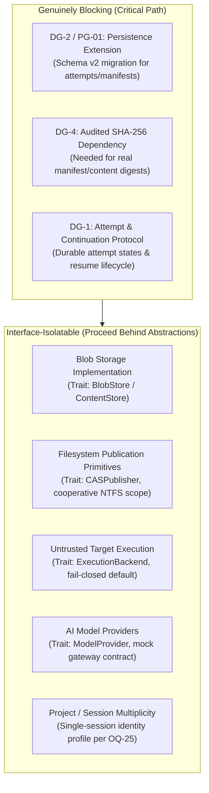
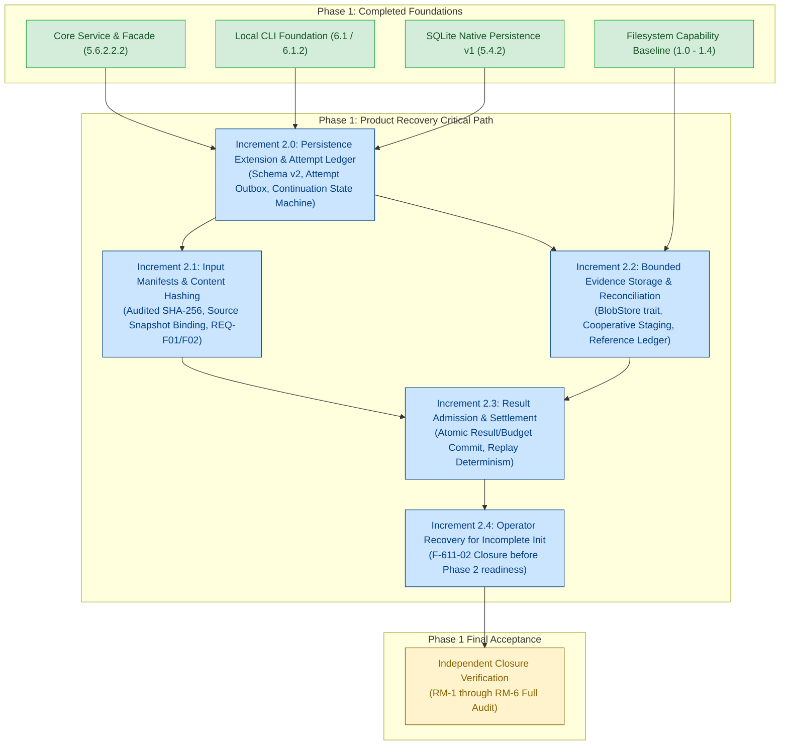

# Sentra — Development Direction Review & Product Refocus

**Date:** 2026-11-08  
**Status:** **Direction Review & Strategic Realignment. Phase 1 remains NOT APPROVED. Phase 2 remains unauthorized.**  
**Authority:** Project Owner Direction Instruction (2026-11-08)  
**Preceding Evidence:** [PHASE1_GAP_ANALYSIS.md](docs/phase1/PHASE1_GAP_ANALYSIS.md), [REMEDIATION_ARCHITECTURE.md](docs/phase1/REMEDIATION_ARCHITECTURE.md), [FILESYSTEM_CAPABILITY_CONTRACT.md](docs/phase1/FILESYSTEM_CAPABILITY_CONTRACT.md), [INCREMENT_1_4_VALIDATION.md](docs/phase1/INCREMENT_1_4_VALIDATION.md)

---

## 1. Executive Summary & Immediate Scope Boundary

In accordance with owner instruction, all filesystem-publication experiment expansion has been halted immediately. Sentra is an AI-assisted security research and remediation platform designed to discover, validate, analyze, and help remediate security vulnerabilities in authorized software projects. Recent Phase 1 efforts expanded disproportionately into low-level Windows NTFS handle and race-condition experiments.

This document formalizes the pivot back to Sentra's core product requirements:
1. **Immediate Stop:** Increment 1.5 is cancelled. No further PowerShell experiment scripts, Windows API micro-benchmarks, or NTFS race harnesses will be created. Existing empirical evidence (Increments 1.0 through 1.4) is preserved intact as capability baselines.
2. **Filesystem Scope Treatment:** Filesystem research is treated as empirical capability evidence, not as a requirement to build a kernel-race-proof publication mechanism. Guarantees are strictly scoped to what unprivileged Windows NTFS provides: accidental self-modification prevention and cooperative concurrency serialization. Hostile same-user process tampering and administrator overrides are formally classified as unsupported threat models on standard NTFS without dedicated service credentials.
3. **Product-Level Priorities Restored:** Focus returns to durable session continuation, attempt and dispatch ledgers, execution manifest integrity, evidence reference storage, and CLI workflows exercising the Core Engine.

---

## 2. Current Product Implementation Status

Sentra's codebase contains an operational, verified local foundation across two workspace crates (`sentra-core` and `sentra-cli`), backed by extensive offline security and invariant test suites:

### 2.1 Core Engine (`crates/sentra-core`)
- **Domain & Classification:** Rigid, strongly-typed domain representations (`SessionId`, `SecurityClassification`, `CostUsd`, `TimestampUtc`) with strictly ordered classification floors (`Public` $\rightarrow$ `Internal` $\rightarrow$ `Confidential` $\rightarrow$ `Restricted`).
- **Policy Engine:** Immutable effective policy rules (`PolicyEngine`), micro-USD budget reservation and tracking, atomic context generation invalidation (`context_generation`), ABA regression prevention, and fail-closed evaluation.
- **Persistence Foundation:** Bundled native SQLite 3.46.0 engine configured with write-ahead logging (`WAL`), synchronous normal, foreign key constraints, atomic multi-table transactions, OS-level exclusive admission locking, and strict schema version 1 integrity verification.
- **Workspace Containment:** Canonical root binding, path containment algorithms, symlink and Windows junction/reparse-point quarantine (`0x00000410`), and metadata-only discovery (`DiscoverMetadata`) running with zero target process execution.
- **Execution & Isolation Boundary:** Strictly fail-closed execution engine (`FailClosedBackend`, `ExecutionError::untrusted_workload_disabled()`). Untrusted target workloads cannot execute in the current host environment.
- **Local Workspace Service:** Local lifecycle facade (`LocalWorkspace`) managing project initialization, domain-state read-only status reporting, and single-session inspection.

### 2.2 CLI Foundation (`crates/sentra-cli`)
- **Command Grammar:** Strict, hand-crafted parser enforcing UTF-8 arguments, maximum 64 parameters, duplicate flag rejection, and payload-free error responses.
- **Commands:** `sentra init`, `sentra status`, `sentra session show`, `sentra --help`, and `sentra --version`.
- **Output & Exit Codes:** Deterministic exit codes (0, 2, 3, 4, 5, 6, 7, 8) and standardized single-line JSON output (`schema_version: 1`) redacting internal paths, SQL diagnostics, and confidential tokens.
- **Security Boundary:** Zero execution authority minting; no CLI route to task execution; unprivileged foundation session identity.

### 2.3 Verification Baseline
- **Ordinary Suite:** 290 runtime tests + 7 compile-fail doctests Passed (0 Failed, 5 ignored: 2 parent-invoked subprocess helpers and 3 platform/scale fixtures).
- **Specialized Validators:** Persistence (13/13), Authorization (13/13), Workspace (11/11), Authorization Portability (4/4 matrices, each 13/13), CLI (18/18).
- **Invariants:** 300 unique verified assertion invariants passing offline under `#![forbid(unsafe_code)]` and warning-free Clippy.

---

## 3. Remaining Phase 1 Acceptance Blockers

The Phase 1 acceptance criteria ([ROADMAP.md](ROADMAP.md#phase-1--technical-validation-and-local-foundation)) and gap analysis ([PHASE1_GAP_ANALYSIS.md](docs/phase1/PHASE1_GAP_ANALYSIS.md)) identify the following unresolved requirements:

| Acceptance Criterion | Product Requirement | Core Gap | Current Status |
| :--- | :--- | :--- | :--- |
| **RM-3** | **Durable Session Continuation** | Interrupted `Running` sessions cannot be resumed; reopening is inspection-only; no durable task/attempt ledger exists to distinguish in-flight from completed work. | **Implementation Gap** |
| **RM-3 / F-14** | **Durable Dispatch & Result Handling** | `ExecutionRequest` is constructed in memory after transaction commit; no durable outbox/attempt intent commits before external dispatch; no atomic settlement of results with held budgets. | **Implementation Gap** |
| **RM-3 / S-09** | **Evidence & Content Storage** | `EvidenceEnvelope` is an in-memory struct; no persistent blob storage, content-addressed registry, or orphan reconciliation ledger exists in schema v1. | **Implementation Gap** |
| **REQ-F01 / F02** | **Input & Execution Manifests** | No immutable source snapshot or operation manifest binding; revision is an unverified caller string (`local:unversioned-metadata-only`); approvals are not bound to cryptographically identified input bytes. | **Implementation Gap** |
| **RM-4b** | **Resource Quota Enforcement** | Cost reservations are enforced in memory, but no persistent bounds exist on task queue fanout, streamed input sizes, or disk growth. | **Implementation Gap** |
| **RM-4c** | **Process-Tree Cancellation** | Cancellation is synthetic within Core; sandbox spike killed a single sleeper process (`sleep 30`) but did not prove enumeration and termination of multi-tier descendant process trees. | **Verification Gap** |
| **F-611-02 / OQ-25** | **Incomplete Initialization Recovery** | Interrupted `sentra init` leaves partial database files requiring manual deletion; must be resolved via approved operator recovery before Phase 2 production readiness. | **Design Gap** |
| **DG-4 / OQ-24** | **Audited Cryptographic Primitives** | Safe in-crate SHA-256 calculation is unavailable in standard library; requires project owner authorization of a maintained, dependency-audited crate. | **Blocked Dependency** |

---

## 4. Triage: Genuinely Blocking vs. Interface-Isolatable

To prevent future implementation stalling, remaining technical questions are categorized into:
1. **Genuinely Blocking:** Critical path items that must be resolved before dependent product code can be written.
2. **Interface-Isolatable:** Implementation details that can be bounded behind clean abstract traits with safe fail-closed defaults.

### 4.1 Genuinely Blocking Prerequisites
1. **Persistence Extension Framework (PG-01 / DG-2):**
   - *Why it blocks:* Current migration validation strictly enforces the exact 6 tables of schema version 1. Any attempt to persist task attempts, manifests, or blob references without an approved, versioned migration mechanism will cause existing SQLite validators to fail closed.
   - *Action required:* Approve an additive schema version 2 migration specification that preserves all existing tables, audit trails, and version 1 validation invariants.
2. **Audited Cryptographic Digest Dependency (DG-4 / OQ-24):**
   - *Why it blocks:* Reliable input manifest integrity (REQ-F01/F02) and content-addressed blob storage (S-09) require computing actual SHA-256 digests over byte streams. Stable Rust std does not provide crypto, and length-only checks are strictly prohibited (F-13-04).
   - *Action required:* Authorize an audited, pure-Rust, `#![forbid(unsafe_code)]` SHA-256 dependency (e.g. `sha2`) from the offline cache.
3. **Attempt & Recovery Protocol Definition (DG-1):**
   - *Why it blocks:* Implementing durable dispatch requires an agreed state machine (`Recorded` $\rightarrow$ `Prepared` $\rightarrow$ `ReleaseRecorded` $\rightarrow$ `RunningConfirmed` $\rightarrow$ `ResultRecorded` / `Uncertain`) so that crash recovery knows whether to retry admission or report uncertainty.

### 4.2 Limitations That Can Be Isolated Behind Interfaces
1. **Blob Storage & Filesystem Publication:**
   - *Isolation mechanism:* Define a `BlobStore` trait with methods `put_staged(stream) -> Result<BlobId>` and `get(blob_id) -> Result<ReadStream>`.
   - *Implementation:* The cooperative NTFS publication sequence verified in Increment 1.4 (`CREATE_NEW` exclusive handle $\rightarrow$ flush $\rightarrow$ hash verify $\rightarrow$ `hard_link` $\rightarrow$ close $\rightarrow$ unlink staging $\rightarrow$ `FILE_ATTRIBUTE_READONLY`) satisfies all single-user accidental-corruption and cooperative-concurrency requirements. Hostile same-user tampering is documented as an unprivileged NTFS limitation and does not block building the product blob storage interface.
2. **File ID Direct Querying (`windows_by_handle` E0658):**
   - *Isolation mechanism:* Storage references use canonical paths and content digests (`BlobId = Sha256Digest`). Native 128-bit ReFS/NTFS File IDs are unnecessary for local CAS blobs; their absence does not block any product functionality.
3. **Untrusted Target Execution & Dedicated VM Containment:**
   - *Isolation mechanism:* The `ExecutionBackend` trait cleanly separates orchestration from target execution. `FailClosedBackend` remains active in production/CLI, while synthetic, owned test backends validate attempt lifecycles and recovery. RM-6 is fully satisfied by keeping untrusted execution disabled.
4. **AI Model Provider Integration:**
   - *Isolation mechanism:* The provider contract is already isolated and verified via the 62-test mock gateway. Real provider SDKs, network egress, and hosted endpoints are explicitly deferred to Phase 2. Core services remain 100% provider-agnostic.
5. **Multi-Session Identity (OQ-25):**
   - *Isolation mechanism:* The single-foundation-session identity model remains stable for Phase 1. Sentra CLI operates on one session per dedicated database. Multi-session CLI expansion is an architectural enhancement deferred to a future phase.

---

## 5. Explicitly Deferred Filesystem Research

The following low-level Windows filesystem inquiries are formally concluded and **deferred**:

| Deferred Topic | Prior Increment | Justification for Deferral |
| :--- | :---: | :--- |
| **Closing the Post-Close/Read-Only Race (F-15-01)** | 1.4 / 1.5 | The sub-millisecond gap between closing the exclusive handle and setting `FILE_ATTRIBUTE_READONLY` is only exploitable by a hostile process executing under the same user token. Such a process can already strip the read-only attribute at will (`SetFileAttributesW(NORMAL)`). Resolving this kernel race does not alter the threat boundary. |
| **Native `FileDispositionInfoEx` POSIX Deletion** | 1.5 | Requires complex native Win32 FFI class 21 bindings. Unlinking staging links via standard `std::fs::remove_file` after closing the exclusive handle is completely sufficient for cooperative environments. |
| **Alternative Handle Sharing Modes (`FILE_SHARE_DELETE`)** | 1.5 | Unlinking an open file under `FILE_SHARE_DELETE` does not provide additional security against untrusted actors on Windows NTFS. |
| **Hostile Same-User Tamper Resistance (F-13-02)** | 1.3 / 1.4 | Formally classified as **Unsupported on Windows NTFS**. True isolation against malware or hostile processes running under the same user token requires separate OS service SIDs or VM boundaries. |
| **Native File ID by-handle Querying (`windows_by_handle`)** | 1.0 / 1.1 | Blocked in safe Rust by compiler gate `E0658`. Content addressing via SHA-256 digests provides the required identity without native OS File IDs. |
| **Physical Power-Loss & Device IOERR Durability** | 1.0 / 1.4 | Cannot be safely or ethically simulated on developer workstations without specialized test harnesses. Retained as a documented environmental assumption. |

---

## 6. Recommended Next Product Increment

### Proposed: Phase 1 — Increment 2.0: Core Persistence Extension & Durable Session Continuation

Instead of further filesystem micro-benchmarks, the immediate next increment must implement the foundational data model and continuation state machine required by **RM-3**, **RM-4a**, and **REQ-F14**:

#### Scope of Increment 2.0:
1. **Persistence Schema v2 (PG-01):**
   - Add additive tables: `tasks` (logical task plan), `attempts` (execution attempts with outbox states), and `manifests` (canonical input/operation specifications).
   - Implement transactional migration from v1 to v2, verifying that existing v1 databases upgrade seamlessly while preserving all existing audit logs, session state, and security snapshots.
2. **Durable Attempt State Machine (PG-04):**
   - Implement attempt states: `Recorded` $\rightarrow$ `Prepared` $\rightarrow$ `ReleaseRecorded` $\rightarrow$ `ResultRecorded` / `Uncertain`.
   - Persist attempt intent and budget reservation *before* invoking execution backends.
3. **Explicit Session Resume Protocol (PG-07):**
   - Add a trusted CoreService lifecycle method: `resume_session(session_id)`.
   - Reconstruct plan and attempt history; identify unstarted or incomplete tasks.
   - Atomically advance the authorization context generation (`context_generation`), invalidating pre-crash dispatch contexts and stale receipts.
   - Forbid automatic re-execution of completed tasks or uncertain effects.
4. **Adversarial Process-Kill Verification:**
   - Execute owned child processes interrupted by `kill` across 4 dispatch boundaries:
     - Boundary A: Before attempt commit.
     - Boundary B: After attempt commit, before release.
     - Boundary C: After release, before synthetic backend execution.
     - Boundary D: After execution, before result commit.
   - Demonstrate deterministic recovery, zero lost audit events, and no duplicate budget deduction.

---

## 7. Updated Dependency & Acceptance Relationships

---

## 8. Preserved Repository Boundaries & Invariants

1. **Phase Boundary:** Phase 1 remains **NOT APPROVED**; Phase 2 remains **STRICTLY UNAUTHORIZED**.
2. **Untrusted Target Execution:** Remains strictly **FAIL-CLOSED** via `FailClosedBackend`. No target workload or scanner execution is enabled.
3. **Permanent Git Policy:** Maintained without exception. No agent commits, amends, pushes, pulls, fetches, resets, rebases, or branch changes. All work remains unstaged in the local working tree.
4. **Historical Evidence Preservation:** All historical experiment scripts, raw logs, validation reports, and independent reviews under `experiments/phase1/` and `docs/phase1/` are preserved unmodified.
