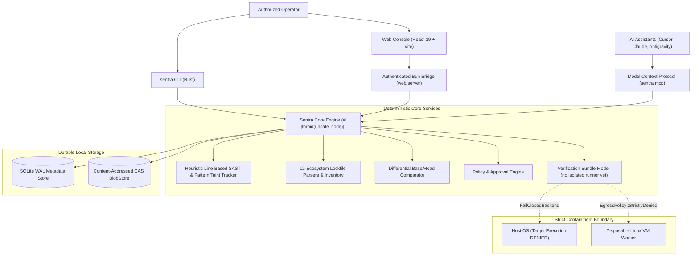

<div align="center">
  
  <h1>Sentra</h1>
  <p><strong>AI-Assisted Security Research & Remediation Platform</strong></p>

  [](https://github.com/Taiizor/Sentra/actions/workflows/ci.yml)
  [](https://github.com/Taiizor/Sentra/actions/workflows/codeql.yml)
  [](LICENSE)
  [](#architectural-boundaries--key-invariants)
  [](#installation--quick-start)
</div>

Sentra is an open-source, extensible, dual-mode security research platform for repository vulnerability discovery, differential code review, and remediation previews across open-source and proprietary software. Independently verified patches are the design goal: verification bundles are modelled, but no isolated runner or worker executes them yet, so no patch is verified (see [docs/LIMITATIONS.md](docs/LIMITATIONS.md)).

Built from the ground up in Safe Rust (`#![forbid(unsafe_code)]`), Sentra pairs heuristic line-based static analysis and intra-procedural lexical taint tracking (no syntax tree is built) with prompt templates and role, campaign and coverage models for Scout, Analyst and Patch Author agents under human-in-the-loop governance.

---

## Key Highlights

- 🛡️ **In-Engine Pure-Rust Taint Analysis & SAST:** Zero-dependency lexical data-flow tracking detecting SQL Injection (CWE-89), Command Injection (CWE-78), Dynamic Code Eval (CWE-95), Path Traversal (CWE-22), and hardcoded credential leaks with automatic false-positive suppression.
- 📦 **Multi-Ecosystem Lockfile Parsing:** Pure-Rust parsers for Cargo, Bun, npm (v1/v3), Yarn (classic/berry), pnpm (v6/v9), Poetry, Pip `requirements.txt`, Go `go.sum`, Composer, Gemfile, NuGet, and Deno, exposed as a package inventory by `sentra inventory`. The `sentra audit` command matches against a small pinned advisory set; the web console matches the inventory against live [OSV.dev](https://osv.dev) data (opt-in).
- 🧪 **The Three-Tier Verification Invariant (modelled, not yet executed):** A remediation patch may be marked verified only if (1) the baseline fails on unpatched code, (2) the target passes on remediated code, and (3) existing test suites show zero regressions. Verification bundles encode this rule, but no isolated runner executes them yet, so no patch is marked verified.
- 🖥️ **Web Operations Console:** React 19 + Tailwind CSS v4 console backed by an authenticated Bun bridge (role-based access, CSRF/DNS-rebinding guards, HMAC-chained operator audit log). It shows only real data: persisted scan history and findings, OSV dependency vulnerabilities, GitHub pull requests and CI runs, verified webhook deliveries, and model-generated patch candidates that are never labelled verified. See [web/README.md](web/README.md).
- 🤖 **Native Model Context Protocol (MCP) Server:** Local stdio server (`sentra mcp`, legacy MCP revisions 2025-11-25, 2025-06-18, 2025-03-26 and 2024-11-05; 2026-07-28 is not implemented) with read-only tools confined to the launch workspace. `sentra install <agent> --mcp` registers it in the documented config file of 29 agent targets without rewriting files it cannot edit losslessly; see [docs/EXTENSIONS.md](docs/EXTENSIONS.md) for supported and unsupported targets.
- 🔍 **Pure-Rust Differential Review Engine:** Base/head directory delta analysis with SHA-256 snapshot hashing, 1:1 rename tracking, and context-bounded hunk generation.
- 🔒 **Fail-Closed Host Isolation:** Untrusted target builds, procedural macros, and reproduction scripts never execute on the operator host (`FailClosedBackend`). Target execution is reserved for disposable Linux VM workers (`ContainmentLevel::DisposableVm`) with strictly denied network egress; no worker registry or provisioning exists yet (`sentra fleet` reports an empty registry), so no target code is executed at all. The one reviewed host exception is opt-in CodeQL analysis in build mode `none` ([ADR-0011](docs/adr/0011-opt-in-host-codeql-analysis.md)), in which CodeQL parses, but does not build or run, the code.
- 📊 **OASIS SARIF v2.1.0 Files:** `sentra scan --sarif` (SAST results) and `sentra export sarif` (dependency results from the bundled advisory sample) write SARIF v2.1.0 files, and `sentra codeql --sarif` parses a CodeQL SARIF file and reports its results without storing them. The core CLI does not call the GitHub Code Scanning or GitLab APIs (the web console reads GitHub code scanning alerts, read-only); uploading a file is up to you, and Code Scanning acceptance of these files has not been tested.
- 🧪 **CodeQL Results:** `sentra codeql import` normalizes CodeQL SARIF produced elsewhere (a local run, GitHub Actions) into one JSON contract with severities from `security-severity`, CWE ids and fingerprints. `sentra codeql analyze` runs an operator-installed CodeQL CLI on the host, off unless `--accept-codeql-terms` is given (CodeQL is licensed under GitHub's CodeQL terms, which restrict use on non-open-source code), in build mode `none` only and for actions, cpp, javascript, python and ruby; go, swift, rust, csharp and java are skipped because their extraction builds or runs project code. Each run has a time budget, an allowlisted environment and a private per-run directory outside the workspace, and its whole process tree is killed when it ends or is cancelled; on Windows, workspace paths containing `&`, `^`, `!` or `%` are refused because CodeQL's extractor scripts would run part of such a path as a command. `--accept-codeql-terms` acknowledges the licence; it does not restrict who can run the analysis. It has been tested against a fake CodeQL launcher and, on Windows 11 x64, with CodeQL CLI 2.27.4 (Linux and macOS pending). The web console can import CodeQL SARIF, sync GitHub code scanning alerts (read-only) and, when an admin enables it, run host analysis in a scan; see [ADR-0011](docs/adr/0011-opt-in-host-codeql-analysis.md) and [docs/LIMITATIONS.md](docs/LIMITATIONS.md#9-codeql-host-analysis-and-import).

---

## Operating Modes

1. **Continuous Security Review:** Designed for PR and commit workflows. Compares base/head snapshots, matches lockfile packages against the bundled advisory sample, and prints draft remediation previews. Candidate fixes are not built, tested or verified: verification against test oracles is modelled, and no runner executes it yet.
2. **Deep Security Research:** Designed for repository exploration. Models Scout, Analyst and Patch Author roles, bounded research campaigns and exploration ledgers (covered vs. skipped units). Crash reproduction inside isolated workers is not implemented: no worker exists, so no target code is executed.

---

## Architecture & System Topology

Sentra employs a local-first, modular architecture where policy enforcement, state transitions, and evidence admission remain deterministic:



---

## Installation & Quick Start

### 1. Prerequisites

- **Rust:** 1.88+ (Stable; edition 2024 with let-chains)
- **Bun:** 1.2+ (Sole JavaScript/TypeScript runtime and package manager)

### 2. Build the CLI

```bash
# Clone the repository
git clone https://github.com/Taiizor/Sentra.git
cd Sentra

# Install sentra CLI globally (or run cargo build --release)
cargo install --path crates/sentra-cli
```

### 3. Essential CLI Commands

```bash
# Initialize a local project workspace
sentra init --workspace ./my-project --database ./sentra.db

# Inspect workspace health, active session, and discovery metadata
sentra status --workspace ./my-project --database ./sentra.db

# Run in-engine pure-Rust taint analysis & secret scanning
sentra scan --workspace ./my-project

# Scan an inline code snippet with SARIF output
sentra scan --snippet "let query = 'SELECT * FROM users WHERE id = ' + req.query.id; db.execute(query);"

# Audit the workspace-root lockfiles (12 formats) against the small bundled advisory sample
# (6 hand-written records; not a synchronized OSV or RustSec feed, see docs/LIMITATIONS.md)
sentra audit --workspace ./my-project --database ./sentra.db

# Compare two directory snapshots with pure-Rust diff engine
sentra diff --base ./repo-v1 --head ./repo-v2

# Probe workspace languages and print suggested CodeQL commands (CodeQL is not run)
sentra codeql --workspace ./my-project

# Parse a CodeQL SARIF file and report its results (nothing is uploaded or stored)
sentra codeql --sarif ./codeql-results.sarif

# Normalize CodeQL SARIF produced elsewhere (local run, GitHub Actions) into the CodeQL result JSON
sentra codeql import --sarif ./codeql-results.sarif --workspace ./my-project --json

# Opt-in: run your installed CodeQL CLI on this host in build mode none (see ADR-0011 and the CodeQL terms first).
# On Windows --codeql must be codeql.exe; query packs come from the CodeQL bundle or, with --allow-pack-download, ghcr.io.
# Keep --work-dir and --pack-cache private: on Linux and macOS they must not be writable by other users.
sentra codeql analyze --workspace ./my-project --codeql /opt/codeql/codeql --work-dir ~/.cache/sentra-codeql/work \
  --pack-cache ~/.cache/sentra-codeql/packs --accept-codeql-terms --allow-pack-download --json

# Discover, probe, and run subprocess adapters from an explicit directory (default: SENTRA_PLUGIN_DIR, else the platform plugin directory).
# Adapters run on this host with your privileges; the Snyk and Ollama examples return synthetic output.
sentra plugin list --dir ./examples/adapters
sentra plugin probe --id org.sentra.adapter.snyk --dir ./examples/adapters --workspace ./my-project
sentra plugin run --id org.sentra.adapter.snyk --dir ./examples/adapters --capability dependency_audit --workspace ./my-project

# Install the bundled AppSec skills for an agent, or register the MCP server in its config
sentra install claude --skill golang-security --workspace ./my-project
sentra install claude --mcp --workspace ./my-project

# Write the dependency audit results (bundled advisory sample) as an OASIS SARIF v2.1.0 file;
# SAST results go to SARIF with `sentra scan --workspace ./my-project --sarif ./sast.sarif`
sentra export sarif --database ./sentra.db --workspace ./my-project --output ./results.sarif

# Recover an interrupted or incomplete initialization store
sentra recover --workspace ./my-project --database ./sentra.db

# Launch the local Model Context Protocol (MCP) stdio server, confined to a workspace
sentra mcp --workspace ./my-project
```

### 4. Run the Web Operations Dashboard

The web console (React 19 + Vite UI, Bun bridge) shows only real data from the core, GitHub, OSV and configured model providers. Authentication, roles and every environment variable are documented in [web/README.md](web/README.md).

```bash
# Build the core binary the bridge executes
cargo build --release -p sentra-cli

# Development: bridge on 127.0.0.1:3001 + Vite on http://localhost:5173
bun run --cwd web dev
# The bridge prints a one-time sign-in URL (loopback-only admin token) unless SENTRA_WEB_TOKENS is set.

# Production: one origin serving the built UI and the API
bun run --cwd web build
bun run --cwd web start
```

---

## Verification & Test Harnesses

Sentra enforces comprehensive test coverage across unit, property, and integration harnesses:

```bash
# Run all workspace unit and integration tests (460+ tests passing)
cargo test --workspace

# Run strict clippy analysis (fails on any warning)
cargo clippy --workspace --all-targets --all-features -- -D warnings

# Check code formatting
cargo fmt --all -- --check

# Build web operations dashboard for production
bun run --cwd web build

# Execute all 23 independent test suites in isolated Linux Docker container
pwsh -NoProfile -File scripts/docker-test.ps1 -Mode all
```

---

## Architectural Boundaries & Key Invariants

- **Safe Rust Strictly Enforced:** `#![forbid(unsafe_code)]` is unconditionally enforced across all core workspace crates.
- **Bun Sole JavaScript Runtime:** Bun is the sole JavaScript/TypeScript runtime and package manager across Sentra tooling (`bun run`, `bunx`). Node.js, npm, and yarn are not used. (When an operator enables host CodeQL analysis, CodeQL's own JavaScript extractor starts the host's Node.js from `PATH` to parse TypeScript files; that is CodeQL's requirement, not Sentra's.)
- **Fail-Closed Host Isolation:** Untrusted target builds, procedural macros, and test executions are strictly blocked from the host operating system (`FailClosedBackend`). Opt-in CodeQL analysis in build mode `none` parses untrusted code on the host without building or running it ([ADR-0011](docs/adr/0011-opt-in-host-codeql-analysis.md)).
- **Anti-Collusion & Confused Deputy Protection:** AI model agents propose actions but cannot self-approve remediation proposals or verified statuses.
- **Zero-Secret Fork Boundary:** Pull requests from untrusted forks are quarantined with `secrets_permitted: false`. No worker fleet exists yet, so no credentials are handed to workers.
- **Multi-Tenant Fencing:** Cross-tenant resource queries and worker allocations fail closed at the domain layer (`CrossTenantAccessDenied`, `CrossTenantWorkerAccessDenied`).
- **Monotonic Audit Trail:** Core mutations, policy decisions, and approvals emit monotonically sequenced audit records. The core store's `audit_events` table has no hash chain, so tampering is not detectable there; the web console's operator audit log is HMAC-chained.

---

## Documentation Index

| Specification / Guide | Description |
| :--- | :--- |
| [**Architecture Overview**](ARCHITECTURE.md) | High-level system topology, core services, and trust boundaries |
| [**Installation Guide**](docs/INSTALLATION.md) | Comprehensive setup, prerequisites, and operational parameters |
| [**Operating Modes**](docs/OPERATING_MODES.md) | Workflows for Continuous Security Review and Deep Research |
| [**Threat Model**](docs/THREAT_MODEL.md) | STRIDE analysis, threat catalog, permission gates, and mitigations |
| [**Limitations & Constraints**](docs/LIMITATIONS.md) | Explicit security boundaries, assurance limits, and non-goals |
| [**Data Model**](docs/DATA_MODEL.md) | SQLite schema, Findings, Evidence envelopes, and Patch bundles |
| [**Plugin & Adapter Guide**](docs/PLUGINS_GUIDE.md) | End-user commands, manifest specification, and adapter development |
| [**Extensions & MCP**](docs/EXTENSIONS.md) | Subprocess plugin SDK, Model Context Protocol, and target matrices |
| [**Agent Model**](docs/AGENT_MODEL.md) | Multi-role autonomous agent architecture (Scout, Analyst, Patch Author) |
| [**Release Gates Audit**](docs/RELEASE_GATES_AUDIT.md) | Formal audit of all release-wide quality and containment gates |
| [**Decision Records (ADRs)**](docs/adr/README.md) | Accepted design decisions (ADR-0001 through ADR-0011) |
| [**Progress Ledger**](PROGRESS.md) | Milestone history and verification evidence |
| [**Roadmap**](ROADMAP.md) | Delivery milestones and acceptance criteria |
| [**Contributing Guide**](CONTRIBUTING.md) | Guidelines, invariant checklist, and development workflow |
| [**Code of Conduct**](CODE_OF_CONDUCT.md) | Standards of professional conduct and community participation |
| [**Security Policy**](SECURITY.md) | Vulnerability disclosure policy, reporting channels, and SLAs |
| [**Changelog**](CHANGELOG.md) | Release versions and milestone changes |
| [**Notices & Acknowledgments**](NOTICE) | Third-party component licenses and copyright notices |

---

## License

Sentra is licensed under the [Apache License, Version 2.0](LICENSE). In accordance with [ADR-0007](docs/adr/0007-open-source-and-integration-licensing.md), Apache-2.0 is the official permissive license. Third-party component attributions and notices are documented in [NOTICE](NOTICE).
