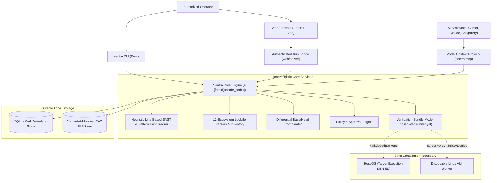

<div align="center">
  
  <h1>Sentra</h1>
  <p><strong>Autonomous AI Security Research & Independently Verified Remediation Platform</strong></p>

  [](https://github.com/Taiizor/Sentra/actions/workflows/ci.yml)
  [](https://github.com/Taiizor/Sentra/actions/workflows/codeql.yml)
  [](LICENSE)
  [](#architectural-boundaries--key-invariants)
  [](#installation--quick-start)
</div>

Sentra is an open-source, extensible, dual-mode security research platform for autonomous repository vulnerability discovery, differential code review, and independently verified patch generation across open-source and proprietary software.

Built from the ground up in Safe Rust (`#![forbid(unsafe_code)]`), Sentra pairs deterministic static analysis and interprocedural taint tracking with autonomous multi-role AI agents (Scout, Analyst, Patch Author) under human-in-the-loop governance.

---

## Key Highlights

- 🛡️ **In-Engine Pure-Rust Taint Analysis & SAST:** Zero-dependency lexical data-flow tracking detecting SQL Injection (CWE-89), Command Injection (CWE-78), Dynamic Code Eval (CWE-95), Path Traversal (CWE-22), and hardcoded credential leaks with automatic false-positive suppression.
- 📦 **Multi-Ecosystem Lockfile Parsing:** Pure-Rust parsers for Cargo, Bun, npm (v1/v3), Yarn (classic/berry), pnpm (v6/v9), Poetry, Pip `requirements.txt`, Go `go.sum`, Composer, Gemfile, NuGet, and Deno, exposed as a package inventory by `sentra inventory`. The `sentra audit` command matches against a small pinned advisory set; the web console matches the inventory against live [OSV.dev](https://osv.dev) data (opt-in).
- 🧪 **The Three-Tier Verification Invariant:** Remediation patches are marked verified if and only if: (1) baseline fails on unpatched code, (2) target passes on remediated code, and (3) zero regressions across existing test suites.
- 🖥️ **Web Operations Console:** React 19 + Tailwind CSS v4 console backed by an authenticated Bun bridge (role-based access, CSRF/DNS-rebinding guards, HMAC-chained operator audit log). It shows only real data: persisted scan history and findings, OSV dependency vulnerabilities, GitHub pull requests and CI runs, verified webhook deliveries, and model-generated patch candidates that are never labelled verified. See [web/README.md](web/README.md).
- 🤖 **Native Model Context Protocol (MCP) Server:** Built-in JSON-RPC 2.0 stdio transport (`sentra mcp`) enabling deep autonomous collaboration with AI coding assistants (Cursor, Claude Desktop, Antigravity).
- 🔍 **Pure-Rust Differential Review Engine:** Base/head directory delta analysis with SHA-256 snapshot hashing, 1:1 rename tracking, and context-bounded hunk generation.
- 🔒 **Fail-Closed Host Isolation:** Untrusted target builds, procedural macros, and reproduction scripts never execute on the operator host. Dedicated disposable Linux VM workers (`ContainmentLevel::DisposableVm`) with strictly denied network egress.
- 📊 **OASIS SARIF v2.1.0 Standard:** Native import and export for seamless integration with GitHub Code Scanning, GitLab SAST, and CodeQL.

---

## Operating Modes

1. **Continuous Security Review:** Designed for PR and commit workflows. Reviews immutable base/head diffs, audits package manifests, matches known advisories, and generates candidate fixes verified against test oracles.
2. **Deep Security Research:** Designed for autonomous repository exploration. Organizes Scout, Analyst, and Patch Author agent roles across bounded task DAGs, tracks exploration ledgers (covered vs. skipped units), and reproduces crashes inside isolated workers.

---

## Architecture & System Topology

Sentra employs a local-first, modular architecture where policy enforcement, state transitions, and evidence admission remain deterministic:



---

## Installation & Quick Start

### 1. Prerequisites

- **Rust:** 1.80+ (Stable)
- **Bun:** 1.2+ (Sole JavaScript/TypeScript runtime and package manager)

### 2. Build the CLI

```bash
# Clone the repository
git clone https://github.com/Taiizor/Sentra.git
cd Sentra

# Install sentra CLI globally (or run cargo build --release)
cargo install --path crates/sentra-cli
```

### 3. Essential CLI Commands

```bash
# Initialize a local project workspace
sentra init --workspace ./my-project --database ./sentra.db

# Inspect workspace health, active session, and discovery metadata
sentra status --workspace ./my-project --database ./sentra.db

# Run in-engine pure-Rust taint analysis & secret scanning
sentra scan --workspace ./my-project

# Scan an inline code snippet with SARIF output
sentra scan --snippet "let query = 'SELECT * FROM users WHERE id = ' + req.query.id; db.execute(query);"

# Audit package dependencies across 12 lockfile formats against OSV/RustSec
sentra audit --workspace ./my-project --database ./sentra.db

# Compare two directory snapshots with pure-Rust diff engine
sentra diff --base ./repo-v1 --head ./repo-v2

# Ingest CodeQL SARIF logs or probe workspace languages
sentra codeql --workspace ./my-project --sarif ./codeql-results.sarif

# Discover, probe, and run external subprocess security adapters (Semgrep, Snyk, Ollama)
sentra plugin list
sentra plugin probe --id org.sentra.adapter.snyk
sentra plugin run --id org.sentra.adapter.snyk --capability dependency_audit

# Export all findings to OASIS SARIF v2.1.0 (for GitHub Code Scanning)
sentra export sarif --database ./sentra.db --workspace ./my-project --output ./results.sarif

# Recover an interrupted or incomplete initialization store
sentra recover --workspace ./my-project --database ./sentra.db

# Launch the native Model Context Protocol (MCP) stdio server
sentra mcp
```

### 4. Run the Web Operations Dashboard

The web console (React 19 + Vite UI, Bun bridge) shows only real data from the core, GitHub, OSV and configured model providers. Authentication, roles and every environment variable are documented in [web/README.md](web/README.md).

```bash
# Build the core binary the bridge executes
cargo build --release -p sentra-cli

# Development: bridge on 127.0.0.1:3001 + Vite on http://localhost:5173
bun run --cwd web dev
# The bridge prints a one-time sign-in URL (loopback-only admin token) unless SENTRA_WEB_TOKENS is set.

# Production: one origin serving the built UI and the API
bun run --cwd web build
bun run --cwd web start
```

---

## Verification & Test Harnesses

Sentra enforces comprehensive test coverage across unit, property, and integration harnesses:

```bash
# Run all workspace unit and integration tests (460+ tests passing)
cargo test --workspace

# Run strict clippy analysis (fails on any warning)
cargo clippy --workspace --all-targets --all-features -- -D warnings

# Check code formatting
cargo fmt --all -- --check

# Build web operations dashboard for production
bun run --cwd web build

# Execute all 23 independent test suites in isolated Linux Docker container
pwsh -NoProfile -File scripts/docker-test.ps1 -Mode all
```

---

## Architectural Boundaries & Key Invariants

- **Safe Rust Strictly Enforced:** `#![forbid(unsafe_code)]` is unconditionally enforced across all core workspace crates.
- **Bun Sole JavaScript Runtime:** Bun is the sole JavaScript/TypeScript runtime and package manager across Sentra tooling (`bun run`, `bunx`). Node.js, npm, and yarn are not used.
- **Fail-Closed Host Isolation:** Untrusted target builds, procedural macros, and test executions are strictly blocked from the host operating system (`FailClosedBackend`).
- **Anti-Collusion & Confused Deputy Protection:** AI model agents propose actions but cannot self-approve remediation proposals or verified statuses.
- **Zero-Secret Fork Boundary:** Pull requests from untrusted forks are quarantined with `secrets_permitted: false`. Write credentials are stripped before reaching workers.
- **Multi-Tenant Fencing:** Cross-tenant resource queries and worker allocations fail closed at the domain layer (`CrossTenantAccessDenied`, `CrossTenantWorkerAccessDenied`).
- **Monotonic Audit Trail:** All mutations, policy decisions, and approvals emit monotonically sequenced, immutable audit records.

---

## Documentation Index

| Specification / Guide | Description |
| :--- | :--- |
| [**Architecture Overview**](ARCHITECTURE.md) | High-level system topology, core services, and trust boundaries |
| [**Installation Guide**](docs/INSTALLATION.md) | Comprehensive setup, prerequisites, and operational parameters |
| [**Operating Modes**](docs/OPERATING_MODES.md) | Workflows for Continuous Security Review and Deep Research |
| [**Threat Model**](docs/THREAT_MODEL.md) | STRIDE analysis, threat catalog, permission gates, and mitigations |
| [**Limitations & Constraints**](docs/LIMITATIONS.md) | Explicit security boundaries, assurance limits, and non-goals |
| [**Data Model**](docs/DATA_MODEL.md) | SQLite schema, Findings, Evidence envelopes, and Patch bundles |
| [**Plugin & Adapter Guide**](docs/PLUGINS_GUIDE.md) | End-user commands, manifest specification, and adapter development |
| [**Extensions & MCP**](docs/EXTENSIONS.md) | Subprocess plugin SDK, Model Context Protocol, and target matrices |
| [**Agent Model**](docs/AGENT_MODEL.md) | Multi-role autonomous agent architecture (Scout, Analyst, Patch Author) |
| [**Release Gates Audit**](docs/RELEASE_GATES_AUDIT.md) | Formal audit of all release-wide quality and containment gates |
| [**Decision Records (ADRs)**](docs/adr/README.md) | Accepted design decisions (ADR-0001 through ADR-0010) |
| [**Progress Ledger**](PROGRESS.md) | Milestone history and verification evidence |
| [**Roadmap**](ROADMAP.md) | Delivery milestones and acceptance criteria |
| [**Contributing Guide**](CONTRIBUTING.md) | Guidelines, invariant checklist, and development workflow |
| [**Code of Conduct**](CODE_OF_CONDUCT.md) | Standards of professional conduct and community participation |
| [**Security Policy**](SECURITY.md) | Vulnerability disclosure policy, reporting channels, and SLAs |
| [**Changelog**](CHANGELOG.md) | Release versions and milestone changes |
| [**Notices & Acknowledgments**](NOTICE) | Third-party component licenses and copyright notices |

---

## License

Sentra is licensed under the [Apache License, Version 2.0](LICENSE). In accordance with [ADR-0007](docs/adr/0007-open-source-and-integration-licensing.md), Apache-2.0 is the official permissive license. Third-party component attributions and notices are documented in [NOTICE](NOTICE).
