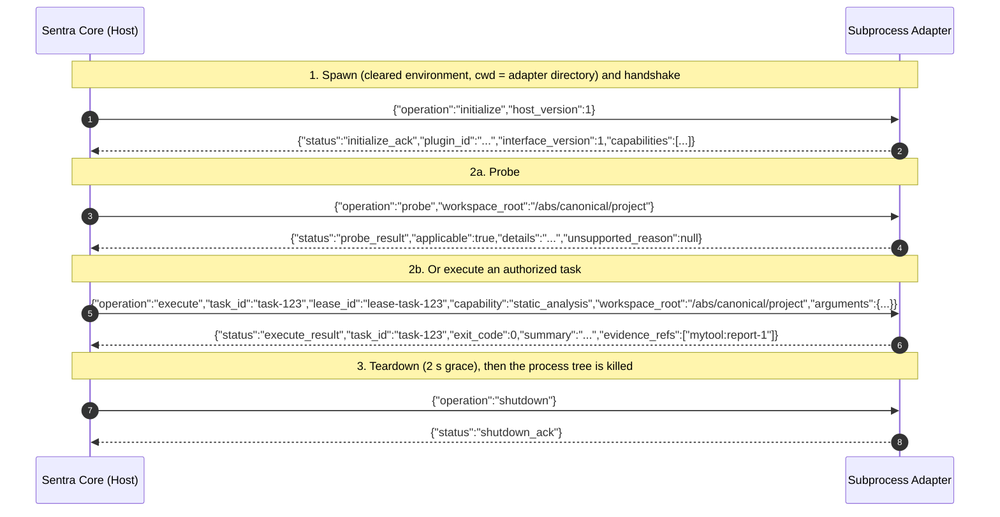

# Sentra Plugin & Adapter User Guide

This guide explains how to install, discover, probe, run, and author external security adapters for the **Sentra Security Platform** using Sentra's **Subprocess Plugin Architecture** (`REQ-F16`, [`docs/EXTENSIONS.md`](./EXTENSIONS.md)).

Status (2026-11-11): the protocol, discovery and host supervision described here are implemented in `sentra-core` (`crates/sentra-core/src/plugin/`). There is no signed package format, no marketplace and no trust record; an adapter is a directory you copy. Adapters are **not sandboxed** — see [§7](#7-security-model-and-residual-risks).

---

## 1. Architecture

1. **Out-of-process adapters:**
   Adapters never run inside Sentra's memory space (no `.dll`/`.so` loading, no Rust ABI). Each `probe` or `run` starts one adapter process, talks to it, and terminates it.
2. **Polyglot:**
   Adapters can be written in any language that reads `stdin` and writes `stdout`: **TypeScript (Bun)**, **Python 3**, **Go**, **Rust**, **C++**.
3. **Framed IPC (NDJSON over stdio):**
   The host writes one single-line JSON request per line to the adapter's `stdin`; the adapter answers with one single-line JSON response per line on `stdout`. Logs go to `stderr`; the host drains and counts them (they are not part of the protocol).
4. **Capability fencing:**
   An adapter declares its capabilities in its manifest. A `run` for an undeclared capability is refused **before the adapter is started**. An adapter that acknowledges an undeclared capability during the handshake is quarantined and killed.

---

## 2. Installing an Adapter

There is no `sentra plugin install` command. Installing an adapter means **copying its directory** (the folder that holds `manifest.json` and the adapter's files) into a plugin directory you control:

| Platform | Default plugin directory |
| :--- | :--- |
| Any | `$SENTRA_PLUGIN_DIR`, when set to an absolute path |
| Windows | `%APPDATA%\sentra\plugins` |
| macOS | `~/Library/Application Support/sentra/plugins` |
| Linux / other Unix | `$XDG_CONFIG_HOME/sentra/plugins` (absolute only), else `~/.config/sentra/plugins` |

```bash
# Example (Linux): install the Snyk example adapter
mkdir -p ~/.config/sentra/plugins
cp -r examples/adapters/sentra-adapter-snyk ~/.config/sentra/plugins/
```

- **Trust decision:** installing an adapter means you will run its code with your user's privileges when you `probe` or `run` it. Review the manifest and the adapter code first. Sentra does not verify a publisher, signature or digest.
- **Removal:** delete the adapter's directory.
- **Updates:** replace the directory. Nothing is pinned or cached.
- `--dir <directory>` replaces the default directory for a single command. Sentra never searches the current directory, its parents, or a repository's `examples/adapters` or `.sentra/plugins` on its own, so a repository you scan cannot inject an adapter.
- The web console bridge uses `SENTRA_PLUGIN_DIR` from its own environment or, when it is unset, the platform default directory the core reports. It refuses a default that is not an absolute path (on Windows, a drive-letter path whose real path is not a UNC or device path, so a mapped network drive or a link to a share is refused as far as the host's `realpath` reports it) or that overlaps its data or temporary directories, the system temporary directory, the repository or a registered workspace, and it never creates the directory. Network mounts on macOS and Linux are not detected. See [web/README.md](../web/README.md#plugin-directory).
- A plugin directory is either one adapter directory (it holds `manifest.json`) or a container whose **immediate** child directories hold one manifest each. If a directory holds its own manifest, manifests in its children are ignored and reported (`nested_manifest_ignored`).
- Plugin ids must be unique across the searched directories. When two manifests declare the same id, **neither** is loaded and the id is reported as `duplicate_plugin_id`; `probe`/`run` for that id fail with `plugin_duplicate_id`.

---

## 3. CLI Usage

### 3.1 Listing Plugins (`sentra plugin list`)

```bash
sentra plugin list                        # default plugin directory
sentra plugin list --dir ./my-adapters    # an explicit directory
sentra plugin list --json
```

Skipped manifests are reported as diagnostics with a path, a severity and a code:

| Code | Severity | Meaning |
| :--- | :--- | :--- |
| `plugin_dir_not_found` | error | The directory does not exist. |
| `plugin_dir_unreadable` | error | The directory cannot be listed. |
| `manifest_unreadable` / `manifest_too_large` | error | The manifest cannot be read or exceeds 256 KiB. |
| `manifest_invalid_json` | error | The manifest is not UTF-8 JSON (a UTF-8 BOM is accepted). |
| `manifest_invalid` | error | Schema or validation failure (see [§4](#4-adapter-manifest-specification-manifestjson)). |
| `duplicate_plugin_id` | error | Two or more manifests declare the same id; none is loaded. |
| `manifest_unknown_field` | warning | Unknown keys were ignored; the plugin is loaded. |
| `nested_manifest_ignored` | warning | A child manifest inside an adapter directory was not loaded. |

### 3.2 Probing an Adapter (`sentra plugin probe`)

`probe` **starts the adapter process** (adapter code runs with your privileges), performs the handshake and asks whether the adapter applies to a workspace. It does not run Sentra's own analysis.

```bash
sentra plugin probe --id org.sentra.adapter.snyk --workspace ./my-project
sentra plugin probe --manifest ./custom-adapter/manifest.json --workspace ./my-project --json
```

The workspace is validated with Sentra's workspace boundary (it must be an existing local directory; links and junctions in its path are rejected) and sent to the adapter as a canonical absolute path.

### 3.3 Running an Adapter Job (`sentra plugin run`)

```bash
sentra plugin run --id org.sentra.adapter.snyk --capability dependency_audit --workspace ./my-project
sentra plugin run --id org.sentra.adapter.semgrep --capability static_analysis \
  --workspace ./my-project --args '{"config": ".semgrep.yml"}' --json
```

The validated workspace is sent in the `execute` frame as `workspace_root`. Everything in the result — `exit_code`, `summary` and `evidence_refs` — is **adapter-reported**. Evidence references are opaque labels; Sentra does not resolve them or admit them as evidence. The real process exit status is recorded separately by the host.

The Snyk and Ollama reference adapters return synthetic data: for example, the Snyk example always reports `Snyk audit detected 2 vulnerable package(s).` whatever the workspace contains. The Semgrep example runs a Semgrep CLI found on `PATH` against `workspace_root` with local rules only (`config` inside the workspace, or a `rules/` directory the operator adds next to the adapter); it refuses registry rulesets and URLs, reports counts by severity and the top findings in `summary`, and fails with `plugin_adapter_error` when Semgrep is missing or fails. It has been tested with a stand-in executable, not a real Semgrep; see [its README](../examples/adapters/sentra-adapter-semgrep/README.md).

### 3.4 Error Codes

Every failure exits non-zero. With `--json`, stderr carries one object: `{"schema_version":1,"error":<code>,"message":...,"reason":...}`, plus `process_exit_code`, `timed_out` and `killed_by_host` when an adapter process was started. Exit codes: 2 for `plugin_dir_unavailable` (no `--dir` and no default directory) and `plugin_invalid_workspace`; 4 for `invalid_manifest`, `plugin_duplicate_id` and `plugin_executable_rejected`; 7 for `plugin_not_found`; 5 for every other code.

| Code | Meaning |
| :--- | :--- |
| `plugin_dir_unavailable` | No `--dir` was given and no default plugin directory could be resolved. |
| `plugin_not_found` | No manifest in the plugin directory declares the id. |
| `plugin_duplicate_id` | The id is declared by more than one manifest. |
| `invalid_manifest` | The manifest failed to parse or validate. |
| `plugin_identity_mismatch` | The adapter answered `initialize` with a different `plugin_id` than its (valid) manifest declares. |
| `plugin_executable_rejected` | The executable was not found, or resolves outside the adapter directory. |
| `plugin_spawn_failed` | The operating system refused to start the adapter. |
| `plugin_invalid_workspace` | The workspace is not an acceptable local directory. |
| `plugin_undeclared_capability` | The capability is not declared (checked before spawning) or not acknowledged. |
| `plugin_replay_rejected` | The task id was already dispatched by this host instance. |
| `plugin_incompatible_interface` | The adapter acknowledged another interface version. |
| `plugin_timeout` | The adapter did not answer before its deadline; its process tree was killed. |
| `plugin_output_quota_exceeded` | stdout + stderr together exceeded `max_total_output_bytes`. |
| `plugin_frame_too_large` | A single stdout line (frame) exceeded `max_frame_bytes`. |
| `plugin_protocol_violation` | A frame was not valid UTF-8 JSON of the expected shape. |
| `plugin_process_exited` | The adapter exited or closed `stdout` before answering. |
| `plugin_adapter_error` | The adapter answered with an `error` frame. |
| `plugin_result_mismatch` | `execute_result` carried another `task_id` or a malformed evidence label. |

---

## 4. Adapter Manifest Specification (`manifest.json`)

```json
{
  "id": "com.example.adapter.mytool",
  "name": "My Custom Security Tool Adapter",
  "version": "1.0.0",
  "interface_version": 1,
  "family": "analysis_tool",
  "executable_path": "bun run adapter.ts",
  "declared_capabilities": ["static_analysis", "my_custom_scan"],
  "quotas": {
    "max_memory_mib": 512,
    "max_execution_time_secs": 30,
    "max_frame_bytes": 1048576,
    "max_total_output_bytes": 10485760
  },
  "egress_policy": "strictly_denied"
}
```

| Field | Type | Rules |
| :--- | :--- | :--- |
| `id` | `string` | 1–128 characters of `[A-Za-z0-9._-]`, starting with a letter or digit. Unique across plugin directories. |
| `name` | `string` | Display name. |
| `version` | `string` | Adapter semver (`MAJOR.MINOR.PATCH`). |
| `interface_version` | `u32` | Must be `1` (this host's protocol version). |
| `family` | `string` | `language_framework`, `analysis_tool`, `ai_provider`, `execution_backend`, `research_system` or `export_import`. |
| `executable_path` | `string` | Command line, run **without a shell**. Split on whitespace; `"..."` or `'...'` group an argument that contains spaces (no escapes or expansion). A program containing `/` or `\` (e.g. `./bin/adapter`, `bin/adapter.exe`) is resolved inside the adapter directory and must stay inside it. A bare name (`bun`, `python`) is looked up on `PATH` (with `PATHEXT` on Windows); the adapter directory and the current directory are never searched for bare names. `python` and `python3` fall back to each other. Absolute paths are used as given. |
| `declared_capabilities` | `string[]` | `source_discovery`, `dependency_audit`, `static_analysis`, `fuzz_execution`, `patch_generation`, or a custom name of 1–64 characters of `[a-z0-9_.-]`. The legacy `{"custom": "name"}` form is still read. |
| `quotas.max_execution_time_secs` | `u32` | **Enforced.** Session deadline (> 0, clamped to 3600 s). The handshake must also finish within 30 s. On expiry the process tree is killed. Default 60. |
| `quotas.max_frame_bytes` | `usize` | **Enforced.** Longest single `stdout` line; reads are bounded, so a longer line is never buffered. Default 1 MiB. |
| `quotas.max_total_output_bytes` | `usize` | **Enforced.** Cumulative `stdout` frames plus `stderr` bytes per session (≥ `max_frame_bytes`). Default 10 MiB. |
| `quotas.max_memory_mib` | `u32` | **Declared, not enforced** (> 0). Default 1024. |
| `egress_policy` | `string` | **Declared, not enforced.** `strictly_denied` (the adapter states it needs no network) or `whitelisted_local_only` (loopback only). Nothing restricts the adapter's network access. |

`quotas` and each quota field are optional and default to the values above. Unknown keys are ignored with a warning.

---

## 5. The Subprocess Protocol Lifecycle



Rules for adapters:

- Answer every request with exactly one line on `stdout`; never print anything else there. An `error` frame (`{"status":"error","code":1,"message":"..."}`) fails the operation with `plugin_adapter_error`.
- `initialize_ack.plugin_id` must equal the manifest id, and every acknowledged capability must be declared.
- `execute_result.task_id` must echo the request's `task_id`.
- `evidence_refs` entries are labels of the form `<scheme>:<value>`: the scheme is 1–32 characters of `[a-z0-9+.-]` starting with a letter, the value 1–256 characters of `[A-Za-z0-9._:+=@-]` without `..`. Paths and URLs are rejected. At most 1024 labels.
- `workspace_root` is absent from `execute` only when the caller supplied no workspace.
- The adapter's working directory is its own directory; only `PATH`, `PATHEXT`, `SYSTEMROOT`, `SYSTEMDRIVE`, `WINDIR`, `COMSPEC`, `TEMP`, `TMP`, `TMPDIR`, `HOME`, `USERPROFILE`, `LOCALAPPDATA`, `APPDATA`, `PROGRAMDATA`, `LANG` and `LC_ALL` are passed through. API keys and tokens in the operator's environment are not forwarded. On Linux and macOS the host adds one variable of its own, `CONTAINED_BY_SENTRA`, whose value identifies the session (host process id, a sequence number and random bits; not a secret). It marks the adapter's process tree for termination (§7), so adapters should pass it on to the processes they start.
- Do not leave background processes behind; reap your children before acknowledging `shutdown`.
- `plan` and `cancel` are defined in the schema but not sent by the host today.

---

## 6. Authoring an Adapter

### Option A: TypeScript ([Bun](https://bun.sh))

`manifest.json` uses `"executable_path": "bun run adapter.ts"`. Create `adapter.ts`:

```typescript
#!/usr/bin/env bun
import * as readline from "readline";

const PLUGIN_ID = "com.example.adapter.mytool";

function emit(payload: object) {
  process.stdout.write(JSON.stringify(payload) + "\n");
}

function log(msg: string) {
  process.stderr.write(`[${PLUGIN_ID}] ${msg}\n`);
}

const rl = readline.createInterface({ input: process.stdin, terminal: false });

for await (const line of rl) {
  const trimmed = line.trim();
  if (!trimmed) continue;

  const req = JSON.parse(trimmed);
  switch (req.operation) {
    case "initialize":
      emit({
        status: "initialize_ack",
        plugin_id: PLUGIN_ID,
        interface_version: 1,
        capabilities: ["static_analysis"],
      });
      break;

    case "probe":
      emit({
        status: "probe_result",
        applicable: true,
        details: `MyTool ready for ${req.workspace_root}`,
        unsupported_reason: null,
      });
      break;

    case "execute":
      log(`Executing task ${req.task_id} in ${req.workspace_root}`);
      emit({
        status: "execute_result",
        task_id: req.task_id,
        exit_code: 0,
        summary: "Static scan completed: 0 findings",
        evidence_refs: [],
      });
      break;

    case "shutdown":
      emit({ status: "shutdown_ack" });
      process.exit(0);

    default:
      emit({ status: "error", code: 1, message: `unsupported operation ${req.operation}` });
  }
}
```

### Option B: Python 3

`manifest.json` uses `"executable_path": "python adapter.py"`. Create `adapter.py`:

```python
#!/usr/bin/env python3
import sys
import json

PLUGIN_ID = "com.example.adapter.pytool"

def emit(response: dict):
    sys.stdout.write(json.dumps(response) + "\n")
    sys.stdout.flush()

def log(msg: str):
    sys.stderr.write(f"[{PLUGIN_ID}] {msg}\n")
    sys.stderr.flush()

for line in sys.stdin:
    line = line.strip()
    if not line:
        continue
    req = json.loads(line)
    op = req.get("operation")

    if op == "initialize":
        emit({
            "status": "initialize_ack",
            "plugin_id": PLUGIN_ID,
            "interface_version": 1,
            "capabilities": ["source_discovery"]
        })
    elif op == "probe":
        emit({
            "status": "probe_result",
            "applicable": True,
            "details": f"Python Tool ready for {req.get('workspace_root')}",
            "unsupported_reason": None
        })
    elif op == "execute":
        log(f"Executing task {req.get('task_id')} in {req.get('workspace_root')}")
        emit({
            "status": "execute_result",
            "task_id": req.get("task_id"),
            "exit_code": 0,
            "summary": "Source discovery completed",
            "evidence_refs": []
        })
    elif op == "shutdown":
        emit({"status": "shutdown_ack"})
        sys.exit(0)
    else:
        emit({"status": "error", "code": 1, "message": f"unsupported operation {op}"})
```

---

## 7. Security Model and Residual Risks

Enforced by the host (`crates/sentra-core/src/plugin/driver.rs`, `process.rs`):

- **Explicit discovery:** only `--dir` or the default plugin directory are read; duplicate ids fail closed.
- **No shell:** the command line is split by Sentra and passed as an argument vector; host data (workspace, task id, arguments) travels only as JSON on `stdin`.
- **Executable resolution:** relative programs resolve inside the adapter directory, never against Sentra's working directory.
- **Cleared environment** with the allowlist in [§5](#5-the-subprocess-protocol-lifecycle).
- **Capability fence before spawn**, then again against the acknowledged set after the handshake.
- **Deadlines:** handshake ≤ 30 s, session ≤ `max_execution_time_secs` (≤ 3600 s), shutdown grace 2 s.
- **Bounded output:** `stdout` lines are read with a bound of `max_frame_bytes`; `stderr` is always drained (the last 16 KiB are kept for diagnostics) and counted with `stdout` against `max_total_output_bytes`. At session end the host waits (up to 2 s) for `stderr` to reach end of file, so the reported `stderr_bytes` includes what was still in the pipe when the adapter exited.
- **Termination on every path** (success, error, quarantine, timeout, panic): the tree is killed before the adapter's stdin is closed. Windows assigns the adapter to a Job Object with `JOB_OBJECT_LIMIT_KILL_ON_JOB_CLOSE` right after it starts (dependency `win32job`), so closing the job at session end, or the host exiting, terminates every descendant, including detached ones and children of an adapter that already exited; if the job cannot be created or assigned, the host falls back to `taskkill /T /F` while the adapter is alive. Unix starts the adapter in its own process group and sends `SIGKILL` to the group with the system `kill` utility. On Linux and macOS the host also reads the process table (`/proc` on Linux, `ps -E` on macOS) and sends `SIGKILL` to every live process of the tree: the adapter while it has not been reaped, every process whose initial environment contains the session's `CONTAINED_BY_SENTRA` value, and every descendant of either by parent process id. The table is read before anything is signalled and again after each round until nothing is left (at most 10 rounds). This reaches descendants that left the process group (`setsid` or `setpgid`; Node documents `detached: true` as starting a new session, and Bun's left the group on Linux in CI), also when the adapter exited on its own first.
- **Result correlation:** `task_id` must match; evidence labels must follow the grammar above.
- **Replay protection:** a task id is single-use **within one driver/host instance**. Nothing is persisted; separate CLI invocations do not share the replay set.

Not enforced (residual risks):

- **No sandbox.** Adapters run with the operator's privileges and file-system access. `max_memory_mib` and `egress_policy` are declared only. The approved isolation profile required by `AGENTS.md` for target-facing execution is not applied to adapters.
- **Windows process trees:** a descendant created in the moment between process creation and Job Object assignment is not contained. When the job cannot be created or assigned (for example under a parent job that forbids it), the `taskkill /T` fallback only reaches children while the adapter is still running, so children of an adapter that exits on its own can outlive the session.
- **Linux and macOS process trees:** a descendant that left the process group and does not carry `CONTAINED_BY_SENTRA` in its initial environment (it was started with an environment without it, or its environment cannot be read, for example after it changed user) is found only through its parent process id: if its parent chain up to the adapter or a marked process has already exited when the session ends, it keeps running. On macOS with System Integrity Protection (SIP) enabled, the kernel withholds the environment of a process whose code signature is restricted (`CS_RESTRICT`, as for Apple's own binaries such as `/bin/sh`) from `ps -E` (`sysctl_procargsx` in XNU's [`bsd/kern/kern_sysctl.c`](https://github.com/apple-oss-distributions/xnu/blob/main/bsd/kern/kern_sysctl.c), read 2026-11-11), so such a process never counts as carrying the variable; whether a given third-party binary (Bun, Node.js, a JDK) is restricted has not been checked. The variable is not a secret, so an unrelated process of the same user that carries the session's value is killed too. A process id can be reused by an unrelated process between reading the process table and `kill` (a few milliseconds). When `/proc` or `ps` cannot be read, only the process group is killed. The Linux and macOS paths are covered by the plugin tests (Bun adapters with detached children) in the CI `test` job on `ubuntu-latest` and `macos-latest`; no passing Linux or macOS run of these tests has been recorded yet, GitHub-hosted macOS runners are reported to run with SIP disabled ([actions/runner-images#8162](https://github.com/actions/runner-images/issues/8162)), so they do not cover the restricted-signature case, and no other distribution or macOS version has been exercised.
- **Other Unix systems:** only the process group is killed; a descendant that calls `setsid` or `setpgid` leaves the group and is not killed.
- **Handle inheritance (Windows):** inheritable handles of the Sentra process, including its own stdout, can be inherited by the adapter tree. They are released only when every process holding them has exited; a caller that pipes Sentra's stdout can otherwise wait for end of file after Sentra exits. With the Job Object every holder is terminated at session end; on the fallback path, callers should stop waiting for stdout shortly after the Sentra process exits.
- **Manifest trust:** manifests are unsigned and no digest is pinned; a modified adapter directory is run as found.
