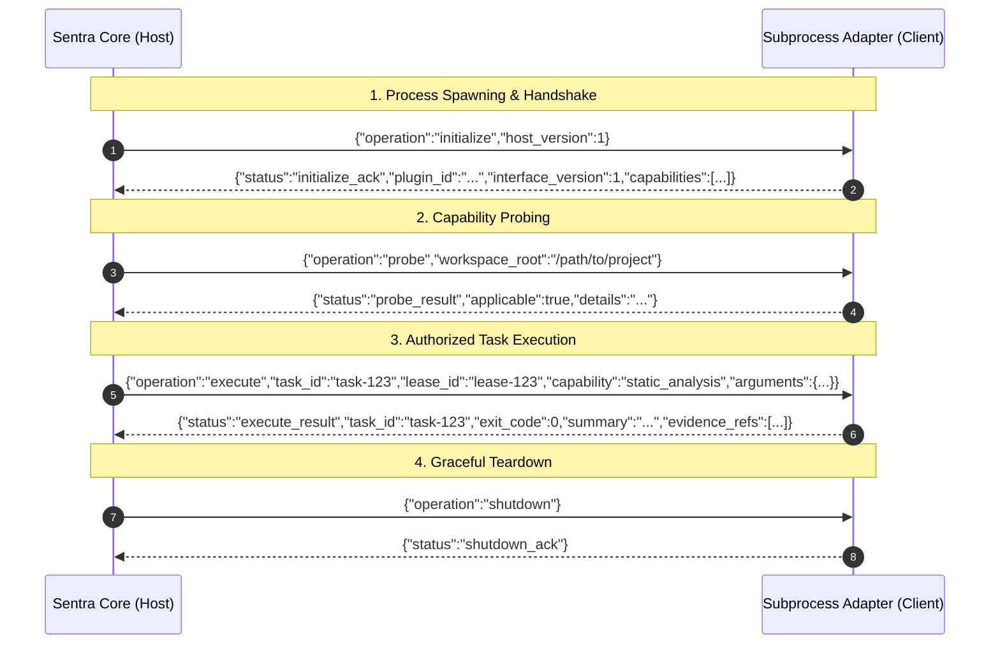

# Sentra Plugin & Adapter User Guide

This guide explains how to discover, probe, run, and author external security adapters for the **Sentra Security Platform** using Sentra's **Subprocess Plugin Architecture** (`REQ-F16`, [`docs/EXTENSIONS.md`](./EXTENSIONS.md)).

---

## 1. Architectural Philosophy

Sentra enforces unconditional memory safety and process isolation across all supported platforms:

1. **Process Isolation (`#![forbid(unsafe_code)]`):**
   External tools and plugins do **NOT** run inside Sentra's memory space via dynamic linking (`.dll`, `.so`, or unstable Rust ABIs). Instead, every adapter executes as an isolated, supervised subprocess.
2. **Polyglot Extensibility:**
   Adapters can be written in any language: **TypeScript (Bun)**, **Python 3**, **Go**, **Rust**, or **C++**.
3. **Framed Structured IPC (NDJSON over stdio):**
   Communication occurs via single-line newline-delimited JSON frames over `stdin` (host to adapter) and `stdout` (adapter to host). Diagnostics, progress indicators, and logs are directed to `stderr` without corrupting protocol streams.
4. **Capability Fencing & Default-Deny:**
   An adapter must declare its capabilities in its manifest. If a plugin attempts to exercise or acknowledge an undeclared capability, Sentra halts the process immediately and marks it **Quarantined**.

---

## 2. CLI Usage for End-Users

Sentra provides native CLI commands to manage and execute adapters directly from your terminal.

### 2.1 Discovering Available Plugins (`sentra plugin list`)

Scans `.sentra/plugins/`, `examples/adapters/`, or a custom directory for valid `manifest.json` definitions:

```bash
# Human-readable list
sentra plugin list

# Specifying a custom adapter directory
sentra plugin list --dir /path/to/my-plugins

# Machine-readable JSON output
sentra plugin list --json
```

**Example output:**
```text
Sentra discovered plugins (count: 3):
  • org.sentra.adapter.ollama v1.0.0 (ai_provider)
    Manifest: examples/adapters/sentra-adapter-ollama/manifest.json
    Capabilities: patch_generation
    Egress: WhitelistedLocalOnly

  • org.sentra.adapter.semgrep v1.0.0 (analysis_tool)
    Manifest: examples/adapters/sentra-adapter-semgrep/manifest.json
    Capabilities: source_discovery, static_analysis
    Egress: StrictlyDenied

  • org.sentra.adapter.snyk v1.0.0 (analysis_tool)
    Manifest: examples/adapters/sentra-adapter-snyk/manifest.json
    Capabilities: dependency_audit
    Egress: StrictlyDenied
```

---

### 2.2 Probing Plugin Applicability (`sentra plugin probe`)

Tests whether an adapter is installed, prerequisites are met, and whether the target repository is applicable—**without executing target code or modifying filesystem state**:

```bash
# Probe by plugin ID
sentra plugin probe --id org.sentra.adapter.snyk

# Probe target workspace
sentra plugin probe --id org.sentra.adapter.snyk --workspace ./my-project

# Probe using a direct manifest file
sentra plugin probe --manifest ./custom-adapter/manifest.json

# JSON output
sentra plugin probe --id org.sentra.adapter.snyk --json
```

**Example output:**
```text
Sentra plugin probe: completed
Plugin: org.sentra.adapter.snyk (Snyk Dependency Audit Adapter)
Applicable: true
Details: Discovered supported package manifest(s): Cargo.lock, package-lock.json
Capabilities: dependency_audit
```

---

### 2.3 Running an Adapter Job (`sentra plugin run`)

Executes an authorized task using an explicitly declared capability:

```bash
# Run Snyk dependency audit
sentra plugin run --id org.sentra.adapter.snyk --capability dependency_audit

# Run Semgrep static analysis with JSON arguments
sentra plugin run \
  --id org.sentra.adapter.semgrep \
  --capability static_analysis \
  --args '{"rule_suite": "owasp-top-10"}'

# Run with machine-readable JSON output
sentra plugin run --id org.sentra.adapter.snyk --capability dependency_audit --json
```

**Example output:**
```text
Sentra plugin execution: completed
Plugin: org.sentra.adapter.snyk
Task ID: task-53454ff5-909a-4a0d-8000-000000000001
Capability: dependency_audit
Exit Code: 0
Summary: Snyk audit detected 2 vulnerable package(s).
Evidence Refs: sha256:snyk-audit-task-53454ff5-909a-4a0d-8000-000000000001
```

---

## 3. Adapter Manifest Specification (`manifest.json`)

Every plugin must be stored in a directory containing a `manifest.json` conforming to `sentra_core::plugin::PluginManifest`:

```json
{
  "id": "org.sentra.adapter.snyk",
  "name": "Snyk Dependency Audit Adapter",
  "version": "1.0.0",
  "interface_version": 1,
  "family": "analysis_tool",
  "executable_path": "bun adapter.ts",
  "declared_capabilities": [
    "dependency_audit"
  ],
  "quotas": {
    "max_memory_mib": 1024,
    "max_execution_time_secs": 60,
    "max_frame_bytes": 1048576,
    "max_total_output_bytes": 10485760
  },
  "egress_policy": "strictly_denied"
}
```

### Field Definitions

| Field | Type | Description |
| :--- | :--- | :--- |
| `id` | `string` | Globally unique reverse-DNS identifier (e.g. `com.company.adapter.linter`). |
| `name` | `string` | Human-readable name. |
| `version` | `string` | Semver string (e.g. `"1.0.0"`). |
| `interface_version` | `u32` | Major protocol version (currently `1`). Incompatible versions are fail-closed. |
| `family` | `string` | Classification: `analysis_tool`, `ai_provider`, `language_framework`, `execution_backend`, `research_system`, `export_import`. |
| `executable_path` | `string` | Command or path invoked by Sentra (e.g. `"python adapter.py"`, `"bun adapter.ts"`, `"./bin/adapter"`). |
| `declared_capabilities`| `array` | Subset of: `source_discovery`, `dependency_audit`, `static_analysis`, `fuzz_execution`, `patch_generation`, or custom strings. |
| `quotas.max_memory_mib`| `u32` | Resident memory budget in MiB. |
| `quotas.max_execution_time_secs` | `u32` | Maximum run duration before forced SIGKILL. |
| `quotas.max_frame_bytes` | `u32` | Maximum byte length allowed for a single newline JSON frame (default: 1 MiB). |
| `quotas.max_total_output_bytes` | `u32` | Cumulative stdout/stderr ceiling (default: 10 MiB). |
| `egress_policy` | `string` | `"strictly_denied"` (air-gapped) or `"whitelisted_local_only"` (loopback daemon access). |

---

## 4. The Subprocess Protocol Lifecycle



---

## 5. Authoring an Adapter (Step-by-Step)

### Option A: Authoring in TypeScript ([Bun](https://bun.sh))

Create `adapter.ts`:

```typescript
#!/usr/bin/env bun
import * as readline from "readline";

const PLUGIN_ID = "com.example.adapter.mytool";

function emit(payload: object) {
  process.stdout.write(JSON.stringify(payload) + "\n");
}

function log(msg: string) {
  process.stderr.write(`[${PLUGIN_ID}] ${msg}\n`);
}

const rl = readline.createInterface({
  input: process.stdin,
  output: process.stdout,
  terminal: false,
});

for await (const line of rl) {
  const trimmed = line.trim();
  if (!trimmed) continue;

  const req = JSON.parse(trimmed);
  switch (req.operation) {
    case "initialize":
      emit({
        status: "initialize_ack",
        plugin_id: PLUGIN_ID,
        interface_version: 1,
        capabilities: ["static_analysis"],
      });
      break;

    case "probe":
      emit({
        status: "probe_result",
        applicable: true,
        details: "MyTool Scanner v1.2 ready",
        unsupported_reason: null,
      });
      break;

    case "execute":
      log(`Executing task ${req.task_id}...`);
      emit({
        status: "execute_result",
        task_id: req.task_id,
        exit_code: 0,
        summary: "Static scan completed: 0 findings",
        evidence_refs: [],
      });
      break;

    case "shutdown":
      emit({ status: "shutdown_ack" });
      process.exit(0);
  }
}
```

### Option B: Authoring in Python 3

Create `adapter.py`:

```python
#!/usr/bin/env python3
import sys
import json

PLUGIN_ID = "com.example.adapter.pytool"

def emit(response: dict):
    sys.stdout.write(json.dumps(response) + "\n")
    sys.stdout.flush()

def log(msg: str):
    sys.stderr.write(f"[{PLUGIN_ID}] {msg}\n")
    sys.stderr.flush()

for line in sys.stdin:
    line = line.strip()
    if not line:
        continue
    req = json.loads(line)
    op = req.get("operation")

    if op == "initialize":
        emit({
            "status": "initialize_ack",
            "plugin_id": PLUGIN_ID,
            "interface_version": 1,
            "capabilities": ["source_discovery"]
        })
    elif op == "probe":
        emit({
            "status": "probe_result",
            "applicable": True,
            "details": "Python Tool v3.0 ready",
            "unsupported_reason": None
        })
    elif op == "execute":
        emit({
            "status": "execute_result",
            "task_id": req.get("task_id"),
            "exit_code": 0,
            "summary": "Source discovery completed",
            "evidence_refs": []
        })
    elif op == "shutdown":
        emit({"status": "shutdown_ack"})
        sys.exit(0)
```

---

## 6. Official Reference Implementations

The Sentra repository includes three reference adapters under [`examples/adapters/`](file:///E:/MyProject/Mix/GitHub/Sentra/examples/adapters/):

1. [**`sentra-adapter-semgrep`**](file:///E:/MyProject/Mix/GitHub/Sentra/examples/adapters/sentra-adapter-semgrep/):
   - **Language:** Python 3
   - **Capabilities:** `source_discovery`, `static_analysis`
   - **Integration:** Wraps Semgrep CLI for fast AST pattern and taint matching.
2. [**`sentra-adapter-snyk`**](file:///E:/MyProject/Mix/GitHub/Sentra/examples/adapters/sentra-adapter-snyk/):
   - **Language:** TypeScript / Bun
   - **Capabilities:** `dependency_audit`
   - **Integration:** Software Composition Analysis (SCA) across multi-ecosystem lockfiles.
3. [**`sentra-adapter-ollama`**](file:///E:/MyProject/Mix/GitHub/Sentra/examples/adapters/sentra-adapter-ollama/):
   - **Language:** Python 3
   - **Capabilities:** `patch_generation`
   - **Integration:** Air-gapped local LLM inference (Llama 3, DeepSeek-R1) with strict loopback isolation (`whitelisted_local_only`).

---

## 7. Security & Containment Invariants

- **Fail-Closed Capability Enforcement:** If an adapter advertises `source_discovery` but tries to execute `patch_generation`, Sentra will reject the task before sending it to the child, and will isolate the session.
- **Replay Protection:** Task IDs are unique and strictly single-use. Replay requests are rejected fail-closed (`REQ-S02`).
- **Quota Enforcer:** If any line on `stdout` exceeds `max_frame_bytes` (default 1 MiB) or cumulative output exceeds `max_total_output_bytes` (default 10 MiB), Sentra terminates the subprocess immediately and flags it as `Quarantined`.
- **Human-in-the-Loop Governance:** Finding admissions and automated Git proposals generated through adapters are treated as candidate evidence. Sentra's core policy engine requires human authorization before applying modifications or dispatching remote PRs.
