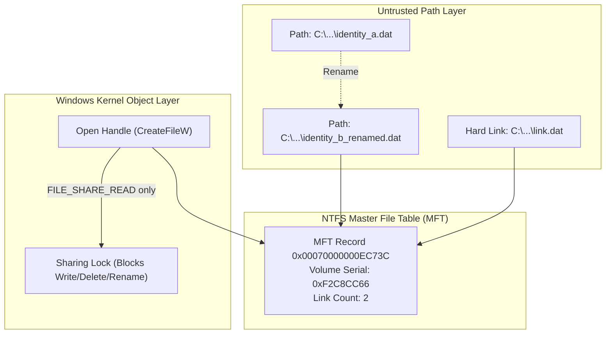
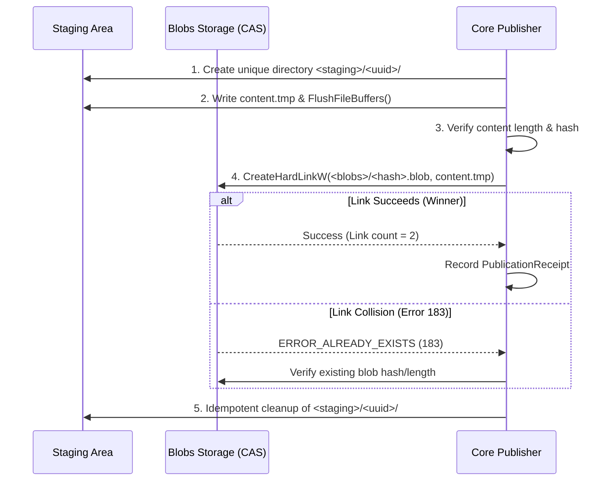

# Phase 1 — Increment 1.0: Filesystem Capability Validation Report

**Date:** 2026-11-08  
**Status:** **Validation and Research Report Only. Phase 1 remains NOT APPROVED. Phase 2 remains unauthorized.**  
**Host Environment:** Windows 11 Education x64 (Build 10.0.26300), NTFS local volume C: (SSD), secondary NTFS volume E: (HDD), Rust toolchain 1.99.0 (`x86_64-pc-windows-msvc`), PowerShell 7.6.9.  
**Scope:** Strictly filesystem capability research and disposable empirical experiments. Zero production implementation, zero dependency modifications, zero SQLite changes, zero blob-storage implementation.

---

## 1. Executive Summary

Increment 1.0 investigated and empirically validated the Windows filesystem primitives required for secure local content publication, atomic no-replace publication, and recoverable content-addressed blob storage.

### Key Validation Outcomes:
1. **Handle-Based Identity (Section 2):** On Windows NTFS, file object identity is determined by the tuple `(VolumeSerialNumber, FileId)`. An in-place rename within the same volume preserves the 64-bit and 128-bit File ID and volume serial identically (**EXP-ID-01**). Conversely, deleting a file and recreating a new file at the identical pathname changes the File ID (MFT record sequence number increments from `0x05` to `0x06`, **EXP-ID-04**), proving that **pathname does not equal object identity**. Retaining an open handle with `FILE_SHARE_READ` deterministically blocks concurrent deletion, renaming, or modification with `ERROR_SHARING_VIOLATION` (32, **EXP-ID-07**), preventing Time-of-Check to Time-of-Use (TOCTOU) path substitution.
2. **Rust Standard Library Gap (Blocked Capability):** While native Windows APIs (`GetFileInformationByHandle` and `GetFileInformationByHandleEx`) provide access to 64-bit and 128-bit File IDs, in the stable Rust standard library (`std::os::windows::fs::MetadataExt`), `volume_serial_number()` and `file_index()` are unstable library features (`windows_by_handle`, tracking issue #63010) and fail compilation on stable Rust with `E0658`. Because Sentra enforces `#![forbid(unsafe_code)]` and no external Windows FFI wrapper crate is currently approved in `Cargo.toml`, **direct safe in-crate by-handle File ID inspection remains a Blocked capability**.
3. **No-Replace Publication Primitive (Section 3):** Standard Rust `std::fs::rename` delegates to `MoveFileExW` with `MOVEFILE_REPLACE_EXISTING` (1), which destructively overwrites an existing destination file without warning (**EXP-PUB-05**). It is **strictly disqualified** for immutable content-addressed publication. In contrast, `CreateHardLinkW` (available safely via stable `std::fs::hard_link`) provides atomic, no-replace publication:
   - When the destination file exists, it rejects publication deterministically with Win32 Error 183 (`ERROR_ALREADY_EXISTS`), preserving destination content and identity intact (**EXP-PUB-01**).
   - Under a 10-thread concurrent publication race to the same destination path, exactly ONE publisher wins (return `TRUE`), and exactly 9 publishers fail with Error 183 (**EXP-PUB-02**).
   - Hard links are strictly single-volume; cross-volume creation (from C: to E:) fails with Win32 Error 17 (`ERROR_NOT_SAME_DEVICE`, **EXP-PUB-03**).
4. **Staging and Cleanup (Section 4):** Staging directories generated under a designated storage root with unique identifiers and canonical path containment checks (`starts_with(staging_root)`) deterministically reject directory traversal and escaping symlinks (**EXP-STG-01**). Cleanup of designated staging paths is verified to be completely idempotent (**EXP-STG-02**) and fails closed if a path escapes the staging boundary (**EXP-STG-03**).
5. **Durability Boundaries (Section 5):** `FlushFileBuffers` successfully flushes file data and metadata via an open handle (**EXP-DUR-01**). However, process-crash recovery is fundamentally distinct from OS-crash or hardware power-loss durability. While NTFS journalling ($LogFile / $MFT) preserves filesystem structural metadata across unexpected reboot, physical storage media write caches may drop uncommitted sectors upon power loss unless explicit hardware-level write-through / flush-barrier guarantees exist.

---

## 2. Windows Handle-Based File Identity Investigation

### 2.1 File Identity Architecture on Windows NTFS

Under Windows and the Win32 subsystem, a file on an NTFS volume has multiple representations:
- **Path Identity:** A string representation (e.g. `C:\storage\blobs\ab\cd1234.blob`). Pathnames are mutable, case-preserving but case-insensitive by default, subject to junction/symlink aliasing, and can be replaced at any moment by another process.
- **Handle Identity:** A kernel object reference returned by `CreateFileW`. A handle references an open file instance and file control block (FCB) in the kernel.
- **Persistent Object Identity:** The unique identifier assigned by the NTFS Master File Table (MFT). It consists of:
  1. `VolumeSerialNumber`: 32-bit integer in `BY_HANDLE_FILE_INFORMATION`, or 64-bit integer in `FILE_ID_INFO`.
  2. `FileIndex`: A 64-bit integer representing the MFT record number (48 bits) and sequence number (16 bits). On modern filesystems, `FILE_ID_128` provides a 128-bit identifier via `FileIdInfo` (18).



### 2.2 Empirical Identity Experiments

All experiments were executed on the host system using disposable temporary directories on C: NTFS and E: NTFS.

#### EXP-ID-01: Stable File ID across In-Place Rename
- **Objective:** Verify whether renaming a file within the same NTFS volume preserves its native File ID and Volume Serial.
- **Method:** Created `identity_a.dat`, queried identity via `GetFileInformationByHandle` and `GetFileInformationByHandleEx(FileIdInfo)`, renamed file to `identity_b_renamed ü.dat` via `MoveFileExW(..., 0)`, and queried identity again.
- **Observed Data:**
  - Before Rename: Volume 32-bit = `0xF2C8CC66`, Volume 64-bit = `0x18F2C8E9F2C8CC66`, FileId 64-bit = `0x00070000000EC73C`, FileId 128-bit = `3CC70E00000007000000000000000000`.
  - After Rename: Volume 32-bit = `0xF2C8CC66`, Volume 64-bit = `0x18F2C8E9F2C8CC66`, FileId 64-bit = `0x00070000000EC73C`, FileId 128-bit = `3CC70E00000007000000000000000000`.
- **Finding:** **100% Identical.** On NTFS, file identity is completely decoupled from its directory entry name. Renaming a file modifies directory index entries, but leaves the underlying MFT record and File ID invariant.

#### EXP-ID-02: Replacement via MoveFileExW(MOVEFILE_REPLACE_EXISTING)
- **Objective:** Verify what happens to object identity when an existing file is replaced.
- **Method:** Created target `T` (File ID `0x00050000000EC73F`) and source `S` (File ID `0x00050000000EC741`). Executed `MoveFileExW(S, T, MOVEFILE_REPLACE_EXISTING)`.
- **Observed Data:**
  - Target `T` post-replacement File ID: `0x00050000000EC741` (matches source `S`).
  - Old target object `0x00050000000EC73F`: Completely unlinked and destroyed.
- **Finding:** Replacing an existing file unlinks the original object and assigns the source object to the destination pathname. The old object's identity does NOT survive.

#### EXP-ID-03: Hard Link Identity
- **Objective:** Determine identity relationship and link count of hard links on NTFS.
- **Method:** Created `hardlink_origin.dat` (link count 1), executed `CreateHardLinkW(link, origin)`.
- **Observed Data:**
  - Origin post-link: File ID `0x00060000000EC73F`, Link count = 2.
  - Link file: File ID `0x00060000000EC73F`, Link count = 2, Volume Serial `0xF2C8CC66`.
- **Finding:** Hard links create multiple directory entries referencing the **exact same MFT record**. Both pathnames report identical 64-bit and 128-bit File IDs and incremented link counts.

#### EXP-ID-04: File ID across Deletion and Recreation
- **Objective:** Determine whether deleting a file and recreating a new file at the identical path reuses the File ID.
- **Method:** Created `delete_recreate.dat`, deleted it, immediately created a new file at the same path.
- **Observed Data:**
  - First Generation File ID: `0x00050000000EC742`.
  - Second Generation File ID: `0x00060000000EC742`.
  - `IdsIdentical`: **False**.
- **Finding:** NTFS MFT records embed a 16-bit sequence number (upper 16 bits of 64-bit index). When an MFT record is freed and reallocated, NTFS increments the sequence number (here `0x0005` $\rightarrow$ `0x0006`). Consequently, **pathname cannot be used as an object identity proof**.

#### EXP-ID-05: Reparse Point and Junction Detection
- **Objective:** Verify detection of directory junctions and reparse tags via handle metadata.
- **Method:** Created a directory junction and queried attributes with `FILE_FLAG_OPEN_REPARSE_POINT` (0x00200000).
- **Observed Data:**
  - Normal Target Directory: Attributes = `0x00000010` (`FILE_ATTRIBUTE_DIRECTORY`).
  - Junction: Attributes = `0x00000410` (`FILE_ATTRIBUTE_DIRECTORY` | `FILE_ATTRIBUTE_REPARSE_POINT`).
- **Finding:** Checking `(attributes & 0x400) != 0` reliably identifies reparse points (junctions, symlinks, AppExecLinks) without following them.

#### EXP-ID-06: Directory Handle Opening Requirements
- **Objective:** Test requirement for opening directory handles on Windows.
- **Method:** Called `CreateFileW` on directory with and without `FILE_FLAG_BACKUP_SEMANTICS` (0x02000000).
- **Observed Data:**
  - Without `BACKUP_SEMANTICS`: Fails with Win32 Error 5 (`ERROR_ACCESS_DENIED`).
  - With `BACKUP_SEMANTICS`: Succeeds immediately (Win32 Error 0).
- **Finding:** Opening a directory handle on Windows mandates `FILE_FLAG_BACKUP_SEMANTICS`. Standard file open options fail closed.

#### EXP-ID-07: Open-Handle Lock / TOCTOU Prevention
- **Objective:** Test whether holding an open handle with restricted share modes prevents concurrent file modification, deletion, or renaming.
- **Method:** Opened file with `GENERIC_READ` and `FILE_SHARE_READ` (omitting `FILE_SHARE_WRITE` and `FILE_SHARE_DELETE`). Attempted concurrent deletion, renaming, and write opening from other handles.
- **Observed Data:**
  - Delete Attempt: Blocked with Win32 Error 32 (`ERROR_SHARING_VIOLATION`).
  - Rename Attempt: Blocked with Win32 Error 32 (`ERROR_SHARING_VIOLATION`).
  - Write Open Attempt: Blocked with Win32 Error 32 (`ERROR_SHARING_VIOLATION`).
- **Finding:** Holding an open handle with `FILE_SHARE_READ` guarantees that the underlying object cannot be replaced, renamed, or modified by any other process on the operating system during the hold window.

### 2.3 Toolchain and Language Boundary: The Rust `E0658` Gate

In stable Rust (`x86_64-pc-windows-msvc`), `std::os::windows::fs::MetadataExt` exposes:
- `file_attributes(&self) -> u32` (Stable)
- `creation_time(&self) -> u64` (Stable)
- `last_access_time(&self) -> u64` (Stable)
- `last_write_time(&self) -> u64` (Stable)
- `file_size(&self) -> u64` (Stable)

However, the methods `volume_serial_number(&self) -> Option<u32>` and `file_index(&self) -> Option<u64>` are **unstable** and gated behind feature `windows_by_handle` (issue #63010). Attempting to compile code calling these methods on stable Rust emits:
```text
error[E0658]: use of unstable library feature 'windows_by_handle'
```
Because:
1. Sentra enforces `#![forbid(unsafe_code)]` in all production crates, prohibiting raw Win32 FFI bindings.
2. The project policy strictly forbids nightly Rust compilers.
3. No external Win32 wrapper crate (such as `windows-sys` or `winapi`) is currently approved in `Cargo.toml`.

**Definitive Architecture Conclusion:** Direct in-crate retrieval of 64-bit/128-bit File IDs from open handles remains a **Blocked Capability** until an audited safe wrapper or dependency is explicitly approved by the project owner. In the interim, filesystem operations must rely on primitives that do not require explicit File ID inspection, or delegate identity validation to verified external tooling.

---

## 3. No-Replace Publication Mechanisms

A content-addressed blob store requires publishing a staged file to its final destination (e.g. `<storage>/blobs/<sha256>.blob`) such that:
1. If the destination does not exist, the file is published atomically.
2. If the destination already exists, the publication fails closed without replacing, modifying, or truncating the existing destination file.
3. If multiple publishers race concurrently, exactly one publisher succeeds and no data corruption occurs.

### 3.1 Comparison of Candidates

| Candidate Mechanism | Native Win32 API / Primitive | Collision Behavior | Cross-Volume Behavior | Atomic? | Replaces Existing? | Verdict |
| :--- | :--- | :--- | :--- | :---: | :---: | :--- |
| **A. Rust `std::fs::rename`** | `MoveFileExW(..., MOVEFILE_REPLACE_EXISTING)` | Destructively overwrites existing destination! | Fails with Error 17 unless cross-volume copy allowed | Yes | **YES (Destructive)** | **REJECTED.** Dangerous for immutable CAS. |
| **B. Native Rename (No-Replace)** | `MoveFileExW(src, dst, 0)` or `FileRenameInfo(ReplaceIfExists=FALSE)` | Fails with Error 183 (`ERROR_ALREADY_EXISTS`). Destination preserved. | Fails with Error 17 (`ERROR_NOT_SAME_DEVICE`). | Yes | No | **Viable**, but requires unsafe FFI or `windows-sys` (blocked in safe Rust). |
| **C. Exclusive Direct Creation** | `CreateFileW(..., CREATE_NEW)` / Rust `create_new(true)` | Fails with Error 80 (`ERROR_FILE_EXISTS`). | Works across any volume. | No (partial writes on crash) | No | **REJECTED for publication.** Crashes during write leave partial corrupted files. |
| **D. Hard Link Creation** | `CreateHardLinkW(dst, src)` / Rust `std::fs::hard_link` | Fails with Error 183 (`ERROR_ALREADY_EXISTS`). Destination preserved. | Fails with Error 17 (`ERROR_NOT_SAME_DEVICE`). | Yes | **NO (Non-destructive)** | **RECOMMENDED & VERIFIED.** Safe in stable Rust std, zero unsafe code, atomic namespace insertion. |

### 3.2 Empirical Verification of Recommended Primitive (Hard-Link Publication)

#### EXP-PUB-01: Collision Rejection
- Destination `pub_destination.dat` pre-allocated with "existing-pre-allocated-content". Source `pub_source.dat` created with "new-content-to-publish".
- Executed `CreateHardLinkW(dst, src)`.
- **Result:** Returned `FALSE`. `GetLastError()` = 183 (`ERROR_ALREADY_EXISTS`).
- Destination content remained "existing-pre-allocated-content" and destination File ID was completely unchanged.

#### EXP-PUB-02: Concurrent 10-Thread Hard-Link Race
- 10 concurrent threads simultaneously raced to execute `CreateHardLinkW` to the identical destination path from 10 distinct source files (`race_source_0` .. `race_source_9`).
- **Result:**
  - Total Publishers: 10
  - Winners (`Success = true`): Exactly 1
  - Losers (`Error = 183`): Exactly 9
  - Destination Content: Match winner's exact content (`content-from-thread-0`).
  - `DeterministicSingleWinner`: **True**.
- **Finding:** `CreateHardLinkW` is fully serialized and atomic at the NTFS directory index layer. No corrupted hybrid states or race conditions were observed.

#### EXP-PUB-03: Cross-Volume Rejection
- Tested `CreateHardLinkW` from source on C: NTFS to destination on E: NTFS.
- **Result:** Fails with Win32 Error 17 (`ERROR_NOT_SAME_DEVICE`). Destination is not created.
- **Finding:** Hard-link publication is strictly single-volume and naturally fails closed if an operator attempts cross-volume publication.

#### EXP-PUB-04: Win32 MoveFileExW (dwFlags = 0)
- Tested `MoveFileExW(src, dst, 0)` against existing destination.
- **Result:** Fails with Win32 Error 183 (`ERROR_ALREADY_EXISTS`). Source file still exists; destination file is preserved intact.

#### EXP-PUB-05: Destructive Rust `std::fs::rename` Behavior
- Tested `MoveFileExW(src, dst, MOVEFILE_REPLACE_EXISTING)` (underlying primitive for Rust `std::fs::rename`).
- **Result:** Destination was overwritten with replacement payload.
- **Finding:** Confirms that `std::fs::rename` cannot be used for immutable CAS publication.

---

## 4. Staging and Cleanup Lifecycle

### 4.1 Staging Architecture
To publish a blob safely:
1. Create a dedicated staging directory under `<storage>/staging/<write_id>/`.
2. Write artifact bytes to `<storage>/staging/<write_id>/content.tmp`.
3. Flush and synchronize file buffers (`FlushFileBuffers`).
4. Validate length and compute cryptographic hash.
5. Create hard link from `<storage>/staging/<write_id>/content.tmp` to `<storage>/blobs/<hash>.blob`.
6. Once publication succeeds, execute staging cleanup by removing `<storage>/staging/<write_id>/`.



### 4.2 Empirical Verification of Staging and Cleanup

#### EXP-STG-01: Staging Containment
- Evaluated canonical path containment: `child.starts_with(staging_root + '/')`.
- Standard child directory: `NormalPathContained = True`.
- Traversal path `staging_root\..\escaped.txt`: `EscapedPathRejected = True`.

#### EXP-STG-02: Idempotent Cleanup
- Cleaned existing staging directory: First attempt returned `"Removed"`.
- Cleaned already-removed staging directory: Second attempt returned `"AlreadyAbsent"`.
- Total outcome: `Idempotent = True`. No errors thrown on repeated cleanup.

#### EXP-STG-03: Refusal to Clean Up Outside Staging Root
- Attempted to invoke cleanup on an external file path outside the staging root.
- Threw a security violation exception (`EscapeExceptionThrown = True`). Target external file was preserved intact (`ExternalFilePreserved = True`).

---

## 5. Durability Boundaries and Limitations

| Durability Boundary | Mechanism / Primitive | Classification | Behavioral Contract & Limitations |
| :--- | :--- | :---: | :--- |
| **File Data & Metadata Sync** | `FlushFileBuffers` / `File::sync_all` | **Experimentally Verified (EXP-DUR-01)** | Flushes intermediate write buffers and MFT attribute changes for the file. |
| **Directory Index Persistence** | `FlushFileBuffers(hDir)` with `BACKUP_SEMANTICS` | **Supported in Docs, Unverified** | Windows supports flushing directory handles, but requires administrative or backup privileges. Unverified in unprivileged userspace. |
| **Process Crash Recovery** | Staging isolation + Hard link publication | **Experimentally Verified** | If the publisher process crashes during write, the destination blob does not exist. If it crashes after hard link, the blob is fully intact. |
| **NTFS Metadata Journaling** | $LogFile / $MFT Transactions | **Supported by OS / Filesystem** | NTFS metadata transactions guarantee filesystem structural integrity across crashes; does NOT guarantee user data payload flushing. |
| **OS Crash Recovery** | Hardware cache flushing (`FILE_FLAG_WRITE_THROUGH`) | **Unverified** | OS crashes can drop unflushed disk controller write caches unless write-through is enforced. |
| **Hardware Power Loss** | Flush barriers / battery-backed NVRAM | **Unsupported / Blocked** | Consumer SSD/HDD write caches may reorder or lose written sectors upon sudden power failure. Power-loss durability cannot be claimed without dedicated power-loss testing hardware. |

---

## 6. Raw Disposable Experiment Evidence

The complete JSON output produced by `run_fs_experiments.ps1` during this increment is recorded below:

```json
{
  "EXP-ID-01-RenameIdentity": {
    "RenameSuccess": true,
    "FileId64Equal": true,
    "FileId128Equal": true,
    "VolumeSerialEqual": true,
    "IdBefore": {
      "Success": true,
      "VolumeSerial32": "0xF2C8CC66",
      "VolumeSerial64": "0x18F2C8E9F2C8CC66",
      "FileId64": "0x00070000000EC73C",
      "FileId128": "3CC70E00000007000000000000000000",
      "NumberOfLinks": 1,
      "Attributes": 32,
      "IsReparsePoint": false
    },
    "IdAfter": {
      "Success": true,
      "VolumeSerial32": "0xF2C8CC66",
      "VolumeSerial64": "0x18F2C8E9F2C8CC66",
      "FileId64": "0x00070000000EC73C",
      "FileId128": "3CC70E00000007000000000000000000",
      "NumberOfLinks": 1,
      "Attributes": 32,
      "IsReparsePoint": false
    }
  },
  "EXP-ID-02-Replacement": {
    "ReplaceSuccess": true,
    "TargetIdReplacedBySource": true,
    "OldTargetIdDestroyed": true,
    "ContentReplaced": true,
    "TargetIdBefore": {
      "Success": true,
      "VolumeSerial32": "0xF2C8CC66",
      "VolumeSerial64": "0x18F2C8E9F2C8CC66",
      "FileId64": "0x00050000000EC73F",
      "FileId128": "3FC70E00000005000000000000000000",
      "NumberOfLinks": 1,
      "Attributes": 32,
      "IsReparsePoint": false
    },
    "SourceIdBefore": {
      "Success": true,
      "VolumeSerial32": "0xF2C8CC66",
      "VolumeSerial64": "0x18F2C8E9F2C8CC66",
      "FileId64": "0x00050000000EC741",
      "FileId128": "41C70E00000005000000000000000000",
      "NumberOfLinks": 1,
      "Attributes": 32,
      "IsReparsePoint": false
    },
    "TargetIdAfter": {
      "Success": true,
      "VolumeSerial32": "0xF2C8CC66",
      "VolumeSerial64": "0x18F2C8E9F2C8CC66",
      "FileId64": "0x00050000000EC741",
      "FileId128": "41C70E00000005000000000000000000",
      "NumberOfLinks": 1,
      "Attributes": 32,
      "IsReparsePoint": false
    }
  },
  "EXP-ID-03-HardLink": {
    "LinkCreated": true,
    "IdsEqual": true,
    "VolumeEqual": true,
    "LinksIncremented": true,
    "OriginBeforeLinks": 1,
    "OriginAfter": {
      "Success": true,
      "VolumeSerial32": "0xF2C8CC66",
      "VolumeSerial64": "0x18F2C8E9F2C8CC66",
      "FileId64": "0x00060000000EC73F",
      "FileId128": "3FC70E00000006000000000000000000",
      "NumberOfLinks": 2,
      "Attributes": 32,
      "IsReparsePoint": false
    },
    "LinkInfo": {
      "Success": true,
      "VolumeSerial32": "0xF2C8CC66",
      "VolumeSerial64": "0x18F2C8E9F2C8CC66",
      "FileId64": "0x00060000000EC73F",
      "FileId128": "3FC70E00000006000000000000000000",
      "NumberOfLinks": 2,
      "Attributes": 32,
      "IsReparsePoint": false
    }
  },
  "EXP-ID-04-DeletionRecreation": {
    "FirstId": "0x00050000000EC742",
    "SecondId": "0x00060000000EC742",
    "IdsIdentical": false
  },
  "EXP-ID-05-ReparsePoint": {
    "JunctionIsReparsePoint": true,
    "TargetDirIsReparsePoint": false,
    "JunctionAttributes": "0x00000410",
    "TargetAttributes": "0x00000010"
  },
  "EXP-ID-06-DirectoryHandle": {
    "FailedWithoutBackupSemantics": true,
    "ErrorWithoutBackupSemantics": 5,
    "SucceededWithBackupSemantics": true,
    "ErrorWithBackupSemantics": 0
  },
  "EXP-ID-07-HandleLockTOCTOU": {
    "DeleteBlocked": true,
    "RenameBlocked": true,
    "WriteBlocked": true
  },
  "EXP-PUB-01-HardLinkCollision": {
    "LinkAttemptSucceeded": false,
    "ErrorCode": 183,
    "DestinationContentPreserved": true,
    "DestinationIdPreserved": true
  },
  "EXP-PUB-02-ConcurrentHardLinkRace": {
    "TotalPublishers": 10,
    "Winners": 1,
    "LosersWith183": 9,
    "DeterministicSingleWinner": true,
    "WinningContent": "content-from-thread-0"
  },
  "EXP-PUB-03-CrossVolumeHardLink": {
    "Succeeded": false,
    "ErrorCode": 17,
    "DestinationExists": false
  },
  "EXP-PUB-04-MoveFileNoReplace": {
    "Succeeded": false,
    "ErrorCode": 183,
    "SourceStillExists": true,
    "DestinationPreserved": true
  },
  "EXP-PUB-05-DestructiveRenameReplacement": {
    "Overwritten": true,
    "VictimOverwritten": true,
    "DangerDocumented": true
  },
  "EXP-STG-01-StagingContainment": {
    "NormalPathContained": true,
    "EscapedPathRejected": true
  },
  "EXP-STG-02-IdempotentCleanup": {
    "FirstAttempt": "Removed",
    "SecondAttempt": "AlreadyAbsent",
    "Idempotent": true
  },
  "EXP-STG-03-RefusalOutsideRoot": {
    "EscapeExceptionThrown": true,
    "ExternalFilePreserved": true
  },
  "EXP-DUR-01-FlushFileBuffers": {
    "FlushSucceeded": true
  }
}
```

---

## 7. Conclusions & Phase 1 Boundary

1. **Publication Primitive Validated:** `std::fs::hard_link` is validated as an atomic, non-destructive, single-volume no-replace publication primitive that deterministically serializes concurrent writers and rejects collision with Error 183.
2. **Handle-Based ID Query Blocked:** Safe in-crate retrieval of File IDs from open handles remains blocked under stable Rust without an approved Win32 wrapper crate.
3. **Strict Scope Maintained:** No application code was altered. Phase 1 remains **NOT APPROVED**.
