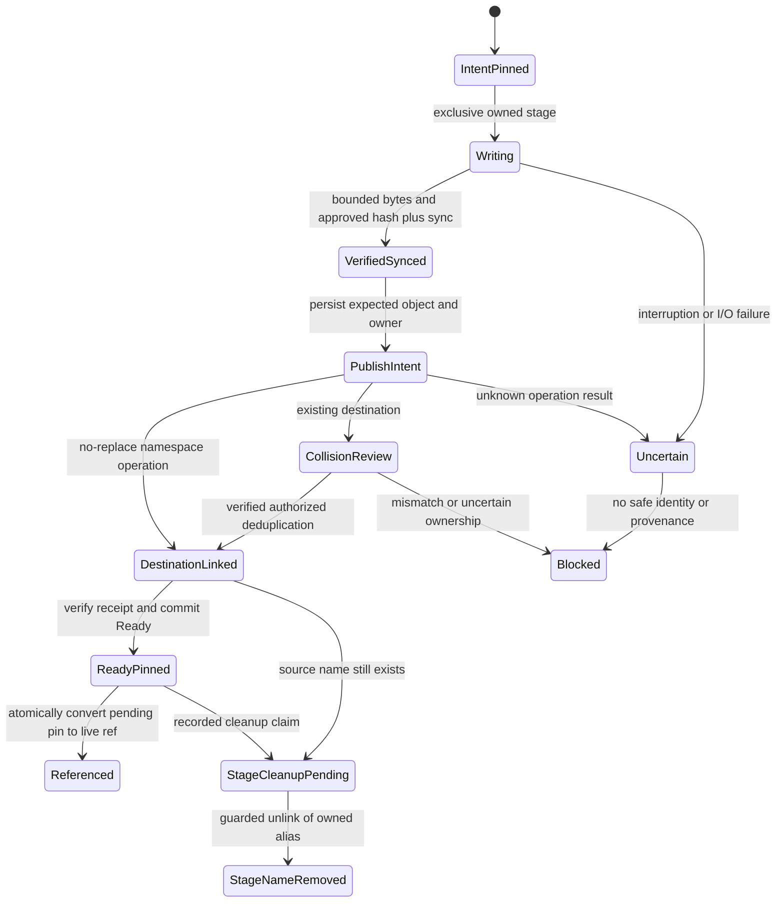
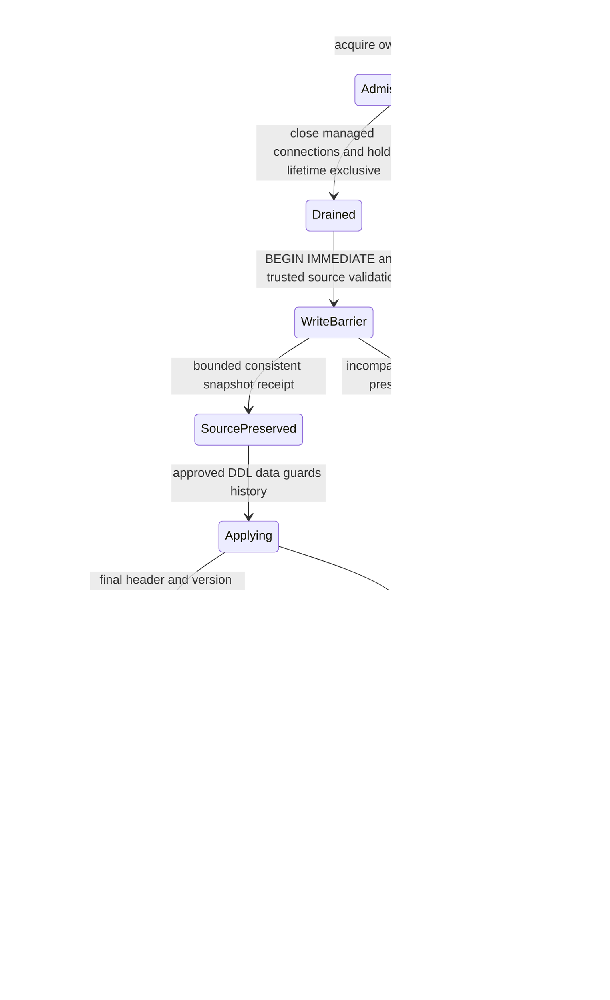

# Phase 1 Remediation — Increment 0.2: Implementation Contracts

Date: 2026-11-07. **Proposed technical contracts only. Phase 1 MUST remain NOT APPROVED. Phase 2 is unauthorized.** No API, source, test, schema, migration, dependency, feature, configuration or runtime change is implemented here.

## 1. Authority, status and scope

These contracts refine [REMEDIATION_ARCHITECTURE](REMEDIATION_ARCHITECTURE.md) using the actual [Increment 0.1 evidence](FOUNDATIONAL_PREREQUISITE_VALIDATION.md). The companion [IMPLEMENTATION_READINESS](IMPLEMENTATION_READINESS.md) contains the decision matrix, dependency decision, ordered work, owners, blockers and verification record. Proposed ADR-0008/0009/0010 remain Proposed; their dated cross-references do not accept any decision.

The [gap analysis](PHASE1_GAP_ANALYSIS.md) and [final NOT APPROVED assessment](PHASE1_FINAL_VERIFICATION.md) retain authority over missing acceptance evidence. The original ROADMAP requirement remains verbatim:

> Persist and resume a session; interrupt at task dispatch, blob promotion, and result commit; show no lost committed events and no repeated sensitive side effects.

F-01/F-02 immutable input/manifest evidence, F-14 recovery/bounded retry, Q-03 decision replay, Q-04 incompatible-writer rejection, S-09 evidence/audit limits and all other original Phase 1 gates are unchanged. The single foundation SessionId still aliases project identity; OQ-25 stays Open. F-611-02 stays Open before Phase 2 production readiness.

| Label | Meaning in these documents |
| --- | --- |
| EVIDENCED-0.1 | Actually observed in the restricted synthetic C: NTFS/SQLite 3.46.0 experiments; not rerun here |
| SOURCE-0.2 | Inspected current source/local cached declarations; not runtime proof |
| CONTRACT | Recommended future implementation requirement, awaiting explicit acceptance/authorization |
| BLOCKED | A missing dependency, safe API, authority decision or proof prevents enabling the dependent operation |
| NOT TESTED | No applicable runtime experiment established the property |

Contract names and record fields describe required semantics, not current public types or approved DDL. A proposed error category or command is not a shipped capability. No new provider, scheduler, cryptographic algorithm, target execution backend or secondary authorization engine is introduced.

## 2. Recoverable filesystem contract

### 2.1 Supported scope and identity

**FS-C01 — Profile admission.** A future storage filesystem provider may issue a private capability only for an explicitly validated local fixed NTFS volume on Windows x64. The 0.1 experiments ran on C: NTFS, not every NTFS volume; E: being NTFS is not equivalence proof. ReFS, network/UNC, removable media, cross-volume publication and other OS/architecture profiles are unsupported until separately validated. A policy asking for an unavailable durability/identity profile is denied before mutation.

A capability is derived by trusted Core composition from the actual API implementation, protected root/volume identity and verified profile evidence. It is not a caller-supplied boolean or a permanent cached success bit. A changed volume/root identity, filesystem mode, implementation or relevant capability invalidates it. Startup does not silently run write probes in a target repository or turn status inspection into recovery.

**FS-C02 — Stable object reference.** Required identity is the scoped tuple of verified live volume identity, native file identifier and retained object handle, under the protected storage activation. Caller strings, drive letters, canonical paths, CIM serials and fsutil output alone cannot create it. IDs are not assumed globally unique, permanent after deletion, or safe across restore/clone. API-selected identifier widths must be preserved without truncation.

Each content/open/delete/publication operation must establish the same object through the final operation using the selected safe handle strategy. Resolve-and-reopen after a pathname check is not sufficient. Reparse entries, junctions, symlinks, unsupported aliases, inaccessible metadata and uncertain identity fail closed even if the apparent target is inside the root. Directory enumeration is inert and bounded.

Hard links are not reparse points: 0.1 observed equal identity under two ordinary names. Source acquisition must reject unverified multi-link ownership/alias cases until a reviewed strategy proves authorized content access. Core-owned CAS deduplication is a separate permissioned operation; equal content or file ID does not grant cross-session access. File content may change through another handle: stable identity does not by itself establish immutable bytes.

**Current gate:** stable Rust by-handle volume/file methods failed with E0658 in 0.1. A safe audited abstraction or rigorously bounded alternative is still unselected. No unsafe FFI, nightly switch, helper-process bridge or string-prefix fallback is authorized. Existing WorkspaceBoundary/ResolvedWorkspacePath remains a metadata boundary, not a new content handle.

### 2.2 Minimal internal ownership boundary

Keep this a small Core-owned filesystem component, not a plugin framework. The following logical values must have private constructors and hold their guards/handles:

| Value | Required content / permitted use |
| --- | --- |
| VerifiedStorageRoot | Retained validated root and volume identity, supported profile, activation and owner guard; outside the target workspace |
| OpenedOwnedObject | Retained handle/identity/kind, ownership/purpose/classification and byte bounds; no trust inferred from a saved path |
| StagedArtifact | Core-assigned WriteId, relative locator, quota/pending-reference pin, expected producer, epoch and verified-write state |
| PublicationReceipt | WriteId, source/destination identities, SHA-256/length, strategy, publication phase and durability profile; not an authorization grant |
| CleanupClaim | Exact owned object, expected state/epoch, exclusive object guard, live/pending/retention reachability decision and bounded action |

Logical operations are bounded exclusive stage creation, safe content open, synchronized finish, no-replace publish, collision inspection and claimed cleanup. Raw paths/handles cannot escape into CLI/model-controlled code as reusable authority. An operation returns a typed receipt, typed denial/error, or explicit uncertain state; it never converts inability to inspect into success.

### 2.3 No-replace publication and collision rules

**FS-C03 — Same volume.** Compare verified source/destination-parent volume identity before publication. Different or unverifiable volumes return CrossVolumeUnsupported/IdentityUnavailable before publish; no implicit copy/delete fallback. Source content remains owned and pinned. A supported same-volume identity is stronger than both paths reporting “NTFS.”

**FS-C04 — Candidate selection.** Rust std rename replaces existing files and is forbidden as a no-replace primitive. A preceding exists check is not a repair. Managed File.Move(false) is historical diagnostic evidence, not a production .NET bridge.

Recommended candidate for further validation is **std hard_link for closed, Core-owned immutable CAS objects**, followed by separately recorded staging-name cleanup. It has safe std availability and documented existing-name rejection; the 0.1 races passed 10/10. This does not select it for production or promise atomic rename/durability. A safe by-handle no-replace rename wrapper remains an alternative pending audit.

Before link publication all producers/writable aliases must be retired, content hashed and synchronized, and the source/object/parent guards held. Unknown writers or aliases block publication. Do not apply this CAS strategy to mutable SQLite DB publication: independent DB names and WAL/SHM naming require a different approved protocol.

**FS-C05 — Collision.** Existing destination is inspected using the same safe identity boundary. Require verified actual SHA-256, length, ownership, classification/access and compatible reference policy. Matching pathname/hash label or error 183 alone is insufficient. Exact authorized content permits idempotent deduplication; different or unverifiable content yields Conflict/Corrupt/Uncertain and preserves existing data plus staged evidence. Never replace the object to “fix” collision.

### 2.4 Publication lifecycle and crash reconciliation

The following specializes the earlier promotion intent; it does not merge SQL/filesystem atomicity.



Ready/reference status and staging-name cleanup are separate axes: cleanup never drops a pending/live pin, and a leftover verified source name does not authorize modifying the published object. If an alternative rename strategy is later selected, its source-removal receipt replaces only that subphase, not the ownership/pin invariants.

| Interruption | Required recovery |
| --- | --- |
| Intent committed, no file | Confirm owned write never produced admitted bytes; audit absent disposition before releasing its quota/pin |
| Partial write or uncertain sync/close | Unavailable, pinned; no Ready. Retain or quarantine only proven owned data |
| Verified source before publish | Revalidate handle/bytes/fence under guards; retry only that idempotent filesystem phase, not the original backend task |
| Destination may exist, receipt missing | Inspect actual destination and both names; matching verified ownership/content may finish the receipt, otherwise preserve/Uncertain |
| Link created, source still named | Verify both names and immutable ownership; record StageCleanupPending. Never overwrite/delete the destination |
| Ready before live reference | Preserve pending pin until the input/result transaction commits its reference |
| Referenced destination missing/corrupt | Mark dependent input/result unavailable/corrupt; preserve logical reference and evidence, deny dependent execution |
| Cleanup interrupted | Reconcile exact claimed object/disposition; repeated cleanup cannot target another object or refund quota twice |

**FS-C06 — External uncertainty.** Failure does not imply non-execution of a namespace operation. Do not repeat a publication/delete against a newly resolved path merely because acknowledgement was lost. Recovery is conditional on identity, expected state and current ownership. No exactly-once external-effect claim follows.

### 2.5 Synchronization profiles

**FS-C07 — Required barriers.** Complete bounded user-space writes, compute SHA-256 over actual retained bytes, request and check the selected file synchronization barrier, retire writable handles/aliases, and establish the selected publication/parent-directory ordering before the corresponding receipt/acknowledgement. All failures are explicit. Dropping a Rust File does not report checked close errors; a backend unable to establish the required finish/close semantics returns CloseOutcomeUnknown and cannot claim the stronger profile.

| Profile | Permitted claim / contract |
| --- | --- |
| ExperimentalProcessObservation | Only 0.1's three controlled flush/rename/close process kills. Not sufficient to enable production Ready |
| ProcessCrashRecoverable | Proposed first production capability, enabled only after real integrated kills at every publish/pin/ref/cleanup point and restart reconciliation pass. Receipt explicitly names this scope |
| OsCrashRecoverable | Unsupported until independently approved API/filesystem journal/metadata ordering and actual OS-crash evidence exist |
| PowerLossDurable | Unsupported until independently approved hardware/device flush/power evidence exists; FULL/sync_all/rename success is not proof |

No implicit directory or volume flush success is assumed. Failure to meet the profile requested by policy denies publication/admission; a weaker profile is not silently substituted. SQL WAL checkpoints do not synchronize blob files. Stronger durability does not establish semantic evidence correctness.

### 2.6 Temporary artifacts and cleanup

**FS-C08 — Ownership before bytes.** Create only beneath a verified protected temporary/storage root using exclusive no-follow creation, a Core-generated ID, quota and persistent ownership/pending intent. Caller-supplied path, a filename prefix, age or an ownership-marker string alone is insufficient against adversarial replacement. Partial creation never overwrites an existing file.

**FS-C09 — Claimed deletion.** Cleanup requires current owner/epoch, exact object identity, held object guard, no live/pending/input/result/retention/backup reference and an approved retention action. Reference admission must exclude a live GC claim or cancel it atomically before attachment. Unknown reparse/type/ownership, active producer, uncertain handle or changed path stops cleanup; preserve data and surface typed failure. Do not unlink lock/admission files while clients can be active.

**FS-C10 — Recovery-family protection.** Never treat DB, WAL, SHM and journal as independent disposable leftovers. Preserve the complete present/absent set and required control metadata under proven quiescence. Several renames are not an atomic quarantine. A healthy SQLite logical snapshot is not forensic capture of a corrupt/incomplete family.

The verified nonrecursive 0.1 cleanup demonstrates only that owned synthetic experiment cleanup succeeded. It does not certify production GC against hostile path races.

## 3. SQLite writer-fencing and migration contract

### 3.1 Exact guarantee, threat model and rejected substitutes

**WF-C01 — Required guarantee:** after the atomic schema-generation/fence commit, a connection admitted under an earlier schema generation must be unable to commit **any protected Sentra logical state mutation**, including approval, budget, audit, session, migration metadata and future recovery records. A blocked statement must not leave a partially committed business operation.

This is not the current behavior: 0.1 SQL-08 demonstrated an old connection writing after user_version changed. No proposed fence was tested in 0.1 or 0.2.

The guarantee covers sealed Core-managed connections and explicitly inventoried supported legacy Sentra write paths. Arbitrary same-account SQLite tools, malicious DDL/guard removal, a compromised storage administrator or raw file mutation remain outside the local trust boundary already documented in S-09. An unknown legacy writer/access path is **not** presumed compatible: in-place migration is blocked unless it is positively excluded or covered. Inspection may perform physical SQLite coordination/checkpoint I/O; that is distinct from a stale logical state commit.

| Substitute | Why insufficient |
| --- | --- |
| Process-local mutex / PID scan / TTL | Does not exclude other processes or prove a writer cannot wake up |
| user_version alone or a pre-transaction epoch query | SQL-08 disproves automatic fencing; check may be stale |
| New clients' sidecar lock alone | A pre-protocol connection never acquired it |
| Exclusive SQLite lock held only by live migrator | Can exclude writes while held, but process death releases it; it is not a durable legacy fence |
| Connection-local authorizer/TEMP trigger alone | Not installed on the old connection |
| Restore/copy into a new filename | May isolate a new file, but does not establish that an old writer cannot commit to the retired file; not the requested guarantee |

### 3.2 Recommended two-layer mechanism

**Contract recommendation, pending explicit acceptance and prototype proof:**

1. **Cooperating connection admission/drain:** stable cross-process OS gates held over complete managed connection lifetimes, plus private immutable generation tokens and transaction revalidation.
2. **Persistent database enforcement:** embedded, validated main-schema DML guard triggers on every protected writable table invoke a connection-local, side-effect-free Core admission function. Missing function or stale/malformed token denies the statement. Persistent guards, rather than a live migrator, deny known pre-protocol connections after bootstrap commit and controller death.

This is a proposed storage-compatibility fence, not an approval/policy replacement. Every business operation still goes through current PolicyEngine, authoritative session context, classification floor, exact grant binding and atomic reservation/consumption/audits. A storage token cannot authorize an operation.

Current rusqlite 0.32.1 is approved with bundled only. Cached source exposes a safe functions API but the **functions feature is not enabled/approved**. Its introduction and callback flags/source must be separately audited/authorized. A safe online backup API may also need the separate backup feature. Both cached feature lists are empty direct dependency additions in that manifest, but actual offline feature graph/build remains to be checked. This increment changes neither feature.

### 3.3 Owned header and connection admission

Logical header fields, not current DDL:

| Field | Contract |
| --- | --- |
| Store/Activation identity | Trusted local activation and restore lineage, not project identity or caller path |
| SchemaVersion | Compiled supported ordered DDL/history version |
| SchemaGeneration | Positive checked integer, advanced on effective schema publication; cannot be refreshed in an old connection |
| WriterProtocolVersion | Explicit guard/token protocol compatibility |
| WriterEpoch | Current mutating-owner/recovery epoch; normal owner handoff advances it atomically |
| Migration disposition | None/committed migration identity and immutable expected source/destination versions; not a permissive “migration in progress” flag |

Require one validated header and exact embedded guard catalog. All counters fit SQLite's supported positive integer domain and fail on overflow. Policy generation, session context generation and schema generation are distinct; missing legacy values cannot be filled with current authorization.

A private connection token binds header identity/generations, lifecycle purpose, authority seal and held leases. Register the callback initially in **deny-all** state before schema/integrity operations that might evaluate guards; activate a binding once only after trusted admission. An old token cannot be upgraded by assigning a newer generation; close and re-admit a new connection. A revoked/unknown purpose denies.

**WF-C02 — Gate order:**

- Preserve ADR-0008's one mutating controller under ControllerOwner, an exclusive cross-process guard.
- OpenTurnstile serializes new managed opens with migration drain. Each managed connection acquires a shared ConnectionLifetime lease before opening SQLite and retains it through all statements, rollback, checkpoint and successful close.
- Migration holds ControllerOwner and OpenTurnstile, stops new work, drains in-flight work without releasing its protection, closes its ordinary connections, then obtains exclusive ConnectionLifetime. A private migration connection uses that exclusive lease. Read-only domain inspection also participates; its read-write SQLite connection is not exempt.
- Never wait for OS/session/object leases while holding a business SQLite transaction. Drain completion does not require OpenTurnstile, preventing a circular wait. All waits have bounded typed Busy/Timeout results; no arbitrary PID killing or host reconfiguration.
- Stable gate files and directory handles remain pinned and cannot be unlinked/replaced while live. Reuse existing safe no-delete-sharing/lock concepts only after FS-C01/02 proves identity/alias behavior. A second filename/hard-link alias must not create a second gate.

Mark the service quiescing before taking OpenTurnstile. An operation counts as in-flight only after it owns its connection lease; finishing it must not require a new open behind the migration's turnstile. Waiting opens are rejected/cancelled with typed Busy rather than counted as work that drain waits for. An unknown external effect or inability to drain within the bound aborts migration, not a forced worker termination.

A newly claimed mutating owner cannot activate an ordinary writer token at an inherited epoch. Its private activation transaction must compare and advance the epoch first; migration or recovery may combine that activation with their final publication transaction. Until then its token is purpose-bound maintenance only. Diagnostic/read-only-domain admission does not claim a mutating owner or advance epochs.

A process-local Arc/Mutex remains useful for one writer's ownership, but is not the cross-process proof.

### 3.4 Persistent guard contract

**WF-C03 — Coverage.** Protect INSERT, UPDATE and DELETE on every application table, including all six existing tables, the new header and every future task/blob/reference/result/recovery table. Guarded tables must be in the embedded migration catalog; unknown writable tables/virtual tables, missing/extra/altered guards or unsupported bypass paths block activation. No target-provided SQL is loaded.

The logical guard, deliberately not executable DDL here, is:

```text
require exactly one valid storage header
require core_write_guard_v1(header activation, schema generation,
                            writer epoch, protocol, fixed table/verb/purpose) IS 1
otherwise abort this statement with a static redacted error
```

The function compares header arguments with a private admitted token; it cannot derive authority from those arguments alone. No function registration is exposed to callers. It performs no SQL re-entry, filesystem access, network, clock reads, logging or secret disclosure. NULL, bad types, missing header, callback failure, absent token or generation/purpose mismatch denies. Normal writer purpose cannot edit header/guard/history; migration/recovery purpose is a private, narrowly scoped lifecycle capability.

The proposed callback must work with **trusted_schema=OFF and defensive mode preserved**. Cached flags expose SQLITE_INNOCUOUS; selecting it requires proof that this non-secret boolean callback is innocuous. DIRECTONLY would prevent trigger use; do not enable trusted_schema as a workaround. Do not mark a token-dependent function deterministic or cache its decision across admission changes. Exact flags, callback lifetime/poisoning and driver error behavior require prototype/security review.

**WF-C04 — Complete rollback.** Trigger ABORT is a statement error, not an assumption of full transaction rollback. Keep the existing ManagedTransaction failure latch and explicit full rollback, including after caught errors. Missing-function errors may be SqlInputError rather than SqliteFailure; do not unwrap an optional code or permit commit because a numeric code is absent. Preserve typed primary/rollback errors and halt on rollback uncertainty.

Known legacy v1 uses managed SQL DML, not incremental blob writes, writable_schema, arbitrary DDL, extension loading or virtual-table update APIs; current source was checked. Trigger coverage must be proven for supported legacy builds, including cached/prepared statements, UPSERT/REPLACE and FK cascades. If a bypass API or unvetted old build is possible, the guard proposal cannot certify it: block bootstrap. This is not a general SQLite authentication system.

### 3.5 How migration proves old writers stopped or cannot commit

**WF-C05 — Fence proof certificate.** Before publishing migration success, Core must establish all of the following:

1. Protected root/DB activation and all required gate identities are verified; the migration has exclusive owner/turnstile/lifetime leases for protocol-aware clients.
2. BEGIN IMMEDIATE on the real source succeeds and remains held through migration commit. This proves any earlier writer transaction finished; active old writers yield Busy/abort, not forced migration. New legacy writers cannot acquire the write slot while it is held.
3. The source schema/history and legacy SQL compatibility profile match an explicitly reviewed supported profile. PID absence or a schema number is not that proof.
4. A validated backup/preservation receipt exists for the committed source cut before any migration DDL/data mutation.
5. Persistent guards/header, ordered schema changes, history, version, audit and the next schema generation publish **in one transaction**. No commit exposes new schema without the full fence.
6. Supported legacy statements must either be invalidated/reprepared against the guards or fail; old read snapshots must fail write-upgrade rather than execute stale code. Mandatory independent runtime proof covers both prepared-before and prepared-after migration cases.
7. After commit, a known legacy connection has no callback and fails DML; a protocol-aware old token mismatches the new header. This must remain true after the migrator dies/releases every lock. New valid connections alone may write through full normal Core authorization.

Items 5–7 are a **proposed proof obligation, not a demonstrated result**. Without the accepted design, audited feature and adversarial evidence, existing-store migration stays disabled. Physical retirement/quiescence remains mandatory for full raw recovery-family capture, incomplete/corrupt stores and any unsupported writer. “Logically retired” is allowed only when this durable fence actually proves inability to commit; it does not mean that a process was observed to exit.

### 3.6 Migration transaction and preservation phases



**WF-C06 — No backup retry side effects.** A healthy pre-migration logical snapshot may be obtained through a separately approved safe SQLite backup API on an auxiliary read connection while the migration connection holds the write barrier. This is a bounded **non-retryable maintenance phase**, not filesystem work inside a retryable business closure. Cached SQLite source returns BUSY when the backup source pager itself is in a write transaction; do not use the same write-barrier connection as backup source. The separate-reader/barrier topology is **Not Tested** and must pass before use. 0.1's successful VACUUM INTO outside a transaction does not prove that topology; VACUUM inside the migration transaction is forbidden.

Backup creation has its own unique ID, quota, protected destination, sync/validation receipt and failure cleanup under the filesystem contract. Failure rolls back the barrier before migration DDL; retry requires a fresh explicit maintenance attempt, never automatic overwrite of a partial snapshot. If a consistent source-cut backup cannot be established, stop. For corrupt/incomplete input, preserve raw family **before** opening source in a way that can recover/checkpoint it; a healthy logical snapshot is not a substitute.

**WF-C07 — Publishing last.** A migration token binds the validated source header. Apply authorized schema/data/guard/history and success audit operations under that token, verify exact guard coverage/FKs/integrity, then publish the next header/generation as the last state mutation in the transaction. Header update requires maintenance purpose and exact expected old/new values. No DML follows under the now-stale token; commit/close and re-admit a fresh connection. No new numeric schema version or DDL is chosen here.

Ordinary writes always BEGIN IMMEDIATE, re-read and compare the header in that transaction, evaluate authoritative business context, mutate with the guard active, and validate before commit. A migration cannot concurrently change the generation while another writer owns SQLite's write slot. BUSY_SNAPSHOT restarts the entire pure-SQL operation with fresh policy/context/budget/grant reads under the existing bound; no external action belongs in that closure.

| Failure point | Contract |
| --- | --- |
| Before migration commit | Explicit rollback restores old schema/history/header; no migration success. Old-schema work may resume only after fresh validation and release of maintenance protection |
| Commit before acknowledgement | Reopen by immutable MigrationId and validate final schema/header/guards/audit; return already committed, never repeat DDL by missing reply alone |
| Owner dies after commit | Persistent guards still reject legacy/mismatched DML; next owner advances writer epoch and re-admits. Do not rely on dead owner's mutex |
| Rollback/close/checkpoint failure | Preserve typed primary plus secondary error, halt uncertain connection; distinguish committed-but-checkpoint-failed from rolled-back |
| Two migrators | One owner/write barrier wins; loser returns Busy or later validates already-applied. No duplicate generation/history/audit |
| Long-lived WAL reader | May block drain/checkpoint; bounded wait/typed denial. Do not delete WAL/SHM or silently weaken durability |
| Unknown/newer/corrupt/inconsistent schema | Refuse logical migration; preserve original set. No recreate, reset or invented compatible version |
| Legacy snapshot missing input/policy binding | Retain historical data/holds/consumed grants; LegacyUnbound for execution. Explicit rebinding only with full proof, never permissive defaults |
| Backup restore | New explicit activation, old owner retirement, validated DB/blob generation, new fence/epoch and inherited uncertain attempts; no live in-place rollback/downgrade |

### 3.7 Mandatory adversarial fence tests

All are **Not Tested in 0.2**. WF-T01–T12 are prerequisites, not newly passing cases:

1. Hold an old write transaction: migration cannot commit until it finishes; timeout causes zero migration mutation.
2. Keep a legacy v1 connection idle through fence commit; every existing write path fails afterward, including after killing the migrator.
3. Prepare/cache legacy INSERT/UPDATE/DELETE/UPSERT/REPLACE before migration; ensure schema reprepare or rejection, never unguarded execution.
4. Keep a v1 read snapshot through migration and attempt write upgrade/restart; no old-generation commit.
5. Reuse a protocol token with old generation/epoch/activation or wrong purpose; deny without approval/budget/audit partial mutations.
6. Missing/altered guard, missing/extra header, unknown writable table, NULL/type confusion or callback failure blocks activation/writes.
7. Test trusted_schema OFF, defensive mode, required callback flags, poisoned callback state and optional numeric SQLite codes with no fallback.
8. Competing processes/migrators and new admissions during drain: deterministic barriers, one publication and bounded typed Busy.
9. Kill before/after guard/header/history/version commit and before/after reply: old complete state or new complete guarded state; no hybrid.
10. Inject each DDL/data/guard/audit/commit/rollback/checkpoint failure in test-only fixtures; primary/secondary errors and full holds survive.
11. Preserve valid legacy issued/consumed/expired approvals, policy snapshots, terminal sessions, audit sequence and FK constraints; no authorization uplift.
12. Verify the separate-reader backup/write-barrier topology, backup collision/partial failure, reference pins and explicit restore lineage. Unknown legacy/bypass APIs must be refused.

An independent review must inspect actual generated guards, cached statement behavior and all commit APIs. A green ordinary migration test alone does not satisfy WF-C01.

## 4. SHA-256 contract and decision

Formal dependency record **DEP-SHA256-01** in [readiness section 3](IMPLEMENTATION_READINESS.md#3-dependency-decision-record--dep-sha256-01) has outcome **Blocked because the available evidence is insufficient**. sha2 remains the preferred candidate to evaluate, consistent with 0.1; this is neither an exact version selection nor dependency approval.

CR-C01: accept only an audited pinned implementation over actual bytes, with independent known-answer/streaming/corruption tests. No custom SHA-256, weak digest or helper-process substitute. CR-C02: bounded incremental input, checked counters/limits, explicit partial-read/I/O/cancel failure, no finalized Ready after failure. CR-C03: algorithm-tagged 32-byte value or strict sha256 plus 64 lowercase hex, verified length and unambiguous canonical manifest domains. CR-C04: content integrity, authorization, provenance and semantic correctness remain separate.

Unknown crate source/graph/license/maintenance, unavailable offline material or unproved target build is a blocker, not a support claim. Windows x64 and ARM64 require separate build/run evidence; a target declaration or x64 fixture proves neither candidate on ARM64.

## 5. Explicit operator recovery contract — F-611-02

### 5.1 Detection and safe diagnosis

Recommend explicit operator recovery B under Proposed ADR-0010, not automatic staging A. No current CLI command or Core recovery API is added here.

RC-C01: diagnose using the verified workspace/storage boundary and exclusive recovery exclusion. Acquire stable ownership and preserve the complete present/absent DB/WAL/SHM/journal/control family before any source open that may recover/checkpoint it. Analyze a bounded preserved working copy, never activate it as another live store. If stable identity, writer quiescence or preservation cannot be proved, return Blocked without modifying the original.

| Diagnosis | Required result |
| --- | --- |
| Absent database and no related artifacts | NotInitialized; not a recovery operation |
| Valid compatible singleton Created foundation with provable original identity, input, policy and authorization | RecoverableIncomplete candidate only; no permission to apply |
| Valid Scoped singleton, acknowledgement may have been lost | AlreadyInitialized; return same identity through normal validated inspection |
| Supported schema with no session | IncompleteNoIdentity, blocked for continuation; never invent the missing SessionId |
| Partial/version-zero/unknown schema, inconsistent metadata or integrity/FK failure | UnsupportedIncomplete/Corrupt/UnknownSchema; preserve and block; do not call it recoverable |
| Wrong application/workspace, multiple sessions, unknown ownership or sidecar-only family | Unrelated/Ambiguous; deny adoption/recovery |
| Missing legacy immutable/policy provenance or uncertain external work | RecoveryBlocked; do not fill defaults, release holds or replay work |

RC-C02: ordinary diagnostics expose a stable category, whether planning is possible, compatible schema identifier, bounded state/counts, opaque recovery reference and safe next action. Do not print absolute sensitive paths, raw SQLite SQL/errors, tokens, full authorization payload, target contents or secret-bearing manifests in Debug/Display/source accessors. Operator-only plan inspection is a separate classified view; errors are typed, not ordinary policy Denied.

Existing commands remain unchanged: current init/status/session show retain their documented exits and storage effects. Their domain-state immutability is **not physical read-only**: SQLite read-write open/recovery/checkpoint, lock/coordination files and timestamps may change. A future diagnosis/plan command may create protected preservation/plan artifacts, explicitly disclosed, without changing original domain records. Do not send the owner to status as a forensic acquisition tool.

### 5.2 Exact planned action and consent boundary

RC-C03: initial mutating recovery action is narrowly **CompleteFoundationInitialization**: transition that same verified singleton Created session to Scoped under the existing legal edge, preserve SessionId/project alias, creation identity, classification floor, policy/budget/grants/holds, and bind the verified scope/input/context. It does not execute work, add a session, repair arbitrary SQL, select a new project or resume a terminal session. Missing proof means no applicable action.

Proposed future interface, **not implemented/authorized CLI expansion**:

```text
sentra storage recovery diagnose --workspace <explicit-workspace> --database <explicit-store>
sentra storage recovery plan --workspace <explicit-workspace> --database <explicit-store> --action complete-foundation-initialization
sentra storage recovery show-plan --plan <PlanId>
sentra storage recovery apply --plan <PlanId>
```

Apply loads the protected canonical plan; there is no caller-edited JSON, --force, --yes, reset/delete or automatic reinitialize option. The first implementation should require interactive explicit confirmation of the displayed action plus PlanId through the trusted controller; noninteractive apply is unavailable until a separately approved existing-broker consent channel exists. Typed confirmation is operator consent, **not human identity authentication**. PlanId or a digest is not a bearer grant.

RC-C04: the same trusted ApprovalBroker/authority boundary must own the request, canonical operation and consent. A new explicit maintenance action/purpose must be reviewed in OperationAction and policy encoding; current UnknownOperation stays denied, DiscoverMetadata/ModifyCheckout grants cannot be reinterpreted. Existing Created/Paused/terminal execution restrictions do not relax: this is one legal trusted lifecycle transition, not CoreService task execution or a caller-controlled maintenance flag.

### 5.3 Immutable plan and apply transaction

A canonical plan contains its independent PlanId/version, exact action, preserved source-family receipt/digest, verified root/file identity, source schema/header, singleton SessionId, expected state/context/policy/classification/budget/audit checkpoint, target input/manifest binding, expected activation/epochs, preservation ownership and allowed final changes. It excludes its own computed digest; SCF-1/domain framing and SHA-256 bind its immutable bytes. No circular plan/action digest definition.

RC-C05: before opening original source for apply, revalidate the complete observed family/identity against the plan. Changed raw family means stale plan/re-diagnose; even a legitimate status/checkpoint between plan and apply may require a new plan. After the explicitly permitted SQLite open/recovery, validate the same object and **logical source snapshot**, not an impossible claim that WAL/SHM bytes never changed.

There is one safe idempotent lookup branch: if the family changed, do not apply. After verifying the same protected source identity, preserve its current family anew and perform authorized receipt-only inspection. A validated existing SQL receipt matching this PlanId, plan digest, source lineage and session returns AlreadyApplied without mutation. If no such receipt exists, the old plan is Stale/Uncertain and cannot execute. Thus successful re-entry does not incorrectly require pre-recovery file bytes, and physical drift never becomes implicit permission to retry an uncommitted plan.

All filesystem preservation, plan creation and content verification precede the final mutation transaction. Hold exclusive recovery/admission ownership through apply. Existing or unknown writer, stale epoch, unsupported guard schema, missing input or unavailable approval authority blocks. Recovery does not silently upgrade an incompatible database; accepted migration is a separate operation.

RC-C06: use the existing trusted broker for a private purpose-bound consent record, retaining full canonical request/provenance/expiry via the existing clock. No public constructor or caller metadata can forge it. The required atomic Core unit must:

1. Lock/validate that broker-owned exact consent without consuming it speculatively.
2. BEGIN IMMEDIATE and re-read the full source/header/session/plan binding, same owner/epoch and approved action.
3. Persist the trusted approval issuance/one-use consumption, RecoveryId/PlanId receipt, the one legal lifecycle/context transition, epoch activation and corresponding audit events in **one transaction**.
4. Publish updated header/epoch as the final state mutation; commit, then finalize only the broker's cached disposition and close/re-admit as necessary.

This is an explicit **required narrow broker/repository API extension**, not a claim that today's API already performs it. The SQL consumption/RecoveryId uniqueness is authoritative. No independent RAM consumption before commit, no source-domain “preparation writes” outside the approved unit and no external side effects inside its retry closure. The private consent originates in the existing broker; the plan/journal never becomes a second approval mechanism.

Before implementing that unit, audit every affected lock path against the fixed nested order: owner/admission guards -> session lifecycle guard -> broker consent lock -> serialized connection -> SQLite transaction. Callback evaluation cannot acquire broker/session locks or re-enter SQL. Any existing reverse path must be corrected/reviewed before enabling the unit; do not hold a database lock while waiting for broker consent or an interactive operator. The operator decision is collected first, then its short private validation lock spans only the bounded SQL commit. Deterministic lock-order/drain tests are part of RC-T06/WF-T08, not a presumed safety property.

If SQL rolls back, consent is not accidentally spent and lifecycle/audits do not commit. If process dies after SQL commit but before broker-cache finalization/reply, stored consumed approval/RecoveryId prevents replay; return the recorded outcome after fresh validation. Cache-finalization failure cannot turn a committed transition into permission to apply again. The contract requires independent review of this cross-component boundary and crash tests before implementation may use it.

A new recovery/owner epoch is claimed atomically with activation in this final unit. Earlier diagnostic/plan guards are exclusion/inspection only, not an active execution owner. An incompatible live owner prevents entry. On restart old transient consent is not trusted automatically; a new explicit attempt must validate persistent outcome first. No new execution authority exists until normal current-context admission after recovery.

### 5.4 Recovery journal, interruption and audit

RC-C07: before source is healthy, a protected classified recovery journal may record preservation/diagnosis/plan phases with unique RecoveryId and validated receipts. It is **not** a grant store or proof of successful source mutation. Once compatible source is usable, the final SQL recovery receipt/audits are authoritative, and external receipt reconciliation is idempotent. Missing journal data blocks uncertain action rather than fabricating authority.

| Interrupted phase | Recovery behavior |
| --- | --- |
| Preservation incomplete | Original remains untouched; partial copy unavailable, no Ready or apply. Cleanup only under FS ownership rules |
| Plan written, no consent | No original domain mutation; fresh inspection/consent required |
| Consent exists only in broker RAM | Process death loses it; revalidate plan/source and obtain fresh consent; no automatic use of a journal record |
| Apply transaction uncommitted | SQLite rollback, same Created identity/holds, no successful recovery audit |
| Apply committed, reply/cache/journal update missing | Read authoritative receipt and return AlreadyApplied; no second transition/grant/epoch increment |
| Checkpoint/close fails after commit | Report CommittedWithStorageFailure with typed primary/secondary context; do not say rolled back or apply twice |
| Outcome/provenance cannot be established | RecoveryUncertain, preserve evidence and block; no delete, replacement or implicit success |

RC-C08: audit plan/consent/action correlation and same-session old/new state/context/epoch, not secret payloads. Successful mutation, consumption and success events commit together with monotonic sequence uniqueness. A repeated successful PlanId/RecoveryId has zero new mutation/audit/refund. A new incompatible plan for already initialized state returns AlreadyInitialized or Conflict, never overwrites identity. Terminal sessions never reopen.

RC-C09: current v1 Created records lacking new immutable/provenance proof may remain permanently blocked. A new initialization at another expressly selected unused location is a separate owner-authorized operation, not recovery by inventing/replacing identity. B does not promise universal repair.

### 5.5 Comparison with atomic staging

A would initialize/validate/close a complete temporary SQLite store then publish it without replacing existing files. It still needs same-volume identity/no-replace, checkpoint/sidecar closure, directory ordering, concurrent-init exclusion and abandoned-stage reconciliation. CAS hard-link evidence is not sufficient for it. B has more operator interaction and can block unrecoverable states, but avoids pretending an incomplete/corrupt store can be automatically replaced. B remains recommended pending explicit ADR-0010 acceptance; no approach resolves F-611-02 until implemented and verified.

Mandatory recovery tests RC-T01–T09: all four bootstrap kill windows; original-family preservation/partial/collision/race; typed redacted diagnosis of every row above; stale plan/epoch/input/classification denial; explicit broker binding/expiry/forgery denial; every final SQL failure and rollback; kill after commit before cache/journal/reply; repeated apply/concurrent operators with one transition; unchanged SessionId/terminal restrictions/full holds/no external execution. All are Not Tested here.

## 6. Invariants, handoffs and unresolved authority

- Filesystem handles, database writer tokens and approval grants are different capabilities; none substitutes for another.
- Migration fences do not stop an already released backend effect. Preserve uncertain dispatch/usage, current session/policy/input binding and no automatic sensitive replay.
- Blob Ready, input manifest, dispatch intent, admitted result and budget settlement retain the four distinct recovery boundaries in the earlier architecture.
- Result/ref/terminal outcome/settlement/audits share one SQLite transaction; blob writes require the separate pinned publication protocol.
- Schema compatibility cannot fabricate policy/input/provenance, unconsume approval or refund unknown usage. Restore requires fresh activation, not copied-counter anti-rollback claims.
- Provider absence remains supported; only separately authorized mock coordination may be added. Real providers, target execution, VM management, CLI expansion beyond the specifically approved future recovery surface and Phase 2 stay disabled/unverified.

This document specifies denial outcomes and proof obligations; it does not accept ADRs or unblock unavailable APIs/features. The exact chosen safe filesystem provider, crypto package/version, persistent-guard protocol/feature audit, backup topology, migration DDL/legacy coverage and recovery consent API all require the decisions/tests in the readiness document before dependent implementation.

