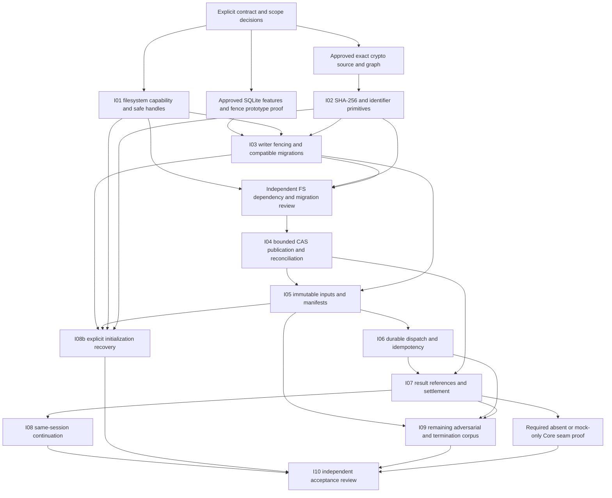

# Phase 1 Remediation — Increment 0.2: Implementation Readiness

Date: 2026-11-07. **Design and decision readiness only. Phase 1 MUST remain NOT APPROVED. Phase 2 remains unauthorized.**

## 1. Readiness decision and baseline

**Not ready to enable production recovery, content storage or in-place upgrades.** The [implementation contracts](IMPLEMENTATION_CONTRACTS.md) now specify concrete failure/ownership/transition obligations and a proposed durable writer fence. Safe Windows identity/publication, approved crypto, fence feature/prototype proof, preservation and lifecycle-consent integration remain hard blockers. A written contract does not count as implementation or runtime acceptance evidence.

This is not a new Phase 1 closure assessment. The [final rejection](PHASE1_FINAL_VERIFICATION.md), [original gap traceability](PHASE1_GAP_ANALYSIS.md), [recovery architecture](REMEDIATION_ARCHITECTURE.md) and dated [0.1 experiment results](FOUNDATIONAL_PREREQUISITE_VALIDATION.md) remain preserved. Original acceptance criteria are unchanged; OQ-25 and F-611-02 remain Open. The latter is a mandatory pre-Phase-2 production-readiness requirement, not a silently added original Phase 1 bullet.

| Actual entry | Value |
| --- | --- |
| Branch / HEAD | develop / d9cca25cedae6946555f8bda3f94c78719c9232b |
| Upstream locally recorded | origin/develop, 0 ahead / 0 behind |
| Staged / modified / untracked | 0 / 0 / 0; historical working-tree values were not assumed |
| Physical index | 287 entries; SHA-256 c54c0991cbbd363a095086986a3d9daa7ea42957f215d4ba12f8a476ebc07df3 |
| Preservation baseline | All tracked bytes, staged entries/index bytes, complete reference targets and reachable history captured in memory before edits |

Only documentation/source/cache reads and offline documentation checks ran. No runtime or security experiment, Cargo invocation, dependency resolution, network access, host configuration change or untrusted execution occurred. Prior 0.1 **23 successful named checks, 2 blocked probes and 2 failed harness executions** remain historical counts, not new passing tests.

## 2. Decision matrix and evidence boundaries

“Recommended” below means a design proposal. Only explicit later acceptance/authorization and required evidence can enable implementation. DG references are the existing gap-analysis decision gates; new D labels refine them, not original acceptance criteria.

| ID / owner | Recommended decision or formal disposition | Actual evidence | Authorization / remaining blocker |
| --- | --- | --- | --- |
| D-FS / Windows + security, DG-3/OQ-22 | Small Core-owned retained-handle filesystem boundary; unsupported profiles deny. Validate closed immutable CAS link-then-unlink as a candidate | 0.1 C: NTFS observations, stable Rust by-handle compile failure; no strong handle implementation | Safe provider/profile selection, exact APIs/dependency audit, adversarial/no-follow/alias/publication proof. No production filesystem profile is enabled |
| D-DUR / storage + security, DG-3 | Explicit ProcessCrashRecoverable profile only after integrated proof; stronger OS/power requests deny | Three process-kill observations; no OS/power/directory-durability proof | Flush/close and directory-publication error contract plus actual integrated tests |
| D-SHA / dependency + security, DG-4 | **Blocked because available evidence is insufficient** (DEP-SHA256-01) | Source-0.2 cache recount: 0 sha2 source directories and 0 archives | Exact version/graph/license/maintenance/security audit, separately authorized availability and offline tests |
| D-WF / persistence + security, DG-1/2 | Recommend admission/drain + immutable tokens + persistent all-table function/trigger fence | SQL-08 proves old version-only fencing unsafe; cached functions API exists | Explicit acceptance of this proposal, audited functions feature, complete legacy/bypass catalog, cross-process crash proof. No new fence has run |
| D-BACKUP / persistence + Windows, DG-2 | Bounded consistent source-cut snapshot before DDL; raw family before uncertain-source opens | 0.1 VACUUM INTO healthy WAL snapshot; cached backup source rejects a source pager already in write transaction | Approve/test safe backup feature and separate-reader/write-barrier topology, safe destination/preservation; never infer from VACUUM INTO alone |
| D-INIT / product + Core + security, DG-5 | Explicit operator recovery B, one CompleteFoundationInitialization action, existing broker authority | Existing fail-closed diagnosis and legal Created -> Scoped edge; no recovery implementation | ADR-0010 acceptance, provenance/manifest proof, purpose-bound action and atomic consent/lifecycle API, all crash windows |
| D-COMPAT / persistence + security, DG-2 | Preserve v1 history, legacy records and holds; reject unbound execution and incompatible writers | Current strict v1 migration and snapshot v1/v2 validation | Exact next DDL/guard catalog and legacy activation strategy; no generation defaults or destructive down-migration |
| D-ID / Core + dependency, DG-4 | Internal activation/operation identifiers, not project identity or bearer authority | Existing identifiers and cached entropy candidate; no new approval | Approved allocation/uniqueness/restore lineage; no copied-counter global anti-rollback claim |
| D-MOCK / Core + product, DG-6 | Provider absent or explicit deterministic mock-only seam | Standalone mock contract evidence, not production integration | Narrow Core contract/integration scope and tests; no real provider/network/keys |
| D-ADR / owner + architecture | Keep ADR-0008/0009/0010 Proposed; accept no decision by task wording | Current status records and design-only authorization | Explicit future acceptance does not automatically authorize dependency provisioning, implementation, Git mutation or Phase 2 |

### Evidence and cross-document reconciliation

| Prior text / potential ambiguity | Resolution in this increment |
| --- | --- |
| Earlier “retire all legacy writers” without an executable proof | Retain the invariant. Contracts WF-C01–C07 specify physical exclusion or proven durable inability to commit; locks/version checks alone do not satisfy it. The proposed guarded bootstrap is blocked until independently proved |
| Lifetime locks versus already-open pre-protocol connections | Lifetime locks address new cooperating clients; persistent guards address only inventoried legacy DML after atomic fence publication. Unknown/bypass writers require physical exclusion or migration refusal |
| “No filesystem work inside database retries” versus consistent upgrade backup | Preserve the rule. Source preservation is a bounded explicitly non-retryable maintenance phase; no backup creation or publication is repeated by a business SQL retry |
| Healthy logical snapshot versus full recovery-family preservation | Separate them. VACUUM INTO proof covers healthy committed pages only; corrupt/incomplete bootstrap recovery still preserves DB/WAL/SHM/journal/control metadata before source recovery opens |
| No-replace “promotion” versus hard-link evidence | Treat link creation and source cleanup as separate recoverable phases; no atomic-move or mutable-DB alias claim |
| “Checked close/durable” versus std Drop/process kills | Require an actual selected API/error/durability profile. Preserve OS/power limitations; do not call successful Drop or a process kill power-loss proof |
| sha2 preferred evaluation direction versus final dependency disposition | Preference remains. Formal selection/approval is Blocked with insufficient cached evidence; no version or successful build invented |
| Repeated recovery versus stale pre-recovery byte hash | Exact committed receipt lookup may return AlreadyApplied after new preservation/authorized inspection; otherwise physical drift invalidates the old plan |
| Explicit operator recovery versus current CLI | Proposed commands/actions are future design only, not shipped behavior. Current status/session remain domain-state read-only with disclosed storage side effects |
| Original final decision/criteria | Unchanged NOT APPROVED; no original recovery/input/bounds/path/process-tree criterion marked satisfied by documentation |

The minimal dated references appended to Proposed ADRs and the architecture identify these refinements. Historical verification reports, raw evidence and original seven ADRs are not rewritten.

### Source evidence inspected in Increment 0.2

- Current [connection.rs](../../crates/sentra-core/src/persistence/connection.rs) pins admission handles and uses safe std cross-process file locks; [migration.rs](../../crates/sentra-core/src/persistence/migration.rs) still supports exact v1/history and rechecks inside its transaction. These are existing mechanisms, not the proposed lifetime/persistent fence.
- Current [OperationAction](../../crates/sentra-core/src/policy/action.rs) has no initialization-recovery action, and [LocalWorkspace](../../crates/sentra-core/src/service/local_workspace.rs) has no recovery command/service. The contract requires a separately approved extension, not reinterpretation of UnknownOperation.
- Local Cargo source `rusqlite-0.32.1/Cargo.toml` declares optional functions/backup features; `src/functions.rs` exposes safe scalar registration and INNOCUOUS/DIRECTONLY/DETERMINISTIC flags. They are absent from the approved [Core manifest](../../crates/sentra-core/Cargo.toml) feature selection.
- Local cached `libsqlite3-sys-0.30.1/sqlite3/sqlite3.c`, function sqlite3_backup_step (around lines 82349–82354), explicitly returns BUSY for its source pager in a write transaction. The auxiliary read-connection topology is therefore a proposed alternative requiring runtime evidence, not a tested fix.
- Read-only enumeration of current local registry source/archive roots found no sha2 package. No registry resolver, online API documentation or maintenance/advisory service was accessed.

## 3. Dependency decision record — DEP-SHA256-01

- **Outcome: Blocked because the available evidence is insufficient.**
- Date/owners: 2026-11-07; dependency/license maintainer and security reviewer.
- Context: F-01/F-02/S-09 and ADR-0009 require verified content/manifest SHA-256, not the canonical action identifier or FNV drift value.
- Preferred next evaluation: a narrowly configured pinned sha2 implementation; this is not a production selection, addition approval or network permission.
- Alternatives: safe Windows CNG wrapper only if its OS-backed packaging advantage outweighs Windows-specific interop/provenance cost; none selected/cached. No manual crypto, weak hash or shell/Bun/.NET hashing transport.

| Requirement | Evidence available now | Required decision evidence |
| --- | --- | --- |
| Cryptographic provenance/correctness | No sha2 source/version cached, no candidate test | Exact source/checksum/release provenance and independent known-answer/streaming vectors |
| Rust edition/MSRV/toolchain | Sentra edition 2024/x64 MSVC baseline known; candidate compatibility unknown | Pin candidate/MSRV/features; offline compile/check/lint/test under exact supported Rust toolchain |
| Windows x64 | No candidate build/run | Actual Windows x64 build/run with recorded compiler/native graph |
| ARM64 | No candidate compile or execution | Separate target compile then real execution evidence; neither follows from x64 |
| Offline reproducibility | Cache source/archive counts both zero; no resolver/download attempted | Approved source plus complete pinned transitive graph available locally; locked offline build and provenance checks |
| Maintenance/security | Not assessed from unavailable source; no online advisories queried | Separately permitted maintainer/release/advisory review; do not infer safety from popularity or name |
| License/private-project suitability | No candidate manifest/license inspected | Exact package/transitive license texts and integration/distribution review; ADR-0007 remains Proposed |
| Dependency/feature tree | Unknown for unselected candidate | Minimal exact graph, default/cpu/assembly/feature analysis; no broad upgrades |
| Unsafe exposure | Unknown candidate internals | Audit source/conditional assembly/FFI and transitive build scripts. Sentra forbid(unsafe_code) alone is not dependency safety |
| Streaming/memory | Required contract, no candidate demonstration | Fixed bounded buffer and incremental updates, checked counters, partial read/I/O/cancel, no whole-file allocation |
| Serialization | Contract CR-C03 specified | Strict algorithm-tagged 32 bytes or sha256:64-lowercase-hex; malformed/truncated/algorithm-confusion rejection |

Required vectors: empty, abc, standard long-message/million-a cases from independently verified vectors, split equivalence at 0/1/63/64/65, randomized chunks, bounded large-file/counter cases, same-length mutation, incomplete data, altered canonical manifests and known I/O failures. The empty/abc constants in 0.1 remain expectations, not results. Large streamed counters and ARM64 are independent proof obligations.

Reopen this record only when exact evidence is available under explicit dependency/provisioning authorization; do not silently change it to Recommended/Approved because a package later appears in cache. No dependency or feature is added in Increment 0.2.

### Related SQLite feature decisions

Current approved manifest pins rusqlite 0.32.1 with bundled only. Cached source has functions=[] and backup=[] feature definitions and safe API surfaces. Required optional feature audit/authorization is **separate from DEP-SHA256-01**. Empty feature dependency lists are source evidence, not a successful resolved-feature build or approval. Preserve trusted_schema OFF, defensive mode, exact pinned versions and Sentra-owned forbid(unsafe_code); do not broaden to bundled-full or add runtimes/ORMs.

## 4. Dependency graph

Each box is a planned evidence/implementation slice, not an authorized increment number. Tests accompany their step; I09 is completion of remaining corpus, not permission to postpone security tests until the end.



Safe filesystem, crypto and fence-feature prototypes can be evaluated independently under their own authorization. A migration prototype on fresh synthetic data may precede full FS/crypto; **activation against operator stores cannot**. The critical implementation path is I01/I02/I03 -> reviewed I04 -> I05 -> I06 -> I07 -> I08. F-611-02's I08b is independently gated; its pre-Phase-2 readiness deadline is not changed.

## 5. Ordered implementation sequence and acceptance

Paths below are expected change locations, not files created/edited in this increment. New internal modules are proposals within sentra-core, not new crates or framework layers. Preserve v1.sql/history; add reviewed versioned migrations rather than rewriting the old schema/checksum.

### I01 — Filesystem abstraction and capability checks (PG-02, first half)

- **Preconditions/dependencies:** accepted D-FS/D-DUR, selected safe API/profile and any separately approved dependency; explicit experiment/implementation scope.
- **Expected modules:** new internal storage filesystem module; workspace/platform.rs and evidence/persistence integration only where a new content/owned-storage capability is necessary; new focused tests. Existing metadata discovery behavior stays intact.
- **Invariants:** FS-C01–C10; held identity/no-follow, protected roots, hard-link policy, same-volume no-replace, named durability, bounded owned artifacts. A boolean/path is never a capability.
- **Failure/stop:** deny unsupported identity/profile, cross-volume/alias/reparse ambiguity, synchronization failure or unknown mutation outcome; preserve evidence. Stop on unsafe FFI/new unapproved dependency/host setting requirement.
- **Acceptance/tests:** stable object across rename/replacement/restart; adversarial directory/entry swaps and hard-link aliases; known/unknown reparse rejection; retained-handle permission/sharing faults; finish/publication/cleanup kill points. Test actual selected C:/other volume independently; no generalized NTFS support claim.
- **Review:** independent Windows filesystem/security review before storage consumers are enabled.

### I02 — Approved cryptography and identifier primitives (PG-02, second half)

- **Preconditions/dependencies:** reopen DEP-SHA256-01 with exact approved offline sources/graph/license/maintenance evidence; D-ID for activation/operation uniqueness.
- **Expected modules:** exact manifests/lockfile only when separately approved; evidence/verifier.rs, minimal internal digest/ID utility, focused vector/stream tests. No manual SHA-256.
- **Invariants:** CR-C01–C04, bounded reads, canonical digest/domain separation, failure never produces verified content; IDs do not authorize.
- **Failure/stop:** unavailable cache/transitive package, unapproved feature/unsafe exposure, license or known-answer failure blocks all integrity consumers; no network workaround.
- **Acceptance/tests:** independent vectors/chunking/counters/corruption/errors, offline x64 build and actual graph audit; ARM64 compile/run statuses separate. No production usage before approval and review.

### I03 — Writer fencing and migration compatibility (PG-01)

- **Preconditions/dependencies:** accepted D-WF/D-COMPAT/D-BACKUP; approved optional features; WF-T01–T12 prototype evidence. Real-store activation also needs I01/I02/preservation and a valid legacy profile.
- **Expected modules:** persistence/connection.rs, transaction.rs, migration.rs, model.rs, error.rs and new approved migration/guard definitions; repository integration; persistence tests. Existing schema_v1.sql and original v1 history retained.
- **Invariants:** old-generation protected writes cannot commit after fence publication; lifetime cross-process admission; all-table persistent guard; atomic DDL/history/header/audit; no raw connection escape, token refresh or authorization uplift.
- **Failure/stop:** no proof for cached/old/bypass writers, trusted_schema workaround, missing guard/function, backup topology failure or unsafe source preservation means no in-place upgrade. Close/halt uncertain connections, preserve original.
- **Acceptance/tests:** every WF-T case against actual APIs and valid v1 Core sessions/grants/holds; old idle/prepared/read/write connections and post-migrator-death denial; two-process migrations; commit/rollback/ack/backup faults; exact supported old or new schema after real kills.
- **Review:** independent migration/authorization security review is required before I04 or operator-store upgrade. No fallback to version-only fencing.

### I04 — Blob storage, no-replace publication and reconciliation (PG-05)

- **Preconditions/dependencies:** I01/I02/I03 and independent reviews; accepted CAS strategy and quota/retention/pin policy.
- **Expected modules:** small evidence/blob storage and reconciliation modules, persistence blob/reference/quota repositories with approved versioned migrations; evidence/persistence tests.
- **Invariants:** bytes and SHA verified before Ready; distinct publish/source-cleanup states; pending pin survives Ready until live ref commit; all-store reference/retention/backup reachability before GC.
- **Failure/stop:** collision mismatch, lost identity, dangling reference, unknown writer or partial sync/publish/cleanup preserves/quarantines owned data and blocks dependent admission. No delete-by-age or automatic DB repair.
- **Acceptance/tests:** B1–B8 from earlier architecture; concurrent promoter/GC/reference races, real kills before/after link/unlink/Ready/ref, quota overflow/partial streams/corruption/missing data. Reconcile twice without lost committed refs/events or duplicate quota release.

### I05 — Immutable input and manifest evidence (PG-03)

- **Preconditions/dependencies:** I04 retained content plus I01/I02/I03; approved SCF-1 record schemas/vectors, bounded acquisition action separate from DiscoverMetadata.
- **Expected modules:** input/session/operation manifest models and repositories; bounded workspace acquisition/parser adapters; policy/action.rs and context/approval binding; approved migrations; input/security tests.
- **Invariants:** F-01/F-02 before planning; exact immutable bytes/scope/exclusions/operator/authorization/policy/budget; argv/path/revision/configuration included; no case/Unicode conflation or legacy-grant uplift.
- **Failure/stop:** unknown input identity, link/alias/coherence ambiguity, unsupported canonical representation/parser or unapproved content read denies; no Git/tool/build invocation.
- **Acceptance/tests:** independent canonical vectors/digest recomputation, dirty included/excluded bytes, spaces/Unicode/CRLF/collision/archive traversal fixtures, source mutation/size bounds and exact binding negatives. Unsupported archive extraction remains denied, not silently declared supported.
- **Review:** source-acquisition/privacy/authorization review before any task consumes these manifests.

### I06 — Durable dispatch lifecycle and idempotency (PG-04)

- **Preconditions/dependencies:** I05/current policy/context, I03 fences and accepted attempt/receiver capability contract.
- **Expected modules:** service/core.rs, execution request/attempt models and private release capabilities, persistence task/intent repositories/approved migration, policy and dispatch tests.
- **Invariants:** allocate durable operation/attempt before release; one admission transaction for policy/context/approval/reservation/intent/audits; release revalidation and retained lifecycle guard; all operations including no-approval paths have idempotency keys.
- **Failure/stop:** ambiguous post-release outcome -> Uncertain/full hold/no automatic effect retry. No dedup/query/non-start proof means no redelivery. Backend scope remains synthetic/fail-closed for untrusted workloads.
- **Acceptance/tests:** D1–D8 and every release/call/ack/result kill boundary, concurrent duplicates, stale context/policy/revision/manifest, exact A-to-B negatives, rollback on each audit/transition fault and observed controlled effect count. Fencing is not exactly-once execution.
- **Provider boundary:** if DG-6 requires Core coordinator integration, only absent/explicit deterministic mock, current policy/budget and NotConfigured behavior; no real transport or mandatory AI.

### I07 — Persistent results, references and budget settlement (PG-06)

- **Preconditions/dependencies:** I04/I05/I06 and accepted original-issued versus current recovery authority semantics.
- **Expected modules:** result repository/models, service/core.rs and typed errors, evidence admission, persistence/reference/settlement repositories and approved migration; result/budget security tests.
- **Invariants:** result/session/attempt/input/manifest/producer correlation; one terminal result/reference conversion/outcome/typed settlement/audit transaction. Exact duplicate no-op, conflict preserved/denied.
- **Failure/stop:** missing content/provenance, cross-session result, stale producer, unrepresented outcome or persistence failure retains conservative hold; original primary and typed secondary preserved, no unknown usage = zero.
- **Acceptance/tests:** R1–R7 real result/pin/ref/settlement/commit/ack kills, replay/conflict/cross-session cases, actual/unknown/cancel uncertainty and budget overrun/overflow; lookup after restart without backend re-execution.
- **Review:** independent result/settlement/provenance review, including exceptional error-handling branches.

### I08 — Persistent same-session continuation (PG-07)

- **Preconditions/dependencies:** I03/I05/I06/I07, accepted epoch/owner/resume state contract and explicit continuation policy.
- **Expected modules:** service lifecycle/continuation coordinator, persistence task/session/recovery records, session/approval integration and only separately approved client surface.
- **Invariants:** same SessionId/project alias, terminal immutability; only Scoped/Planned/Running execute; owner/context/policy/input revalidation and epoch advance; consumed grants remain consumed, uncertain work held.
- **Failure/stop:** incomplete/corrupt/legacy-unbound/uncertain state blocks continuation; no automatic resume, approval recreation, second session or completed-operation replay.
- **Acceptance/tests:** S1–S7 reopen/owner/context/expiry/concurrent resume/commit kills; two-task synthetic plan continues only unstarted eligible work; recorded decision replay performs zero effects and zero extra settlement/audits.

### I08b — Explicit operator initialization recovery (PG-08 / F-611-02)

- **Preconditions/dependencies:** explicit ADR-0010/D-INIT acceptance, I01/I02/I03/I05, reviewed maintenance action and RC-C06 broker/repository unit. Not a prerequisite to invent multi-session support.
- **Expected modules:** service/local_workspace.rs plus focused recovery coordinator/plan model; existing policy/action/approval and persistence recovery receipt; approved migration. Only then separately authorized CLI storage recovery commands and tests.
- **Invariants:** RC-C01–C09, same Created -> Scoped transition, source-family preservation and exact consent, one-use SQL consumption/lifecycle/epoch/audit, receipts dominate lost acknowledgement.
- **Failure/stop:** unproven ownership/provenance, missing session/immutable input, unknown schema, stale plan, failed preservation, absent trusted authority or uncertainty blocks without delete/reset/replace. No raw SQL repair or --force path.
- **Acceptance/tests:** RC-T01–T09 including four bootstrap windows, interleaved status/checkpoint plan invalidation, interrupted apply and after-commit/cache-finalization loss; one identity/one outcome and classified typed diagnostics.
- **Review:** independent lifecycle/consent/Windows recovery review before closing F-611-02, required before Phase 2 production readiness.

### I09 — Remaining adversarial, quota and termination evidence (PG-09)

- **Preconditions/dependencies:** boundary-specific preceding steps and separately authorized owned-fixture environment; no host configuration change or untrusted execution.
- **Expected modules/artifacts:** affected existing core/CLI integration tests, controlled path/archive/dirty-input/quota fixtures and owned platform-spike process-tree harness; validators/raw evidence only in separately authorized scope.
- **Invariants:** original RM-2/RM-4/Q-05 criteria unchanged; actual task/output/storage bounds, complete parent/child/grandchild cancellation evidence, no target tools or host/Docker/WSL2 production fallback.
- **Failure/stop:** unavailable platform/permissions or missing tree termination remains Blocked/Not Tested, not Passed. No arbitrary sleeps, ignored security cases counted as passing, or tests weakened.
- **Acceptance/tests:** deterministic readiness barriers, actual owned-process termination, hostile boundary/partial stream/exhaustion/counter fixtures, repeated recovery and performance results where affected; uniqueness accounting separates runtime/doctest/platform/helper/repeated records.

### I10 — Independent security review and unchanged-criteria assessment

- **Preconditions/dependencies:** all applicable implementation/review gates above, preserved raw evidence and explicit disposition of remaining open requirements.
- **Expected artifacts:** new independent review/traceability reports and narrow progress references; do not rewrite earlier rejections.
- **Invariants:** reviewers inspect actual source/call paths/transactions/assertions; retain no-approval/policy/BLP/session/approval/rollback/WAL/workspace/evidence/error regressions and fail-closed execution.
- **Failure/stop:** any unresolved material boundary or missing original acceptance proof retains NOT APPROVED; documentation/test totals alone cannot close it.
- **Acceptance/tests:** appropriate offline build/lint/runtime/security/validators after implementation, real crash evidence, non-overlapping inventory and unchanged-criteria matrix. Phase 1 closure requires a separate instruction; even successful closure would not authorize Phase 2.

## 6. Explicit blockers and unsupported claims

| Blocker | Required owner/evidence before enabling dependent work |
| --- | --- |
| B-01 safe filesystem provider/profile | D-FS/D-DUR; held identity and same-object mutation, alias treatment, error/durability protocol and actual adversarial Windows proof |
| B-02 offline crypto | DEP-SHA256-01; exact evidence/provisioning permission then package approval and tests, no download in this task |
| B-03 durable legacy fence | D-WF; feature audit, complete guard coverage/legacy catalog/cached statement/crash behavior under trusted_schema OFF and independent review |
| B-04 preserved migration source cut | D-BACKUP; safe destination plus separate reader/write-barrier topology, interruption/collision evidence and legacy activation rules |
| B-05 recovery consent/identity | D-INIT/D-ID; broker-purpose API and atomic SQL consumption/lifecycle/cache crash proof, no caller flags or invented missing input/session |
| B-06 exact schema/canonical compatibility | D-COMPAT; reviewed DDL/guard/manifest schemas and vectors without rewriting v1 or uplifting grants |
| B-07 integrated acceptance proof | All original recovery/input/bounds/path/cancellation requirements actually implemented/tested and independently assessed |

No production profile is claimed for ReFS, network/removable/cross-volume storage, OS/power failure, ARM64, real providers, dedicated VM supervision/cancellation, streaming evidence, administrator-resistant tamper protection, multi-session projects or exactly-once external effects. Their absence is explicit; no unsupported execution backend is enabled to bypass a gate.

F-611-02 and OQ-25 remain Open at their existing deadlines. Phase 1 remains NOT APPROVED. No implementation sequence here grants dependency, host, Git or Phase 2 authorization.

## 7. Verification and repository preservation

### Permitted work and exact checks

Only two new Markdown documents, dated Proposed-ADR/architecture cross-references and a narrow PROGRESS reference are retained. No historical validation result is changed.

Read-only in-memory Bun scripts check every repository Markdown file's local links, heading anchors and balanced fences; verify the three Proposed status strings and new reciprocal references; and compare final Git/reference/history/index/file-hash snapshots against entry. No script file, experiment, dependency or build artifact is created for those checks.

Whitespace command:

```powershell
$env:GIT_OPTIONAL_LOCKS = '0'
git --no-optional-locks -c core.safecrlf=false diff --check
```

Bun runs as `bun --no-env-file --no-install run -` on an in-memory PowerShell here-string. Git inspection uses --no-optional-locks. No Cargo fmt/check/clippy/test, runtime, security, fence or recovery test ran here; all new test IDs are planned only.

### Final check record

- **Passed — documentation:** final read-only check of 70 Markdown files, 635 local links, 112 heading anchors, balanced fences, three Proposed status records, reciprocal contract/readiness references, explicit NOT APPROVED statements and the Blocked dependency outcome; zero errors, exit 0. An initial new-document trailing-space error was corrected and the check rerun successfully. Mermaid diagrams were source-reviewed, not rendered by a downloaded/installed tool.
- **Passed — whitespace:** `git --no-optional-locks -c core.safecrlf=false diff --check`, exit 0. Existing tracked edits are additions only: 2 lines in PROGRESS, 4 in each of the three Proposed ADRs and 2 in the architecture. Historical text/results were not removed or rewritten.
- **Passed — Git preservation:** develop, HEAD `d9cca25cedae6946555f8bda3f94c78719c9232b`, local origin/develop 0 ahead / 0 behind. Complete reference targets, reachable history and staged entries match entry. Physical index SHA-256 remains `c54c0991cbbd363a095086986a3d9daa7ea42957f215d4ba12f8a476ebc07df3`, 287 entries, 0 staged files. No index/history/reference restoration or mutation occurred.
- **Passed — scope preservation:** 282 other tracked-file byte hashes match entry, including all production code/tests/schemas/manifests/lockfiles/configuration, original seven ADRs, original requirements/criteria and historical verification/raw evidence. No temporary experiment/build artifact or dependency was created.
- **Final worktree:** 5 modified files (PROGRESS, ADR-0008/0009/0010 and REMEDIATION_ARCHITECTURE), 2 untracked files (IMPLEMENTATION_CONTRACTS and IMPLEMENTATION_READINESS), 0 staged files. All retained changes are documentation.
- **Not Tested / Blocked:** all proposed filesystem-provider, persistent-fence, optional-feature, backup-topology, recovery-consent and integration/security runtime properties. No Cargo suite, runtime/security test, experiment, network operation or target workload ran in this increment. The 0.1 counts remain historical evidence only.

**Phase 1 remains NOT APPROVED; ADR-0008/0009/0010 remain Proposed. F-611-02 and OQ-25 remain Open. No remediation implementation, closure attempt, Phase 2 or untrusted execution was started. Stop after Increment 0.2.**

