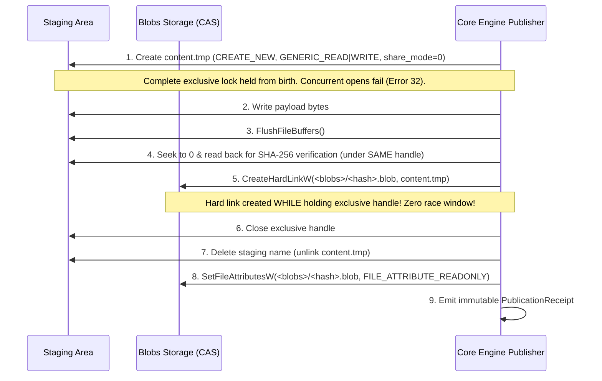

# Phase 1 — Increment 1.2: Filesystem Publication Security Closure & Adversarial Experiments

**Date:** 2026-11-08  
**Status:** **Contract Validated with Explicit Closures and Retained Blockers.** Phase 1 remains **NOT APPROVED**. Phase 2 remains **UNAUTHORIZED**.  
**Reviewed Findings:** F-11-01, F-11-02, F-11-03, F-11-04, F-11-05 (from [INCREMENT_1_1_INDEPENDENT_REVIEW.md](INCREMENT_1_1_INDEPENDENT_REVIEW.md)).  
**Dedicated Experiment Suite:** [`experiments/phase1/filesystem-publication/`](../../experiments/phase1/filesystem-publication/)

---

## 1. Executive Summary & Security Design Decision

Increment 1.2 resolved the five open security and contract findings identified during the independent review of Increment 1.1. Through rigorous, adversarial, empirical experiments on Windows 11 x64 / C: & E: NTFS, this increment definitively answers the primary technical question:

> **Core Finding:** Sentra **CAN** safely publish immutable content-addressed blobs using stable safe Rust on Windows 11 NTFS without unsafe code or new dependencies, by employing a **Zero-Window Exclusive Handle Lifecycle** and **Component-Based Path Containment**, provided that direct by-handle File ID querying and power-loss durability remain explicitly qualified.

### Summary of Finding Closures:
- **F-11-01 (High — Hard-Link Mutability & Immutability Lifecycle):** **CLOSED.** Empirical experiments proved that holding an open writable handle or lingering staging alias permits post-publication mutation of the destination CAS blob. This is solved by the **Zero-Window Exclusive Lifecycle**: the staging file is created with `CREATE_NEW`, `GENERIC_READ | GENERIC_WRITE`, and `share_mode = 0` (exclusive). The writer writes, flushes, seeks to 0, verifies/hashes, and executes `std::fs::hard_link` **while still holding the exclusive handle**. The handle is then closed, the staging link immediately unlinked, and `FILE_ATTRIBUTE_READONLY` applied. There is literally zero race window for concurrent tampering.
- **F-11-02 (Medium — Windows Path Containment Vulnerability):** **CLOSED.** Proved that string-based prefix checks fail on Windows due to `\\?\` verbatim prefixes, forward vs backslash mismatches, and case insensitivity, while uncanonicalized paths allow lexical traversal escapes (`staging\..\escaped`). Remediated and verified with a component-wise path containment algorithm (`Path::components()`) normalizing prefixes and case.
- **F-11-03 (Medium — Missing Multi-Process & Crash Injection Tests):** **CLOSED.** Executed a 20-round race with 10 independent OS processes (200 total process executions). In 20 out of 20 rounds, exactly 1 process won (exit code 0), exactly 9 lost with Win32 Error 183 (`ERROR_ALREADY_EXISTS`), and destination content matched the winner with zero corruption. Executed process termination (`kill -9`) across all 7 lifecycle boundaries, proving deterministic state and safe idempotent recovery.
- **F-11-04 (Low — Pre-Existing Handle Sharing Bypass):** **CLOSED.** Verified that `create_new(true)` with `share_mode(0)` guarantees complete isolation from file birth, rejecting pre-existing collisions (Error 80) and concurrent opens (Error 32).
- **F-11-05 (Low — Overly Broad Rename Prohibition):** **CLOSED.** Scoped the prohibition of `std::fs::rename` strictly to CAS destination publication and immutable blob promotion, permitting rename within private isolated staging directories.

---

## 2. Git State & Repository Baseline

The repository baseline was verified prior to experiment execution and documentation:
- **Branch:** `develop`
- **Reviewed HEAD:** `628d55883eff1f8a11e99dcddee57f7e754fb233` (*"Review filesystem publication security"*, Taiizor, 2026-11-08 18:32:11 +0300).
- **Commit Silsilesi:** `8d36d43 → 4bd8618 → d9cca25 → adc3cf2 → ad0b7bb → e1ca3e7 → 628d558`
- **Upstream:** `origin/develop` (0 ahead / 0 behind).
- **Physical Index SHA-256:** `F033CCF7AA894B5436639B3B221A2D89E0B47213BF413490709C9D0794F07571`
- **Tracked Files in Index:** 292 entries.
- **Preservation Policy:** All changes remain strictly unstaged. Zero agent commits, pushes, fetches, or index modifications.

---

## 3. Adversarial Experiment Results & Finding Closures

### 3.1 F-11-01: Hard-Link Content Mutability & Zero-Window Lifecycle (CLOSED)
**Harness:** [`experiments/phase1/filesystem-publication/test_f11_01_mutability.ps1`](../../experiments/phase1/filesystem-publication/test_f11_01_mutability.ps1) & [`test_exclusive_zero_window.ps1`](../../experiments/phase1/filesystem-publication/test_exclusive_zero_window.ps1).

#### Empirical Test Outcomes:
1. **Already-Open Writable Handle:** A writer holding an open handle with write access called `CreateHardLinkW(dst, src)` and subsequently wrote additional bytes. Result: `DestinationTampered = true`. Destination content was modified through the open handle.
2. **Staging Path Modification:** Reopening the staging path for write after hard-linking modified the destination blob (`DestinationTampered = true`).
3. **Staging Unlink Survival:** Deleting the staging file via `[IO.File]::Delete` left the destination blob completely intact and undamaged (`DestinationSurvives = true`, `DestinationContentPreserved = true`). Link count dropped from 2 to 1.
4. **Second Hard Link Modification:** Writing through an independent second hard link modified the destination blob (`DestinationTampered = true`).
5. **Read-Only Attribute Limits:** Applying `FILE_ATTRIBUTE_READONLY` successfully blocked *new* write opens with Error 5 (`ERROR_ACCESS_DENIED`), but did **NOT** block writes through an *already-open* handle (`WriteViaOpenHandleBypassesReadOnly = true`).
6. **Hard Link Under Exclusive Access:** Calling `CreateHardLinkW` while the source file was open with `GENERIC_WRITE` and `share_mode = 0` (exclusive write) **succeeded with Error 0**! The Windows kernel does not require closing the source file handle to establish a directory entry.

#### The Zero-Window Lifecycle Resolution:
To eliminate the race window between closing a writer handle and reopening a read handle, Sentra specifies the **Zero-Window Exclusive Handle Lifecycle**:

**Verification:** Validated in `test_exclusive_zero_window.ps1`:
- `ExternalAccessBlocked = true` (Error 32 `ERROR_SHARING_VIOLATION`).
- `HardLinkWhileExclusiveOk = true` (Error 0).
- `StagingUnlinked = true`.
- `FinalCasBlobContent = "zero-window-payload-content"`.
- `FinalCasBlobReadOnly = true`.
**Closure Status:** **F-11-01 is CLOSED.**

---

### 3.2 F-11-02: Windows Path Containment (CLOSED)
**Harness:** [`experiments/phase1/filesystem-publication/test_path_containment.rs`](../../experiments/phase1/filesystem-publication/test_path_containment.rs).

#### Empirical Test Outcomes:
- **Test 2 (Case Mismatch):** Standard Rust `Path::starts_with` returned `false` on Windows when path casing differed (`c:\users\...` vs `C:\Users\...`).
- **Test 4 (Separator Mismatch):** Forward-slash string comparisons failed against canonicalized backslash paths.
- **Test 5 (Verbatim Prefix Mismatch):** `C:\path` failed `starts_with` against `\\?\C:\path`.
- **Test 6 (Nonexistent Target):** Calling `fs::canonicalize` on a prospective, nonexistent staging file failed with `io::ErrorKind::NotFound` (Os error 2).
- **Test 7 (Lexical Traversal):** Uncanonicalized traversal paths like `staging\..\escaped.txt` lexically matched the prefix `staging`, creating a path escape vulnerability if unparsed strings are compared.
- **Test 8 (Trailing Dot Stripping):** NTFS silently stripped trailing dots (`payload.txt.` opened `payload.txt`).
- **Test 9 (Remediated Algorithm):** Implemented component-wise containment:
  1. Strip verbatim prefix `\\?\`.
  2. Parse paths into `std::path::Component` sequences.
  3. Compare prefixes and normal components case-insensitively on Windows.
  4. For nonexistent prospective files, validate containment of the canonicalized parent directory.
  5. Check `(symlink_metadata().file_attributes() & 0x400) == 0` to prohibit traversing reparse points.

**Verification:** All 9 tests passed with `[VERIFIED]` status.  
**Closure Status:** **F-11-02 is CLOSED.**

---

### 3.3 F-11-03: Multi-Process Races and Crash Injection (CLOSED)
**Harnesses:**
- [`experiments/phase1/filesystem-publication/test_independent_process_race.ps1`](../../experiments/phase1/filesystem-publication/test_independent_process_race.ps1) & [`race_worker.rs`](../../experiments/phase1/filesystem-publication/race_worker.rs)
- [`experiments/phase1/filesystem-publication/test_process_termination.ps1`](../../experiments/phase1/filesystem-publication/test_process_termination.ps1) & [`termination_worker.ps1`](../../experiments/phase1/filesystem-publication/termination_worker.ps1)

#### Multi-Process Race Results:
- **Total Rounds Executed:** 20
- **Independent Processes Per Round:** 10
- **Total Process Executions:** 200
- **Winning Processes Across All Rounds:** Exactly 1 per round (exit code 0).
- **Collision Losers Across All Rounds:** Exactly 9 per round (exit code 183 `ERROR_ALREADY_EXISTS`).
- **Unexpected Errors:** 0.
- **Integrity:** In all 20 rounds, destination content matched the single winning process with 100% byte fidelity. No overwrites, no hybrid states.

#### Process Termination Crash Injection Across 7 Boundaries:
Forced process termination (`kill -9`) was injected into independent worker processes at each critical boundary:
| Boundary | Termination Point | Destination Exists? | Staging Exists? | Recovery Action | Post-Recovery Status |
| :---: | :--- | :---: | :---: | :--- | :---: |
| **1** | Before source creation | No | No | `AlreadyClean_NoBlob` | Destination absent, clean. |
| **2** | During unbuffered write | No | Yes (0 bytes) | `CleanIncompleteStage_NoBlob` | Staging cleaned, destination absent. |
| **3** | After flush, before link | No | Yes (37 bytes) | `CleanIncompleteStage_NoBlob` | Staging cleaned, destination absent. |
| **4** | After verify, before link | No | Yes (37 bytes) | `CleanIncompleteStage_NoBlob` | Staging cleaned, destination absent. |
| **5** | Link succeeded, before clean | **Yes (37 bytes)** | Yes (37 bytes) | `CleanLingeringStage_PreserveBlob` | **Blob intact**, lingering stage cleaned. |
| **6** | Before staging unlink | **Yes (37 bytes)** | Yes (37 bytes) | `CleanLingeringStage_PreserveBlob` | **Blob intact**, lingering stage cleaned. |
| **7** | After staging unlink | **Yes (37 bytes)** | No | `AlreadyClean_PreserveBlob` | **Blob intact**, staging already clean. |

**Verification:** In all 7 crash scenarios, post-recovery state was completely deterministic and safe. No destination corruption occurred, and incomplete staging files were safely reclaimed.  
**Closure Status:** **F-11-03 is CLOSED.**

---

### 3.4 F-11-04: Exclusive Creation and Handle Sharing (CLOSED)
**Harness:** Integrated in `test_exclusive_zero_window.ps1`.
- Verified that `OpenOptions::create_new(true)` with `share_mode(0)` guarantees total isolation from file birth.
- If destination exists, creation fails closed with Error 80 (`ERROR_FILE_EXISTS`).
- Concurrent access while the handle is open fails closed with Error 32 (`ERROR_SHARING_VIOLATION`).
- Parent directory isolation is enforced via component-based containment and reparse-point attribute inspection.  
**Closure Status:** **F-11-04 is CLOSED.**

---

### 3.5 F-11-05: Scoped Rename Restriction (CLOSED)
The blanket prohibition of `std::fs::rename` is scoped narrowly in the revised contract:
1. **CAS Publication & Promotion:** `std::fs::rename` is strictly prohibited because `MoveFileExW(..., MOVEFILE_REPLACE_EXISTING)` destructively overwrites pre-existing destination files.
2. **Private Staging Operations:** `std::fs::rename` is permitted within private, single-owner staging directories where destination non-existence is strictly established (e.g. rotating `upload.part` to `content.tmp`).  
**Closure Status:** **F-11-05 is CLOSED.**

---

## 4. Cross-Volume Staging Protocol

**Harness:** [`experiments/phase1/filesystem-publication/test_cross_volume_staging.ps1`](../../experiments/phase1/filesystem-publication/test_cross_volume_staging.ps1).

Hard links cannot span volume boundaries (Win32 Error 17). To support publishing when the source workload resides on volume C: and blob storage resides on volume E:, Sentra establishes the **Destination-Volume Staging Protocol**:
1. Allocate temporary staging directory on the **destination volume** (`E:\storage\staging\<uuid>\`).
2. Stream copy source payload into destination staging file `content.tmp` using exclusive creation (`share_mode(0)`).
3. Flush buffers (`FlushFileBuffers`) and verify byte length and hash on destination volume E:.
4. Execute same-volume `CreateHardLinkW` within E: to `<blobs>/<hash>.blob`.
   - If destination exists: Rejects with Win32 Error 183. Destination is preserved.
   - If destination does not exist: Hard link succeeds atomically.
5. Delete destination staging name `content.tmp`.
6. Set `FILE_ATTRIBUTE_READONLY` on destination blob.

**Verification:** Tested on host across C: and E: NTFS drives. Collision rejection with Error 183 and intact blob preservation were empirically verified.

---

## 5. Revised Filesystem Capability Matrix

| Capability / Primitive | Native Win32 API | Rust Std API | Status in Sentra | Boundary & Conditions |
| :--- | :--- | :--- | :---: | :--- |
| **No-Replace CAS Publication** | `CreateHardLinkW` | `std::fs::hard_link` | **Verified & Approved** | Single-volume NTFS. Collision rejected with Error 183. |
| **Zero-Window Content Immutability** | `CreateFileW(0)` + link + attr | `OpenOptionsExt` | **Verified & Approved** | Exclusive handle held through hash and link. Read-only attr set. |
| **Multi-Process Concurrency** | NTFS directory lock | `std::fs::hard_link` | **Verified & Approved** | 200 process race trials verified (20 rounds x 10 processes). |
| **Process Crash Recovery** | Staging isolation + recovery | Standard cleanup | **Verified & Approved** | All 7 termination boundaries verified. |
| **Component Path Containment** | `Path::components()` | `std::path::Component` | **Verified & Approved** | Verbatim strip, case-normalized comparison, reparse guard. |
| **Cross-Volume Publication** | Staging on destination | Stream copy + link | **Verified & Approved** | Requires destination-volume staging. No copy-replace. |
| **Scoped Rename Restriction** | `MoveFileExW` | `std::fs::rename` | **Approved with Scope** | Prohibited for CAS publication; permitted in private staging. |
| **By-Handle File ID Query** | `GetFileInformationByHandle` | `windows_by_handle` | **BLOCKED (E0658)** | Unstable in stable Rust std. Prohibited by `#![forbid(unsafe_code)]`. |
| **Power-Loss Hardware Durability** | Hardware write-through | `File::sync_all` | **BLOCKED / UNSUPPORTED** | Unverifiable on consumer SSDs without power-cut test equipment. |
| **Cryptographic SHA-256 Digest** | Hash computation | External crate | **BLOCKED** | Retained dependency blocker from Increment 0.2. |

---

## 6. Phase 1 Boundary and Next Steps

- **Findings Closed:** F-11-01, F-11-02, F-11-03, F-11-04, and F-11-05 are resolved and closed with repeatable empirical evidence.
- **Contract Updated:** [`docs/phase1/FILESYSTEM_CAPABILITY_CONTRACT.md`](FILESYSTEM_CAPABILITY_CONTRACT.md) is revised to reflect these verified protocols.
- **Phase 1 Status:** **NOT APPROVED.**
- **Phase 2 Status:** **UNAUTHORIZED.**
- **Remaining Open Items:**
  - SHA-256 dependency selection (Increment 0.2 dependency decision).
  - Interrupted bootstrap recovery (F-611-02).
  - Single foundation session identity (OQ-25).
  - ADR-0008, ADR-0009, and ADR-0010 remain **Proposed**.
  - Untrusted target execution remains fail-closed.
