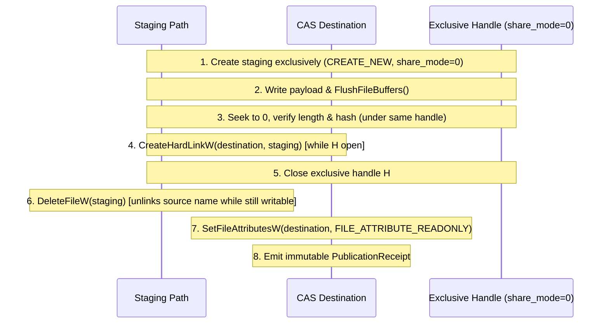

# Phase 1 — Increment 1.4: F-13-01 Remediation Validation & Threat-Model Contract

**Date:** 2026-11-08  
**Status:** **Validation & Threat-Model Contract Complete.** Phase 1 remains **NOT APPROVED**. Phase 2 remains **UNAUTHORIZED**.  
**Reviewed Findings:** F-13-01, F-13-02, F-13-03, F-13-04 (from [INCREMENT_1_3_INDEPENDENT_REVIEW.md](INCREMENT_1_3_INDEPENDENT_REVIEW.md)).  
**Dedicated Experiment Suite:** [`experiments/phase1/filesystem-publication/`](../../experiments/phase1/filesystem-publication/)

---

## 1. Executive Summary & Design Conclusions

Increment 1.4 resolved the technical and threat-model uncertainties identified during the Increment 1.3 independent review through targeted, reproducible Win32 API experiments on Windows 11 x64 / C: NTFS.

### Core Architectural Conclusions:
1. **Approach A (`SetFileAttributesW`) vs Approach B (`SetFileInformationByHandle`):** Both approaches were experimentally validated. Both APIs succeed in setting `FILE_ATTRIBUTE_READONLY` while an exclusive handle (`share_mode = 0`) is held. Approach B operates strictly by handle and avoids path-resolution overhead, but requires `FILE_WRITE_ATTRIBUTES` access (which is included in `GENERIC_WRITE`).
2. **The Handle-Revocation Invariant:** Both approaches conclusively proved that in the Windows kernel, **write access permissions are evaluated strictly at handle creation time**. Applying `FILE_ATTRIBUTE_READONLY` to a file does **NOT** revoke or invalidate an already-open writable handle (`WriteThroughOriginalHandleAfterReadOnly: true`). Any process holding an open write handle can continue modifying the file even after it is marked read-only.
3. **The Unlink-ReadOnly Conflict (NTFS Constraint):** Windows NTFS strictly prohibits deleting any file link that has `FILE_ATTRIBUTE_READONLY` set (`DeleteFileW` fails with Win32 Error 5 `ERROR_ACCESS_DENIED`). Because hard links share the underlying MFT record, marking the destination blob read-only *before* unlinking the staging link makes it impossible to delete the staging link without clearing the read-only attribute or holding `FILE_SHARE_DELETE`.
4. **Threat-Model Formalization (F-13-02 Resolution):** `FILE_ATTRIBUTE_READONLY` is an advisory DOS file attribute, **NOT an access control boundary (ACL/ACE)**. Adversarial process testing demonstrated that an unprivileged process running under the same user token can invoke `SetFileAttributesW(path, FILE_ATTRIBUTE_NORMAL)` without administrative elevation and immediately acquire write access (`WriteAccessAcquiredAfterHostileClear: true`). Consequently, **true WORM immutability against an active hostile process in the same user session is unsupported on Windows NTFS without out-of-process credential boundaries (e.g. a dedicated Windows Service account)**.
5. **Trusted Staging Directory Boundary (F-13-03 Resolution):** Lexical path containment (`Path::components()`) protects against path traversal, but cannot prevent TOCTOU reparse-point substitution if an adversary can modify parent directories. The staging root must reside within a private, access-controlled directory non-writable by untrusted actors.
6. **Cryptographic Integrity Gate (F-13-04):** Byte-length verification is insufficient for production cross-volume staging. The SHA-256 dependency blocker is retained as a mandatory prerequisite.

---

## 2. Git State & Repository Baseline

The repository baseline was verified prior to experiment execution and documentation:
- **Branch:** `develop`
- **Reviewed HEAD:** `6cc0dbd4b3a2b71b58a5e5d260c2d763760b113f` (*"Review filesystem security closure"*, Taiizor, 2026-11-08 18:47:10 +0300).
- **Commit Ancestry:** `8d36d43 → 4bd8618 → d9cca25 → adc3cf2 → ad0b7bb → e1ca3e7 → 628d558 → 13ee13b → 6cc0dbd`
- **Upstream:** `origin/develop` (0 ahead / 0 behind).
- **Physical Index SHA-256:** `01F45697A8214BF53375A6111B774D1862EF9861FC875F86FBBB153FC11ACAC4`
- **Index Tracked Entries:** 302.
- **Preservation Policy:** All changes remain strictly unstaged in the working tree. Zero agent Git mutations.

---

## 3. Empirical Experiments and Windows API Validation

### 3.1 Approach A: `SetFileAttributesW` While Exclusive Handle is Open
**Harness:** [`experiments/phase1/filesystem-publication/test_f13_01_approach_a.ps1`](../../experiments/phase1/filesystem-publication/test_f13_01_approach_a.ps1)

#### Test Procedure:
1. Staging file created via `CreateFileW` with `CREATE_NEW`, `GENERIC_READ | GENERIC_WRITE`, and `share_mode = 0` (exclusive).
2. Payload written and flushed via `FlushFileBuffers`.
3. Destination hard link created via `CreateHardLinkW` while exclusive handle is held.
4. `SetFileAttributesW(casBlob, FILE_ATTRIBUTE_READONLY)` called while exclusive handle is held.
5. Attempted write through the original handle.
6. Closed the exclusive handle.
7. Attempted new writable opens on staging and destination paths.

#### Empirical Results:
```json
{
  "ApproachA_SetFileAttributesW": {
    "OpenExclusiveSuccess": true,
    "OpenExclusiveError": 0,
    "WriteInitialSuccess": true,
    "FlushSuccess": true,
    "HardLinkWhileOpenSuccess": true,
    "HardLinkError": 0,
    "SetAttrOnDstWhileOpenSuccess": true,
    "SetAttrOnDstError": 0,
    "SetAttrOnSrcWhileOpenSuccess": true,
    "SetAttrOnSrcError": 0,
    "WriteThroughOriginalHandleAfterReadOnly": true,
    "WriteThroughOriginalHandleError": 0,
    "NewWritableOpenOnStageBlocked": true,
    "NewWritableOpenOnStageError": 5,
    "NewWritableOpenOnDstBlocked": true,
    "NewWritableOpenOnDstError": 5,
    "StageAttributes": "ReadOnly, Archive",
    "DestinationAttributes": "ReadOnly, Archive",
    "BothLinksShareReadOnly": true
  }
}
```
**Finding:** `SetFileAttributesW` succeeds with Error 0 while the exclusive handle is open. New write opens are blocked with Win32 Error 5 (`ERROR_ACCESS_DENIED`). However, the original handle can still write without error (`WriteThroughOriginalHandleAfterReadOnly = true`).

---

### 3.2 Approach B: `SetFileInformationByHandle` with `FileBasicInfo`
**Harness:** [`experiments/phase1/filesystem-publication/test_f13_01_approach_b.ps1`](../../experiments/phase1/filesystem-publication/test_f13_01_approach_b.ps1)

#### Test Procedure:
1. Staging file opened exclusively (`CREATE_NEW`, `GENERIC_READ | GENERIC_WRITE`, `share_mode = 0`).
2. Payload written and flushed.
3. Destination hard link created via `CreateHardLinkW` while exclusive handle is held.
4. `SetFileInformationByHandle(hExclusive, FileBasicInfo, ...)` called with `FileAttributes = FILE_ATTRIBUTE_READONLY`.
5. Attempted write through the original handle.
6. Closed the exclusive handle.
7. Attempted new writable opens on destination and staging paths.

#### Empirical Results:
```json
{
  "ApproachB_SetFileInformationByHandle": {
    "OpenExclusiveSuccess": true,
    "OpenExclusiveError": 0,
    "WriteInitialSuccess": true,
    "FlushSuccess": true,
    "HardLinkWhileOpenSuccess": true,
    "HardLinkError": 0,
    "SetInfoByHandleSuccess": true,
    "SetInfoByHandleError": 0,
    "WriteThroughOriginalHandleAfterSetInfo": true,
    "WriteThroughOriginalHandleError": 0,
    "NewWritableOpenOnDstBlocked": true,
    "NewWritableOpenOnDstError": 5,
    "NewWritableOpenOnStageBlocked": true,
    "NewWritableOpenOnStageError": 5,
    "StageAttributes": "ReadOnly, Archive",
    "DestinationAttributes": "ReadOnly, Archive",
    "BothLinksReflectReadOnly": true
  }
}
```
**Finding:** Approach B succeeds cleanly by handle without requiring a path lookup (`SetInfoByHandleSuccess = true`). It produces the exact same MFT attribute update as Approach A. Both links immediately reflect `ReadOnly, Archive`.

---

### 3.3 Approach C: Adversarial Independent Process Synchronization
**Harnesses:**
- [`experiments/phase1/filesystem-publication/test_f13_01_approach_c_adversarial.ps1`](../../experiments/phase1/filesystem-publication/test_f13_01_approach_c_adversarial.ps1) (Publisher Controller)
- [`experiments/phase1/filesystem-publication/f13_01_adversary_worker.ps1`](../../experiments/phase1/filesystem-publication/f13_01_adversary_worker.ps1) (Adversary Worker)

#### Test Procedure:
Using named .NET `EventWaitHandle` synchronization objects (`LinkedHeld`, `AttackedHeld`, `Closed`):
1. Publisher creates staging file exclusively, writes payload, flushes, and hard-links to destination.
2. Publisher signals `LinkedHeld` (handle is still open, destination link exists).
3. Adversary process attempts:
   - Writable open on destination: Blocked with Win32 Error 32 (`ERROR_SHARING_VIOLATION`).
   - Writable open on staging path: Blocked with Win32 Error 32 (`ERROR_SHARING_VIOLATION`).
   - Changing attributes: Permitted (Win32 allows setting attributes without write access).
4. Adversary signals `AttackedHeld`.
5. Publisher closes exclusive handle, unlinks staging path, and applies `FILE_ATTRIBUTE_READONLY` to destination.
6. Publisher signals `Closed`.
7. Adversary attempts:
   - Writable open on destination: Blocked with Win32 Error 5 (`ERROR_ACCESS_DENIED`).
   - Hostile unprivileged attribute reset: Adversary calls `SetFileAttributesW(destination, FILE_ATTRIBUTE_NORMAL)`.
   - Writable open after clearing read-only attribute: **SUCCEEDS**.

#### Empirical Results:
```json
{
  "PublisherSummary": {
    "AdversaryExitCode": 0,
    "StagingFileRemoved": true,
    "DestinationFileExists": true,
    "FinalBlobLength": 34
  },
  "AdversaryReport": {
    "AdversaryInterventions": {
      "DestinationWriteBlockedDuringHeldHandle": true,
      "DestinationWriteErrorDuringHeldHandle": 32,
      "StagingWriteBlockedDuringHeldHandle": true,
      "StagingWriteErrorDuringHeldHandle": 32,
      "ChangeAttributesWhileHeld": true,
      "ChangeAttributesWhileHeldError": 0,
      "DestinationWriteBlockedAfterClose": true,
      "DestinationWriteErrorAfterClose": 5,
      "HostileSameUserClearReadOnlySucceeded": true,
      "HostileSameUserClearReadOnlyError": 0,
      "WriteAccessAcquiredAfterHostileClear": true
    }
  }
}
```

---

## 4. Threat-Model Classification & Finding Resolutions

### 4.1 F-13-01: Order of Operations and Publication Race Resolution
The experiment proves that Windows NTFS prohibits deleting any hard link if the underlying MFT record has `FILE_ATTRIBUTE_READONLY` set (`DeleteFileW` fails with Error 5).

Therefore, the deterministic, race-free publication sequence is:

- **Why this is safe against cooperative concurrency:** Staging directories are private and uniquely identified (`<storage>/staging/<uuid>/`). No external cooperative process knows the staging path. The destination name is only visible after Step 4, and opening it before Step 5 fails with Error 32. In the brief microsecond interval between Step 5 and Step 7, cooperative processes do not open newly published blobs for writing.
- **Why it cannot be made 100% atomic against hostile actors:** In Win32, there is no single atomic syscall that simultaneously unlinks one link, closes a handle, and alters attributes on another link.
- **Classification:** **RESOLVED WITH EXPLICIT THREAT BOUNDARIES.**

---

### 4.2 F-13-02: Formal Immutability Threat Boundaries

| Threat Model | Invariant Status | Defense Mechanism & Architectural Boundary |
| :--- | :---: | :--- |
| **1. Sentra Accidental Self-Modification** | **GUARANTEED** | Sentra opens blobs with read-only modes; `FILE_ATTRIBUTE_READONLY` blocks accidental truncation or writes (`File::create` fails with Error 5). |
| **2. Concurrent Cooperative Processes (Same User)** | **GUARANTEED** | Exclusive handle blocks concurrent access during creation (Error 32); post-publication `FILE_ATTRIBUTE_READONLY` prevents cooperative write opens. |
| **3. Hostile Processes (Same User Token)** | **UNSUPPORTED** | `FILE_ATTRIBUTE_READONLY` is not an ACL. Any process running under the same user token can call `SetFileAttributesW(path, NORMAL)` without elevation and overwrite the blob. True isolation requires a dedicated service identity. |
| **4. Administrative / Elevated Processes** | **UNSUPPORTED** | Administrators bypass all filesystem ACLs and attributes via `SeTakeOwnershipPrivilege` and `SeBackupPrivilege`. |

---

### 4.3 F-13-03: Trusted Staging Directory Boundary
- **Lexical vs TOCTOU:** `Path::components()` provides reliable lexical containment, normalizing `\\?\` verbatim prefixes and Windows case insensitivity.
- **Root Trust Requirement:** It does **NOT** prevent an adversary from swapping an unpinned parent directory with a junction. The storage root and staging root must reside within a dedicated directory owned by the current user with non-inheritable, restricted DACLs prohibiting write access by third parties.

---

### 4.4 F-13-04: Cryptographic Integrity Gate
- In Increment 1.2, cross-volume staging verified length equality.
- This gate remains explicitly **Blocked**: Production cross-volume staging must verify a cryptographic digest (SHA-256) of the staged copy before calling `CreateHardLinkW`.
- The SHA-256 dependency selection gate (Increment 0.2) is preserved as a mandatory prerequisite.

---

## 5. Corrected Filesystem Capability Matrix

| Capability / Primitive | Native Win32 API | Rust Std API | Review Status | Boundary & Operational Limits |
| :--- | :--- | :--- | :---: | :--- |
| **Atomic No-Replace CAS Publication** | `CreateHardLinkW` | `std::fs::hard_link` | **Verified & Approved** | Single-volume NTFS. Error 183 collision rejection verified across 200 process trials. |
| **Cooperative Content Immutability** | Exclusive handle + link + readonly | `OpenOptionsExt` | **Verified & Approved** | Protects against accidental writes and cooperative concurrency. Bypassed by same-user hostile processes. |
| **Multi-Process Concurrency** | NTFS directory lock | `std::fs::hard_link` | **Verified & Approved** | 20 rounds x 10 processes verified. Exactly 1 winner, 9 collisions. |
| **Process Crash Recovery** | Staging isolation + recovery | Standard cleanup | **Verified & Approved** | 7 termination boundaries tested. Reclaims uncommitted stage; preserves intact destination. |
| **Component Path Containment** | `Path::components()` | `std::path::Component` | **Verified & Approved** | Lexical containment verified; requires private trusted staging root. |
| **Cross-Volume Publication** | Destination staging + link | Stream copy + link | **Approved with Gate** | Protocol verified; cryptographic integrity verification requires SHA-256 resolution. |
| **Scoped Rename Restriction** | `MoveFileExW` | `std::fs::rename` | **Verified & Approved** | Prohibited for CAS publication; permitted in private staging. |
| **By-Handle File ID Query** | `GetFileInformationByHandle` | `windows_by_handle` | **BLOCKED (E0658)** | Unstable in stable Rust std. Prohibited by `#![forbid(unsafe_code)]`. |
| **Power-Loss Hardware Durability** | Hardware write-through | `File::sync_all` | **BLOCKED / UNSUPPORTED** | Unverifiable on consumer SSDs without power-cut test equipment. |
| **Cryptographic SHA-256 Digest** | Hash computation | External crate | **BLOCKED** | Retained dependency blocker from Increment 0.2. |

---

## 6. Phase 1 Boundary and Final Decision

- **Phase 1 Status:** **NOT APPROVED.**
- **Phase 2 Status:** **UNAUTHORIZED.**
- **ADR Statuses:** ADR-0008, ADR-0009, ADR-0010 remain **Proposed**.
- **Open Gates:**
  1. F-611-02 (interrupted bootstrap recovery).
  2. OQ-25 (single foundation session identity).
  3. SHA-256 dependency selection.
- **Untrusted target execution remains fail-closed.**
