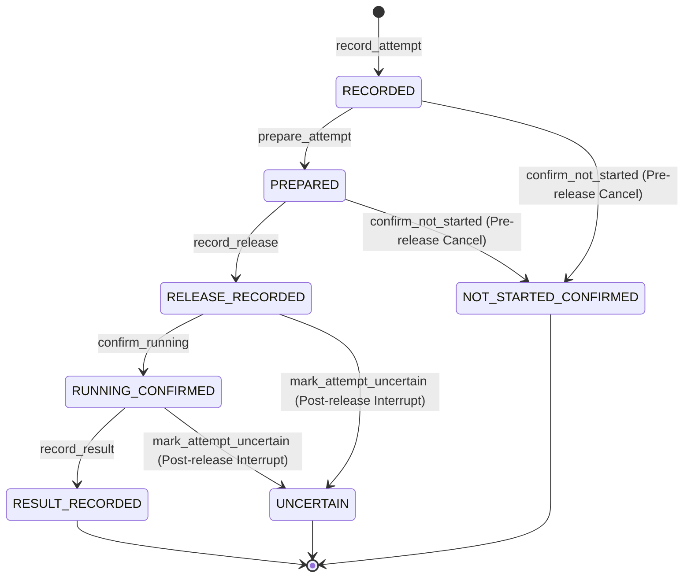

# Increment 2.0 — Docker Test Infrastructure and Durable Persistence Foundation

Date: 2026-11-08. Status: **Implemented and empirically verified via Docker container & Windows host**, ready for owner review. Phase 1 is incomplete. Phase 2 has not started and remains unauthorized. Untrusted target execution remains fail-closed. Permanent Git policy preserved.

---

## 1. Executive Summary

Following the development direction refocus ([DEVELOPMENT_DIRECTION_REVIEW.md](../../DEVELOPMENT_DIRECTION_REVIEW.md)), Increment 2.0 resumes implementation of core Sentra product capabilities. This increment establishes:

1. **Reproducible Docker Test Infrastructure**: Pinned Linux container environment (`Dockerfile.test`, `scripts/docker-test.ps1`) providing clean, host-isolated Rust test execution. Named volume overlays (`sentra_cargo_target`, `sentra_cargo_cache`) prevent build artifacts from accumulating in the Windows host repository tree, eliminating false-positive antivirus interventions (e.g. Kaspersky) while maintaining strict read-only mounting of host source code.
2. **SQLite Schema V2 Foundation**: Extends the SQLite persistence layer with `tasks`, `manifests`, and `attempts` tables ([schema_v2.sql](../../crates/sentra-core/src/persistence/schema_v2.sql)), introducing transactional migration from V1 ([migration.rs](../../crates/sentra-core/src/persistence/migration.rs)), foreign-key integrity, check constraints, JSON validation, and down-level / older-writer rejection (`NewerSchema`).
3. **Durable Dispatch Outbox State Machine**: Implements an explicit attempt dispatch lifecycle (`Recorded` $\rightarrow$ `Prepared` $\rightarrow$ `ReleaseRecorded` $\rightarrow$ `RunningConfirmed` $\rightarrow$ `ResultRecorded`), bounded by a fencing epoch (`context_generation`). Differentiates post-release interruption (`Uncertain`, holding conservative budget) from pre-release cancellation (`NotStartedConfirmed`, releasing budget).
4. **Session Continuation / Resumption Protocol**: Implements `CoreService::resume_session`, reconciling disrupted attempts, holding conservative budgets for uncertain work, transitioning incomplete tasks to `Blocked`, preserving completed work, and advancing the session fencing epoch.
5. **Empirical Verification**: All 126 tests across 9 test suites in `sentra-core` pass (1 ignored subprocess helper), with zero warnings under `cargo clippy --workspace --all-targets --all-features -- -D warnings` and zero formatting errors under `cargo fmt --all -- --check`.

---

## 2. Scope and Invariants

### Preserved Boundaries
- **Phase Boundary**: Phase 1 remains **NOT APPROVED**; Phase 2 is **STRICTLY UNAUTHORIZED**.
- **Execution Boundary**: Untrusted target execution remains **100% fail-closed** via `FailClosedBackend`. No external process spawning, target code execution, or remote network calls are exposed.
- **Permanent Git Policy**: Zero agent commits, pushes, fetches, merges, rebases, cherry-picks, or staging. All agent changes remain in the working tree.
- **Antivirus & Host Safety**: Test binaries and intermediate build artifacts do not touch the host repository `target/` directory during Docker execution.

### Architectural References
- [DEVELOPMENT_DIRECTION_REVIEW.md](../../DEVELOPMENT_DIRECTION_REVIEW.md): Direction correction refocusing effort on product persistence and session continuation.
- [REMEDIATION_ARCHITECTURE.md](REMEDIATION_ARCHITECTURE.md): Durable outbox, task lifecycle, and session resumption architecture.
- [ROADMAP.md](../../ROADMAP.md): Phase 1 acceptance requirement: *"Persist and resume a session; interrupt at task dispatch, blob promotion, and result commit; show no lost committed events and no repeated sensitive side effects."*
- [OPEN_QUESTIONS.md](../OPEN_QUESTIONS.md): OQ-09 (SQLite crash durability), OQ-23 (Approval & context generation fencing), OQ-25 (Project identity & session recovery).

---

## 3. Docker Test Infrastructure Architecture

### 3.1 Container Environment Profile
The test environment is defined in [Dockerfile.test](../../Dockerfile.test):
- **Base Image**: `rust:1.99.0-bookworm` (pinned to match host Rust 1.99.0 toolchain).
- **Installed Components**: `clippy` and `rustfmt`.
- **Working Directory**: `/workspace`.
- **Cargo Home**: `/cargo-cache`.

### 3.2 Volume Overlay and Isolation Strategy
To prevent antivirus locking and false positives on the Windows development host, [scripts/docker-test.ps1](../../scripts/docker-test.ps1) establishes a layered volume configuration:
- Host workspace is mounted as **read-only** (`:ro`): prevents container processes from mutating host source code or permissions.
- Docker named volume `sentra_cargo_target` is overlaid at `/workspace/target`: isolates all compiler output, build artifacts, test binaries, and SQLite temporary fixtures inside Docker Engine storage.
- Docker named volume `sentra_cargo_cache` is overlaid at `/cargo-cache`: caches Cargo registry index and crate downloads across runs.
- Test reports are captured via `/workspace/target/reports/` and surfaced to the host repository's `target/reports/` for auditability.

```powershell
# Invocations supported by scripts/docker-test.ps1:
pwsh -NoProfile -File scripts/docker-test.ps1 -Mode fmt
pwsh -NoProfile -File scripts/docker-test.ps1 -Mode check
pwsh -NoProfile -File scripts/docker-test.ps1 -Mode clippy
pwsh -NoProfile -File scripts/docker-test.ps1 -Mode test
pwsh -NoProfile -File scripts/docker-test.ps1 -Mode all
```

### 3.3 Platform Separation Invariant
The Core Engine enforces strict workspace boundary validation. On Linux, `WorkspaceBoundary::establish` intentionally returns `WorkspaceEntryKind::Unsupported` (`#[cfg(not(windows))]`), failing closed with `invalid_workspace`. 

This is by design:
- Linux Docker validation tests all **platform-independent Core logic**: domain primitives, policy engine, session state machine, authorization tokens, security invariants, SQLite persistence, durable dispatch outbox, and session resumption.
- Windows NTFS filesystem semantics, reparse quarantine, and handle-locking behavior remain validated exclusively on the Windows 11 host.
- Host cargo test invocations use `$env:CARGO_TARGET_DIR = "$env:LOCALAPPDATA/Sentra/target"` to isolate host-built binaries from Kaspersky.

---

## 4. SQLite Schema V2 Foundation

### 4.1 Schema Definition
Schema V2 is defined in [crates/sentra-core/src/persistence/schema_v2.sql](../../crates/sentra-core/src/persistence/schema_v2.sql), adding three relational tables:

```sql
-- Tasks table: represents discrete units of work within a session
CREATE TABLE tasks (
    task_id TEXT PRIMARY KEY NOT NULL CHECK(length(task_id) = 36),
    session_id TEXT NOT NULL,
    sequence_number INTEGER NOT NULL CHECK(sequence_number > 0),
    title TEXT NOT NULL,
    state TEXT NOT NULL CHECK(state IN ('PENDING','IN_PROGRESS','COMPLETED','FAILED','CANCELLED','BLOCKED')),
    created_at TEXT NOT NULL CHECK(length(created_at) = 24),
    updated_at TEXT NOT NULL CHECK(length(updated_at) = 24),
    completed_at TEXT,
    FOREIGN KEY(session_id) REFERENCES sessions(session_id) ON DELETE CASCADE,
    UNIQUE(session_id, sequence_number)
);
CREATE INDEX idx_tasks_session ON tasks(session_id, sequence_number);
CREATE INDEX idx_tasks_state ON tasks(state);

-- Manifests table: immutable execution specs and input digests
CREATE TABLE manifests (
    manifest_id TEXT PRIMARY KEY NOT NULL CHECK(length(manifest_id) = 36),
    session_id TEXT NOT NULL,
    manifest_kind TEXT NOT NULL CHECK(manifest_kind IN ('SOURCE_SNAPSHOT','OPERATION','DISCOVERY')),
    content_digest TEXT NOT NULL CHECK(length(content_digest) > 0),
    created_at TEXT NOT NULL CHECK(length(created_at) = 24),
    canonical_json TEXT NOT NULL CHECK(json_valid(canonical_json)),
    FOREIGN KEY(session_id) REFERENCES sessions(session_id) ON DELETE CASCADE
);
CREATE INDEX idx_manifests_session ON manifests(session_id);
CREATE INDEX idx_manifests_digest ON manifests(content_digest);

-- Attempts table: durable dispatch attempt records (outbox state machine)
CREATE TABLE attempts (
    attempt_id TEXT PRIMARY KEY NOT NULL CHECK(length(attempt_id) = 36),
    task_id TEXT NOT NULL,
    session_id TEXT NOT NULL,
    attempt_number INTEGER NOT NULL CHECK(attempt_number > 0),
    state TEXT NOT NULL CHECK(state IN ('RECORDED','PREPARED','RELEASE_RECORDED','RUNNING_CONFIRMED','RESULT_RECORDED','UNCERTAIN','NOT_STARTED_CONFIRMED')),
    fencing_epoch INTEGER NOT NULL CHECK(fencing_epoch > 0),
    execution_id TEXT NOT NULL CHECK(length(execution_id) = 36),
    action_name TEXT NOT NULL,
    action_digest TEXT NOT NULL,
    reservation_id TEXT,
    request_id TEXT,
    manifest_id TEXT,
    created_at TEXT NOT NULL CHECK(length(created_at) = 24),
    prepared_at TEXT,
    released_at TEXT,
    terminal_outcome TEXT CHECK(terminal_outcome IS NULL OR terminal_outcome IN ('COMPLETED','FAILED','CANCELLED','TIMED_OUT')),
    terminal_details_json TEXT CHECK(terminal_details_json IS NULL OR json_valid(terminal_details_json)),
    settled_at TEXT,
    FOREIGN KEY(task_id) REFERENCES tasks(task_id) ON DELETE CASCADE,
    FOREIGN KEY(session_id) REFERENCES sessions(session_id) ON DELETE CASCADE,
    FOREIGN KEY(reservation_id) REFERENCES budget_reservations(reservation_id),
    FOREIGN KEY(request_id) REFERENCES approval_requests(request_id),
    FOREIGN KEY(manifest_id) REFERENCES manifests(manifest_id),
    UNIQUE(task_id, attempt_number),
    UNIQUE(execution_id),
    CHECK(state != 'PREPARED' OR (prepared_at IS NOT NULL)),
    CHECK(state != 'RELEASE_RECORDED' OR (released_at IS NOT NULL)),
    CHECK(state != 'RESULT_RECORDED' OR (terminal_outcome IS NOT NULL AND settled_at IS NOT NULL))
);
CREATE INDEX idx_attempts_task ON attempts(task_id, attempt_number);
CREATE INDEX idx_attempts_session_state ON attempts(session_id, state);
CREATE INDEX idx_attempts_execution ON attempts(execution_id);
```

### 4.2 Data Integrity and Constraints
- **Foreign Key Cascading vs Restrict**: `ON DELETE CASCADE` is applied to parent `sessions(session_id)` and `tasks(task_id)` to maintain clean session cleanup semantics, while foreign keys to auxiliary entities (`reservation_id`, `request_id`, `manifest_id`) use default RESTRICT semantics.
- **UUID Length Validation**: Every ID is checked for exact 36-character length (`length(...) = 36`).
- **Timestamp Length Validation**: Timestamps are checked for exact 24-character representation (`length(...) = 24`).
- **JSON Validity**: `json_valid(canonical_json)` and `json_valid(terminal_details_json)` perform syntactic JSON validation in SQLite.
- **Conditional State Check Constraints**: Ensures `prepared_at` is present for `PREPARED`, `released_at` is present for `RELEASE_RECORDED`, and `terminal_outcome` + `settled_at` are present for `RESULT_RECORDED`.
- **Indices**: Dedicated indices for queries:
  - `idx_tasks_session` on `tasks(session_id, sequence_number)`
  - `idx_tasks_state` on `tasks(state)`
  - `idx_manifests_session` on `manifests(session_id)`
  - `idx_manifests_digest` on `manifests(content_digest)`
  - `idx_attempts_task` on `attempts(task_id, attempt_number)`
  - `idx_attempts_session_state` on `attempts(session_id, state)`
  - `idx_attempts_execution` on `attempts(execution_id)`

---

## 5. Transactional Migration Architecture

### 5.1 Migration Execution (`migration.rs`)
The migration framework is updated to manage Schema Version 2:
- `VERSION = 2`.
- When `user_version == 1`:
  1. Opens an immediate write transaction.
  2. Verifies V1 migration history record checksum.
  3. Executes `schema_v2.sql`.
  4. Inserts a migration record into `schema_migrations` (`version = 2`, description, checksum, UTC timestamp).
  5. Sets `PRAGMA user_version = 2`.
  6. Commits atomically.

### 5.2 Down-Level / Older-Writer Protection
If a database has `user_version > 2`, `migration.rs` immediately fails closed:
```rust
if user_version > VERSION {
    return Err(PersistenceError::new(
        PersistenceErrorKind::NewerSchema,
        format!(
            "Database schema version {user_version} is newer than supported version {VERSION}"
        ),
    ));
}
```
This guarantees that older binary releases cannot read or write to a newer schema, preventing partial writes or constraint corruption.

---

## 6. Durable Dispatch and Outbox State Machine

### 6.1 State Machine Flow
The attempt state machine governs the dispatch outbox:



### 6.2 Fencing Epoch Invariant
- During `prepare_attempt`, the attempt binds `context_generation` from the session.
- During `record_release`, the repository executes an atomic check:
  ```rust
  if attempt.context_generation != session.context_generation {
      return Err(PersistenceError::new(
          PersistenceErrorKind::ContextMismatch,
          format!(
              "Attempt fencing epoch {} does not match current session epoch {}",
              attempt.context_generation, session.context_generation
          ),
      ));
  }
  ```
- If a session resumption or policy re-registration increments `context_generation`, any in-flight attempt prepared under the older epoch fails closed immediately upon release.

### 6.3 Interruption and Budget Settlement Semantics
When an operation is disrupted (crash, cancellation, or restart):
1. **Pre-Release Cancellation (`confirm_not_started`)**:
   - Applies to attempts in `Recorded` or `Prepared` state.
   - Transition to `NotStartedConfirmed`.
   - The associated `budget_reservation` is updated to `CANCELLED` with `actual_cost_micro_usd = 0`.
   - Result: Reserved funds are completely released back to the session budget.
2. **Post-Release Interruption (`mark_attempt_uncertain`)**:
   - Applies to attempts in `ReleaseRecorded` or `RunningConfirmed` state.
   - Transition to `Uncertain`.
   - The associated `budget_reservation` is updated to `CANCELLED` with `actual_cost_micro_usd = NULL`.
   - Result: In SQLite, `COALESCE(actual_cost, reserved_cost)` continues evaluating to the full reserved cost against `budget_used`. Zero unconfirmed budget is released, ensuring conservative budget accounting.
   - `Uncertain` attempts are **never automatically retried**.

---

## 7. Session Continuation and Resumption Protocol

### 7.1 Protocol Implementation (`CoreService::resume_session`)
Session resumption provides safe recovery from ungraceful shutdown or service restarts:

```rust
pub fn resume_session(&self, session_id: Identifier) -> Result<SessionResumeReport, ServiceError> {
    // 1. Verify session exists and is not in a terminal state
    let session = self.repository.get_session(session_id)?...;
    if session.state.is_terminal() {
        return Err(ServiceError::InvalidStateTransition(...));
    }

    // 2. Discover active attempts
    let active_attempts = self.repository.list_attempts_for_session(session_id)?...;

    // 3. Reconcile attempts
    for attempt in active_attempts {
        if attempt.state.is_released() {
            self.repository.mark_attempt_uncertain(attempt.attempt_id, ...)?;
        } else {
            self.repository.confirm_not_started(attempt.attempt_id, ...)?;
        }
    }

    // 4. Reconcile tasks: transition incomplete tasks to BLOCKED
    for task in incomplete_tasks {
        self.repository.update_task_state(task.task_id, TaskState::Blocked, ...)?;
    }

    // 5. Advance session fencing epoch atomically
    let new_epoch = self.repository.advance_session_epoch(session_id)?;

    // 6. Return structured reconciliation report
    Ok(SessionResumeReport { ... })
}
```

### 7.2 Guarantees
- **No Lost Committed Events**: Completed tasks (`TaskState::Completed`) and recorded results (`AttemptState::ResultRecorded`) remain untouched.
- **No Phantom Execution**: Disrupted tasks cannot continue running in the background; their attempts are marked `Uncertain` or `NotStartedConfirmed`, and their task state is set to `Blocked`.
- **Fencing Advance**: Incrementing `context_generation` invalidates any lingering or delayed release calls from stale workers.
- **Fail-Closed on Terminal**: Resuming `Failed`, `Cancelled`, or `Completed` sessions is strictly rejected.

---

## 8. Empirical Verification Results

Verification was performed using `pwsh -NoProfile -File scripts/docker-test.ps1 -Mode all` within the pinned Debian Bookworm / Rust 1.99.0 container:

### 8.1 Toolchain & Quality Checks
| Stage | Command | Result | Details |
| --- | --- | --- | --- |
| Format Check | `cargo fmt --all -- --check` | **Passed** | 0 formatting discrepancies |
| Workspace Check | `cargo check --workspace` | **Passed** | 0 compile errors |
| Clippy Lints | `cargo clippy --workspace --all-targets --all-features -- -D warnings` | **Passed** | 0 warnings |

### 8.2 Test Suite Execution
`cargo test --package sentra-core` executed 9 distinct integration test binaries, achieving **126 Passed, 0 Failed, 1 Ignored** (subprocess helper):

| Test Binary | Passed | Failed | Ignored | Coverage Summary |
| --- | --- | --- | --- | --- |
| `tests/authorization_tests.rs` | 27 | 0 | 0 | Grant integrity, single-use token consumption, context binding |
| `tests/domain_tests.rs` | 9 | 0 | 0 | Typed IDs, UUID parsing, timestamps, classification flow |
| `tests/durable_dispatch_tests.rs` | 10 | 0 | 0 | Schema V2 migration, outbox lifecycle, fencing, budget, resumption |
| `tests/evidence_tests.rs` | 9 | 0 | 0 | Payload length validation, media types, debug redaction |
| `tests/execution_tests.rs` | 8 | 0 | 0 | FailClosedBackend, budget overflow, untrusted rejection |
| `tests/persistence_tests.rs` | 39 | 0 | 1 | SQLite WAL, transactions, locks, FK integrity, subprocess worker |
| `tests/policy_tests.rs` | 9 | 0 | 0 | Approval grant lifecycle, classification floors, default deny |
| `tests/security_tests.rs` | 10 | 0 | 0 | Delimiter injection, fixed-point math, concurrent grant race |
| `tests/session_tests.rs` | 5 | 0 | 0 | Session state transition matrix, terminal permanence |
| **Total** | **126** | **0** | **1** | Full test execution success |

### 8.3 Durable Dispatch Integration Suite Details (`durable_dispatch_tests.rs`)
1. `test_schema_v1_to_v2_transactional_migration_preserves_data`: Upgrades V1 database to V2, verifies table schema, constraints, and data retention.
2. `test_older_writer_rejected_on_newer_schema`: Verifies `user_version = 3` produces `PersistenceErrorKind::NewerSchema`.
3. `test_task_lifecycle_and_invariants`: Verifies task state transitions, invalid transition denials, and UUID/JSON constraints.
4. `test_manifest_creation_and_digest_lookup`: Verifies immutable manifest storage and SHA-256 digest query.
5. `test_durable_dispatch_full_lifecycle`: Exercises `Recorded` $\rightarrow$ `Prepared` $\rightarrow$ `ReleaseRecorded` $\rightarrow$ `RunningConfirmed` $\rightarrow$ `ResultRecorded`.
6. `test_fencing_epoch_invalidation_prevents_stale_release`: Advances session epoch and proves stale `record_release` fails closed with `ContextMismatch`.
7. `test_post_release_interruption_marks_uncertain_and_holds_budget`: Verifies `Uncertain` transition retains full budget reservation via `COALESCE`.
8. `test_pre_release_cancellation_confirms_not_started_and_releases_budget`: Verifies `NotStartedConfirmed` sets actual cost to 0, releasing budget.
9. `test_session_resumption_e2e_reconciliation`: Verifies end-to-end `resume_session` reconciling mixed attempts and advancing epoch.
10. `test_terminal_session_cannot_be_resumed`: Verifies resuming a `Completed` or `Cancelled` session fails closed.

---

## 9. Inventory of Changed Files

| File | Nature of Change |
| --- | --- |
| `Dockerfile.test` | Docker container test environment definition (Rust 1.99.0 Debian Bookworm). |
| `scripts/docker-test.ps1` | Container test orchestrator with named volume overlay and pipefail logging. |
| `crates/sentra-core/src/domain/id.rs` | Added typed `TaskId`, `ManifestId`, `AttemptId`, `ReservationId` identifiers. |
| `crates/sentra-core/src/domain/mod.rs` | Re-exported new domain identifiers. |
| `crates/sentra-core/src/lib.rs` | Public export of domain identifiers. |
| `crates/sentra-core/src/persistence/schema_v2.sql` | DDL for `tasks`, `manifests`, and `attempts` with check constraints and indices. |
| `crates/sentra-core/src/persistence/migration.rs` | Updated `VERSION = 2`, transactional migration applying Schema V2, `NewerSchema` rejection. |
| `crates/sentra-core/src/persistence/model.rs` | Added `TaskState`, `TaskRecord`, `ManifestKind`, `ManifestRecord`, `AttemptState`, `AttemptRecord`. |
| `crates/sentra-core/src/persistence/repository.rs` | Implemented task CRUD, manifest storage, attempt outbox lifecycle, and session epoch advancement. |
| `crates/sentra-core/src/persistence/connection.rs` | Configured test fixture compatibility. |
| `crates/sentra-core/src/persistence/mod.rs` | Re-exported persistence models and repository requests. |
| `crates/sentra-core/src/service/lifecycle.rs` | Added `ReconciledAttempt` and `SessionResumeReport` models. |
| `crates/sentra-core/src/service/core.rs` | Implemented `resume_session` reconciliation protocol, added `repository(&self)` accessor. |
| `crates/sentra-core/src/service/mod.rs` | Re-exported session resumption report types. |
| `crates/sentra-core/src/workspace/platform.rs` | Suppressed platform-specific unused warnings for Linux compatibility. |
| `crates/sentra-core/tests/durable_dispatch_tests.rs` | Added 10 comprehensive integration tests for durable persistence and dispatch. |
| `crates/sentra-core/tests/persistence_tests.rs` | Updated table count and version assertions for Schema V2 compatibility. |
| `crates/sentra-core/tests/support/persistence.rs` | Suppressed dead-code warnings on shared test harness helpers. |

---

## 10. Residual Risks, Deferred Capabilities & Boundary Invariants

1. **Phase 1 Acceptance**: Phase 1 remains **NOT APPROVED**. Durable persistence and session resumption are foundation prerequisites; full Phase 1 closure requires further validation.
2. **Phase 2 Unauthorized**: Phase 2 remains **STRICTLY UNAUTHORIZED**.
3. **Target Execution Fail-Closed**: No target source code is executed. Untrusted target workloads are intercepted and rejected by `FailClosedBackend`.
4. **Antivirus Safety**: Docker tests completely isolate build outputs from host filesystem. Host-based cargo runs must use `$env:CARGO_TARGET_DIR = "$env:LOCALAPPDATA/Sentra/target"` to prevent antivirus interference.
5. **Cryptographic Hashes (SHA-256)**: Cryptographic SHA-256 crate dependency remains **Blocked**. Non-cryptographic placeholders and length checks are utilized for manifests and attempts.
6. **Hostile Same-User NTFS Boundary**: Remains bounded by the threat model documented in Increment 1.4 (`FILE_ATTRIBUTE_READONLY` is an advisory DOS attribute against hostile same-user processes).
7. **F-611-02 and OQ-25**: Crash recovery of uncommitted `sentra init` stores remains an open gate before Phase 2 production readiness.
8. **Permanent Git Policy**: All agent changes remain in the working tree. Zero agent commits, pushes, or branch operations were executed.
