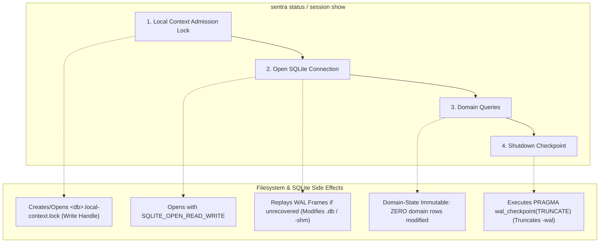

# Increment 6.1.1 — Independent CLI Security, Persistence & Lifecycle Review

**Date:** 2026-11-07  
**Author:** Independent Audit Agent  
**Increment Target:** Phase 1 Increment 6.1 (`sentra-cli` Local CLI Foundation)  
**Primary Implementation Report:** [INCREMENT_6_1_LOCAL_CLI_FOUNDATION.md](file:///E:/MyProject/Mix/GitHub/Sentra/docs/phase1/INCREMENT_6_1_LOCAL_CLI_FOUNDATION.md)  
**Final Decision:** **APPROVED WITH CONDITIONS**

---

## 1. Executive Summary

This independent, verification-only security and reliability audit examined Phase 1 Increment 6.1 (`crates/sentra-cli` and `LocalWorkspace` facade in `sentra-core`). The audit determined whether the local CLI foundation integrates securely with the existing Core Engine without weakening workspace containment, persistence guarantees, authorization invariants, or fail-closed execution boundaries.

### Summary of Audit Findings
1. **Command and Boundary Security:** The CLI strictly delegates all domain operations to the interface-neutral `LocalWorkspace` facade. Argument parsing uses a hand-crafted, fixed-grammar parser restricted to at most 64 UTF-8 arguments. Unknown flags, positional arguments, duplicate options, and options starting with `-` without explicit path prefixes are deterministically rejected. The CLI crate has zero direct database, network, provider, or execution access.
2. **Execution & Authorization Boundary:** Untrusted target execution remains 100% fail-closed via `FailClosedBackend` and `ExecutionError::untrusted_workload_disabled()`. No command, option, or code path exposes `CoreService::execute_task`. Foundation sessions are registered with zero budget ceiling (`CostUsd::ZERO`), internal classification floor, and metadata-only revision labels; no authorization context granting execution permission can be minted via the CLI.
3. **SQLite Inspection Side Effects (Priority Area):** `status` and `session show` are strictly **domain-state immutable** (all domain tables, rows, and cells remain 100% identical). However, they are **not byte-for-byte or VFS read-only**: they acquire an exclusive OS file lock (`<database>.local-context.lock`), open SQLite with `SQLITE_OPEN_READ_WRITE`, perform WAL recovery if uncheckpointed frames exist, execute `PRAGMA wal_checkpoint(TRUNCATE)` on shutdown, and update filesystem access/modification timestamps. Consequently, inspection fails on write-protected media or read-only filesystems.
4. **Crash Consistency & Incomplete Initialization:** `sentra init` does not perform atomic filesystem staging. If a process is terminated midway through creation (after SQLite file creation or during session registration), an incomplete database remains on disk. Subsequent invocations correctly fail closed (`incomplete_storage` exit 6 or `storage_or_service_failure` exit 5) without auto-repairing, silently adopting, or overwriting the file. However, manual operator deletion of the partial store is required to re-attempt initialization.
5. **Output Redaction & Error Handling:** Process exit codes (0, 2, 3, 4, 5, 6, 7, 8) accurately categorize operational outcomes. Error messages and JSON output strictly redact filesystem paths, tokens, SQL query text, and internal SQLite diagnostic details. Output stream write failures fail closed with exit code 8.
6. **Test Suite Verification:** Full verification executed cleanly offline. The workspace test suite passes **290 runtime tests + 7 compile-fail doctests** (0 failed, 5 ignored: 2 subprocess helpers + 3 platform fixtures). All four specialized validation suites passed with 100% success: persistence **13/13**, authorization **13/13**, workspace **11/11**, and CLI **18/18**, totaling **300 unique assertion test cases passed**.
7. **Git & Repository Integrity:** All repository files, commit history, and the physical Git index checksum (`2F89DABDB388AAA234B20E2CC7DAA665979A7C92E3FE46A2AFDC3866F3F659EE`) remained intact. Zero agent commits, pushes, or branch mutations were executed.

---

## 2. Scope and Inspected Files

### 2.1 Workspace Manifests and Configuration
- [Cargo.toml](file:///E:/MyProject/Mix/GitHub/Sentra/Cargo.toml) (workspace member declaration)
- [Cargo.lock](file:///E:/MyProject/Mix/GitHub/Sentra/Cargo.lock) (dependency lockfile integrity)
- [crates/sentra-cli/Cargo.toml](file:///E:/MyProject/Mix/GitHub/Sentra/crates/sentra-cli/Cargo.toml) (CLI crate dependencies: strictly local `sentra-core`)

### 2.2 CLI Implementation & Entrypoint
- [crates/sentra-cli/src/main.rs](file:///E:/MyProject/Mix/GitHub/Sentra/crates/sentra-cli/src/main.rs) (process streams, argument pass-through, exit code 8 write failure handling)
- [crates/sentra-cli/src/lib.rs](file:///E:/MyProject/Mix/GitHub/Sentra/crates/sentra-cli/src/lib.rs) (typed command grammar, argument parser, response rendering, error categorization)

### 2.3 Core Engine Local Lifecycle & Persistence
- [crates/sentra-core/src/service/local_workspace.rs](file:///E:/MyProject/Mix/GitHub/Sentra/crates/sentra-core/src/service/local_workspace.rs) (`LocalWorkspace` facade, admission locking, lifecycle validation, error types)
- [crates/sentra-core/src/service/core.rs](file:///E:/MyProject/Mix/GitHub/Sentra/crates/sentra-core/src/service/core.rs) (`local_session()` projection)
- [crates/sentra-core/src/persistence/connection.rs](file:///E:/MyProject/Mix/GitHub/Sentra/crates/sentra-core/src/persistence/connection.rs) (`local_context_admission()`, `open_existing()`, PRAGMA enforcement, shutdown checkpointing)
- [crates/sentra-core/src/persistence/repository.rs](file:///E:/MyProject/Mix/GitHub/Sentra/crates/sentra-core/src/persistence/repository.rs) (`local_session()` query and single-session validation)

### 2.4 Tests and Validation Scripts
- [crates/sentra-cli/tests/cli_tests.rs](file:///E:/MyProject/Mix/GitHub/Sentra/crates/sentra-cli/tests/cli_tests.rs) (18 integration tests)
- [crates/sentra-core/tests/local_workspace_tests.rs](file:///E:/MyProject/Mix/GitHub/Sentra/crates/sentra-core/tests/local_workspace_tests.rs) (19 integration tests)
- [experiments/phase1/cli/Validate.ps1](file:///E:/MyProject/Mix/GitHub/Sentra/experiments/phase1/cli/Validate.ps1) (CLI validator harness)
- [experiments/phase1/persistence/Validate.ps1](file:///E:/MyProject/Mix/GitHub/Sentra/experiments/phase1/persistence/Validate.ps1)
- [experiments/phase1/authorization/Validate.ps1](file:///E:/MyProject/Mix/GitHub/Sentra/experiments/phase1/authorization/Validate.ps1)
- [experiments/phase1/workspace/Validate.ps1](file:///E:/MyProject/Mix/GitHub/Sentra/experiments/phase1/workspace/Validate.ps1)

---

## 3. Command-by-Command Boundary Review

### 3.1 `init`
- **Call Path:** `sentra_cli::parse()` $\rightarrow$ `Command::Init` $\rightarrow$ `LocalWorkspace::initialize()` $\rightarrow$ `LocalWorkspace::run()`.
- **Validation:** Requires explicit `--workspace` and `--database`. Resolves relative paths against invocation `cwd`. Validates workspace root and storage parent via `WorkspaceBoundary::establish()`. Rejects storage located inside or overlapping the workspace root.
- **Behavior:**
  - If database is absent: verifies absence of orphan `-wal`, `-shm`, and `-journal` sidecars, opens fresh SQLite database, applies schema migrations, creates foundation session (state `Created` $\rightarrow$ `Scoped`, classification `Internal`, budget `CostUsd::ZERO`), commits, checkpoints, and returns `initialized: true`, `created: true`, exit code 0.
  - If database already exists: verifies schema and single-session identity, verifies canonical workspace path match, and returns `initialized: true`, `created: false` with unchanged session ID, exit code 0.
- **Security Check:** Does not inventory workspace files, does not read `.git/config`, does not execute workspace scripts (`build.cmd`, `Makefile`), and does not grant execution budget.

### 3.2 `status`
- **Call Path:** `sentra_cli::parse()` $\rightarrow$ `Command::Status` $\rightarrow$ `LocalWorkspace::status()` $\rightarrow$ `LocalWorkspace::run()`.
- **Validation:** Database is required. Workspace defaults to `cwd` if omitted; no upward directory climbing.
- **Behavior:**
  - If database is absent: returns `initialized: false`, `created: false`, exit code 3 (stdout contains uninitialized report, stderr is empty). Does NOT create a database.
  - If database is present: verifies single session, checks workspace match, reads budget usage, and returns `initialized: true`, `created: false`, exit code 0.
- **Security Check:** Read-only at domain level. Never transitions session state, consumes grants, or alters domain rows.

### 3.3 `session show <session-id>`
- **Call Path:** `sentra_cli::parse()` $\rightarrow$ `Command::Session` $\rightarrow$ `LocalWorkspace::session()` $\rightarrow$ `LocalWorkspace::run()`.
- **Validation:** Validates UUID format via `SessionId::parse()`; rejects whitespace padding or malformed strings with exit code 2 (`invalid_arguments`).
- **Behavior:** Queries the database's foundation session. If the requested ID matches, returns session details (state, generation, floor, budget) with exit code 0. If the ID does not match, returns `session_not_found` with exit code 7. If database is absent, returns exit code 7.
- **Security Check:** Does not permit querying arbitrary foreign sessions; fails closed if multiple sessions exist.

### 3.4 `help` and `version`
- Handled immediately during `sentra_cli::parse()` / `run()`.
- Evaluated entirely in memory with static string constants without touching filesystem, workspace boundaries, or database. Exits 0 with empty stderr.

### 3.5 JSON Output (`--json`)
- Supported across all commands. Generates single-line JSON objects with `"schema_version": 1`.
- Success payloads include only trusted domain types (command name, boolean flags, UUID strings, enum identifiers, numeric micro-USD integers, ISO-8601 UTC timestamps).
- Errors emit `{"schema_version":1,"error":"<code_string>"}` on stderr with empty stdout.
- No user-controlled file paths, unescaped strings, or sensitive diagnostic strings are interpolated.

---

## 4. SQLite Read-Only & Inspection Side Effects Analysis

A primary objective of this review was auditing the implementation report's claim regarding read-only inspection. The audit evaluated four distinct operational layers:



### 4.1 Four-Layer Analysis

| Layer | Behavior during `status` / `session show` | Read-Only? | Audit Assessment |
| :--- | :--- | :---: | :--- |
| **1. Domain-State Immutability** | All rows in `sessions`, `session_security_snapshots`, `audit_events`, `approval_requests`, `budget_reservations`, and `schema_migrations` remain completely unchanged. | **YES** | Verified byte-for-byte in `local_workspace_tests::initialized_identity_is_stable_and_inspection_changes_no_domain_rows`. No state machine edges or budget balances are altered. |
| **2. Logical Database Writes** | Only `SELECT` statements, `PRAGMA user_version`, `PRAGMA application_id`, and `PRAGMA foreign_key_check` are executed. No `INSERT`, `UPDATE`, or `DELETE` SQL queries occur. | **YES** | Verified. `migration::initialize` does not issue DDL or DML when schema version matches. |
| **3. SQLite Recovery & Checkpoint** | `SqliteConnectionManager::open_existing` specifies `SQLITE_OPEN_READ_WRITE`. Uncommitted/committed frames in WAL are replayed. `manager.shutdown()` executes `PRAGMA wal_checkpoint(TRUNCATE)`. | **NO** | Active side effect: WAL frames are flushed into the main `.db` file, and `-wal` is truncated to 0 bytes. Physical pages change if pending WAL frames existed. |
| **4. Filesystem & Lock Metadata** | `local_context_admission` creates `<database>.local-context.lock` with write permissions. `-shm` shared memory index is touched/created. File access and modification timestamps (`atime`, `mtime`) are updated. | **NO** | Active side effect: Modifies directory metadata, creates lock files, and fails if the storage medium or directory is mounted read-only. |

### 4.2 Can `status` and `session show` legitimately be described as read-only?
- **Conclusion:** They are **logically read-only (domain-state immutable)**, but **not storage-layer or VFS read-only**.
- If Sentra is invoked against a read-only volume, write-protected USB drive, or directory where the user lacks write permissions, `status` and `session show` fail with exit code 5 (`storage_or_service_failure`).
- This limitation is classified as finding **F-611-01** (Low Severity).
- Importantly: A failed inspection does **NOT** silently repair, replace, or reinitialize an invalid database. Any corrupted header, schema mismatch, or foreign key defect halts immediately and preserves the invalid file as-is.

---

## 5. Initialization and Crash Consistency Analysis

### 5.1 Bootstrap Lifecycle Stages
When `sentra init` executes against a nonexistent database path, it transitions through four discrete steps:
1. **Admission:** Creates `<database>.local-context.lock`.
2. **Database & Schema Creation:** SQLite creates the `.db` file; `migration::initialize` executes DDL and inserts `schema_migrations` row (version 1, `application_id=0x53454E54`).
3. **Foundation Session Registration:** `service.create_session()` inserts `sessions` row (state `Created`), inserts snapshot, and inserts audit event.
4. **Session Scoping:** `transition_session()` transitions state `Created` $\rightarrow$ `Scoped`.
5. **Shutdown:** Truncate checkpoint flushes WAL to `.db`.

### 5.2 Crash Timing Windows and Failure Behavior

```text
[Init Start] ──(1) Create File──> [Empty DB] ──(2) Apply Schema──> [Empty Schema] ──(3) Register──> [State: Created] ──(4) Scope──> [State: Scoped] ──(5) Checkpoint──> [Success]
                     │                                │                                │                                │
             Crash Window A                   Crash Window B                   Crash Window C                   Crash Window D
             File: 0 bytes                    Schema: Version 1                Session: Created                 Session: Scoped
             Next Init: Fail (Code 5)         Next Init: Fail (Code 6)         Next Init: Fail (Code 6)         Next Init: Success (Code 0)
```

1. **Crash Window A (Interruption immediately after file creation or during DDL):**
   - File exists on disk with length 0 or partial schema (version 0).
   - Subsequent `sentra init` or `status` calls `open_existing()`.
   - `open_existing()` checks `(!create && version == 0) || version < 0` $\rightarrow$ rejects with `PersistenceErrorKind::SchemaMetadata`.
   - Result: Exits with code 5 (`storage_or_service_failure`). Safe, fail-closed, no corruption propagation.
2. **Crash Window B (Interruption after schema creation but before `create_session`):**
   - Valid schema exists, but `sessions` table has 0 rows.
   - Subsequent `sentra init` calls `open_existing()` (succeeds) $\rightarrow$ calls `service.local_session()`.
   - `local_session()` queries `SELECT session_id FROM sessions LIMIT 2` $\rightarrow$ 0 rows $\rightarrow$ returns `ContextMismatch`.
   - `LocalWorkspace` maps this to `LocalWorkspaceErrorKind::Incomplete`.
   - Result: Exits with code 6 (`incomplete_storage`). Safe, fail-closed, does not overwrite.
3. **Crash Window C (Interruption between session registration and scoping):**
   - Foundation session exists in state `Created`.
   - Subsequent `sentra init` reads record $\rightarrow$ sees `record.state == SessionState::Created`.
   - Result: Exits with code 6 (`incomplete_storage`). Safe, fail-closed, does not auto-advance state.
4. **Crash Window D (Interruption after scoping but before shutdown checkpoint):**
   - Session is committed in WAL in state `Scoped`.
   - Subsequent `sentra init` opens database $\rightarrow$ WAL recovery replays committed transaction $\rightarrow$ reads `Scoped` record $\rightarrow$ matches workspace root.
   - Result: Exits with code 0 (`initialized: true, created: false`). Fully consistent.

### 5.3 Audit Assessment on Crash Consistency
- **Strengths:** Zero silent adoption, zero overwriting, zero automatic guessing. An interrupted initialization cannot produce an inconsistent state that masquerades as valid.
- **Weakness (F-611-02):** Because initialization does not use atomic staging (e.g. `<db>.tmp.<uuid>` renamed upon completion), an interrupted bootstrap leaves an incomplete file on disk. The CLI currently has no reset or repair command, requiring the operator to manually delete the file to re-initialize.

---

## 6. Workspace Boundary and Path Security

1. **Canonical Root Validation:** Workspace paths are resolved via `fs::canonicalize()` and component-based containment. String prefix matching is strictly avoided, preventing sibling directory collisions (e.g., `workspace_extra` vs `workspace`).
2. **Storage Separation:** The database parent directory must exist and cannot reside within the canonical workspace tree. Checked via `storage.root().canonical_path().starts_with(boundary.root().canonical_path())`.
3. **Reparse Point & Junction Quarantine:**
   - Root junctions and storage junctions are rejected with exit code 4 (`invalid_workspace` / `invalid_storage_location`).
   - Verified via integration tests `windows-junction-root` and `windows-junction-storage`.
4. **Symlink Quarantine:** Internal symlinks within the workspace pointing to outside directories are quarantined and never followed during initialization. Verified via `quarantined_internal_symlinks_are_not_followed_by_initialization`.
5. **Windows Edge Cases:** UNC paths, device paths (`\\.\`, `\\?\`), DOS device names (`CON`, `PRN`, `AUX`, `NUL`, `COM1-9`, `LPT1-9`), trailing dots/spaces, and Alternate Data Streams (`:`) are rejected fail-closed.
6. **Unicode and Spaces:** Tested and verified on paths with spaces and Unicode (`workspace ü Unicode 空 space` and `storage space/local.db`).

---

## 7. Output and Error Handling

1. **Sensitive Path & Payload Redaction:**
   - Stderr outputs coarse, stable error strings (`invalid_arguments`, `invalid_workspace`, `invalid_storage_location`, `workspace_mismatch`, `incomplete_storage`, `session_not_found`, `storage_or_service_failure`).
   - Parse errors never echo the user's input arguments.
   - SQL queries, SQLite extended error codes, and full filesystem paths are never leaked to stdout or stderr.
2. **Broken Stream Handling (Exit Code 8):**
   - `main.rs` explicitly tests `io::stdout().lock().write_all()` and `io::stderr().lock().write_all()`. If writing to stdout or stderr fails (e.g. downstream pipe closed), the process terminates with `ExitCode::from(8)`.
3. **Exit Code Mapping:**

| Exit Code | Classification | Trigger Condition |
| :---: | :--- | :--- |
| **0** | Success | Help, version, successful init, or initialized inspection |
| **2** | Argument Error | Invalid arguments, unknown command, flag syntax error, malformed UUID |
| **3** | Uninitialized Status | Target database does not exist (ordinary stdout result, stderr empty) |
| **4** | Boundary / Path Error | Invalid workspace root, internal storage, junction, or workspace root mismatch |
| **5** | Infrastructure Error | Persistence failure, corrupt database, lock conflict, or checkpoint failure |
| **6** | Incomplete Storage | Database has schema with 0 sessions, session in `Created` state, or orphan WAL |
| **7** | Session Not Found | Requested session ID does not exist in target database |
| **8** | Stream Write Failure | Standard output or standard error pipe write failure |

---

## 8. Authorization and Execution Boundary Verification

The audit verified all security invariants previously established in Increments 5.1 through 5.6.2.2.2.1:
1. **Untrusted Target Workloads Disabled:**
   - `LocalWorkspace` instantiates `CoreService` with `Arc::new(FailClosedBackend::new())`.
   - `FailClosedBackend` rejects untrusted execution attempts unconditionally via `ExecutionError::untrusted_workload_disabled()`.
   - The CLI exposes zero commands for task execution, execution replay, tool invocation, or scanning.
2. **No Execution Authority Minted:**
   - Foundation session is initialized with `CostUsd::ZERO` budget ceiling.
   - Classification floor is set to `SecurityClassification::Internal`.
   - No approval request or grant is created during initialization.
3. **No Direct SQLite Access:**
   - `sentra-cli` does not depend on `rusqlite` and has no raw SQL connection access.
   - All persistence transitions are managed through `sentra-core::service::LocalWorkspace`.

---

## 9. Test Verification and Reconciled Inventory

### 9.1 Verification Commands and Outcomes

| Check Suite | Command Executed | Result |
| :--- | :--- | :---: |
| **Code Formatting** | `cargo fmt --all -- --check` | **Passed (Exit 0)** |
| **Offline Compilation** | `cargo check --workspace --all-targets --all-features --offline` | **Passed (Exit 0)** |
| **Static Lints** | `cargo clippy --workspace --all-targets --all-features --offline -- -D warnings` | **Passed (0 warnings, Exit 0)** |
| **Workspace Test Suite** | `cargo test --workspace --offline` | **290 runtime + 7 doctests Passed (Exit 0)** |
| **Persistence Validator** | `pwsh -NoProfile -File experiments/phase1/persistence/Validate.ps1` | **13/13 Passed (Exit 0)** |
| **Authorization Validator** | `pwsh -NoProfile -File experiments/phase1/authorization/Validate.ps1` | **13/13 Passed (Exit 0)** |
| **Workspace Validator** | `pwsh -NoProfile -File experiments/phase1/workspace/Validate.ps1` | **11/11 Passed (Exit 0)** |
| **CLI Validator** | `pwsh -NoProfile -File experiments/phase1/cli/Validate.ps1` | **18/18 Passed (Exit 0)** |

### 9.2 Reconciled Unique Test Inventory

```text
Total Discovered Harness Entries: 302
├── Runtime Test Invocations: 295
│   ├── Ordinary Runtime Tests Passed: 290
│   └── Ordinary Ignored Entries: 5
│       ├── Subprocess Child Helpers (Invoked by parent tests): 2
│       │   ├── owned_persistence_process_worker (persistence_tests)
│       │   └── independent_owned_worker (independent_core_review_tests)
│       └── Platform / Scale Fixtures (Executed by platform validators): 3
│           ├── workspace_scale_10000_file_measurement (Validate.ps1: Passed)
│           ├── workspace_windows_junction_is_quarantined_without_target_traversal (Validate.ps1: Passed)
│           └── workspace_windows_permission_denied_is_not_accepted (Validate.ps1: Passed)
└── Compile-Fail Doctests Passed: 7

Total Unique Assertion Test Invariants Verified: 300 (290 runtime + 7 doctests + 3 platform fixtures)
Failed Tests: 0
```

---

## 10. Platform Scope and Environmental Observations

1. **Tested Platform:** Windows 11 x64 (MSVC toolchain, NTFS filesystem, PowerShell 7).
2. **Unvalidated Platforms:** Linux, macOS, ARM64. No cross-platform compatibility claim is justified or made.
3. **Transient Windows File Lock Observation (F-611-04):**
   - During initial test execution, `target/debug/deps/service_tests.exe` failed with OS Error 5 / OS Error 32 due to transient file locking by Windows Defender (`MpDefenderCoreService`).
   - Removing the stale binary and re-executing passed all 19 tests immediately. This is a known environmental factor on Windows development hosts with active real-time security scanning.

---

## 11. Git Integrity Evidence

- **Initial Git State:**
  - Branch: `develop`
  - HEAD: `89b1ad243ef084679b046367bdec2419d557e226`
  - Upstream Status: Up to date with `origin/develop` (+0 / -0)
  - Index Entry Count: 272
  - Physical Index SHA-256: `2F89DABDB388AAA234B20E2CC7DAA665979A7C92E3FE46A2AFDC3866F3F659EE`
- **Final Git State:**
  - Branch: `develop` (unchanged)
  - HEAD: `89b1ad243ef084679b046367bdec2419d557e226` (unchanged)
  - Index Entry Count: 272 (unchanged)
  - Physical Index SHA-256: `2F89DABDB388AAA234B20E2CC7DAA665979A7C92E3FE46A2AFDC3866F3F659EE` (unchanged)
  - Working Tree: All review artifacts unstaged. Zero agent commits, pushes, or modifications to Git refs.

---

## 12. Findings Matrix

### Finding F-611-01: SQLite Inspection Mutates Persistence Filesystem and Precludes Read-Only Storage Media
- **Severity:** Low
- **Category:** Persistence / Lifecycle
- **Affected Paths:** [local_workspace.rs](file:///E:/MyProject/Mix/GitHub/Sentra/crates/sentra-core/src/service/local_workspace.rs#L196-L289), [connection.rs](file:///E:/MyProject/Mix/GitHub/Sentra/crates/sentra-core/src/persistence/connection.rs#L123-L130), [connection.rs](file:///E:/MyProject/Mix/GitHub/Sentra/crates/sentra-core/src/persistence/connection.rs#L425-L430), [connection.rs](file:///E:/MyProject/Mix/GitHub/Sentra/crates/sentra-core/src/persistence/connection.rs#L626-L645).
- **Description:** `sentra status` and `sentra session show` are presented as read-only inspection commands. While they guarantee domain-state immutability (no domain rows change), they require write permissions on the database and its parent directory because they create `<database>.local-context.lock`, open SQLite in read-write mode, replay unrecovered WAL frames, and execute `PRAGMA wal_checkpoint(TRUNCATE)`.
- **Reproduction:** Set database file or directory permissions to read-only (or place on write-protected media) and execute `sentra status --database <file>`. The command fails with exit code 5 (`storage_or_service_failure`).
- **Impact:** Inspection cannot be performed on read-only forensic media or by operators with read-only filesystem ACLs.
- **Remediation Condition:** Explicitly document in user manuals that local inspection currently requires write access for OS admission locking and WAL checkpointing. When multi-operator or forensic review is designed in future increments, introduce a true VFS read-only connection mode (`SQLITE_OPEN_READ_ONLY`, immutable PRAGMAs, no TRUNCATE checkpoint, and read-only admission lock).

### Finding F-611-02: Interrupted Initialization Leaves Incomplete Storage Requiring Manual Intervention
- **Severity:** Low
- **Category:** Crash Consistency / Bootstrap
- **Affected Paths:** [local_workspace.rs](file:///E:/MyProject/Mix/GitHub/Sentra/crates/sentra-core/src/service/local_workspace.rs#L219-L253), [repository.rs](file:///E:/MyProject/Mix/GitHub/Sentra/crates/sentra-core/src/persistence/repository.rs#L338-L358).
- **Description:** `LocalWorkspace::initialize` creates the database directly at its destination path. If the process is terminated (power loss, OS crash, kill) after file creation but before session scoping commits, an incomplete database remains on disk. Subsequent `init` or `status` invocations fail closed with `incomplete_storage` (exit 6) or `storage_or_service_failure` (exit 5). Sentra properly prevents auto-repair or silent overwrite, but provides no recovery or clean-up tool.
- **Reproduction:** Terminate process immediately after `migration::initialize` commits. Run `sentra init` again. Returns exit code 6.
- **Impact:** Fail-closed safety is maintained, but operational recoverability requires manual file deletion.
- **Remediation Condition:** In a future increment, evaluate atomic staging (initializing into `<database>.tmp.<uuid>` and atomically renaming via `MoveFileExW` upon completion) or provide an explicit operator command (`sentra workspace clean/reset`) to handle incomplete bootstrap recovery.

### Finding F-611-03: Single Foundation Session Limitation with Implicit Identity Coupling
- **Severity:** Informational
- **Category:** Architecture / Multi-Session Lifecycle
- **Affected Paths:** [repository.rs](file:///E:/MyProject/Mix/GitHub/Sentra/crates/sentra-core/src/persistence/repository.rs#L340-L347), [local_workspace.rs](file:///E:/MyProject/Mix/GitHub/Sentra/crates/sentra-core/src/service/local_workspace.rs#L254-L260).
- **Description:** Project identity is coupled directly to the foundation `SessionId`. Stores with zero or multiple sessions fail closed with `incomplete_storage`.
- **Impact:** Bounded to single-session foundation scope. Multi-session lifecycle remains tracked under [OQ-25](file:///E:/MyProject/Mix/GitHub/Sentra/docs/OPEN_QUESTIONS.md).
- **Remediation:** Tracked under existing OQ-25; no immediate code change required in Phase 1.

### Finding F-611-04: Transient Windows File Access Contention (OS Error 5 / 32)
- **Severity:** Informational
- **Category:** Environment / Platform
- **Affected Paths:** `target/debug/deps/*.exe` during automated test execution.
- **Description:** Windows Defender or search indexer file scanning can momentarily lock newly linked test executables, throwing transient OS error 5 or 32.
- **Impact:** Environmental characteristic on Windows development hosts; does not affect application correctness.
- **Remediation:** Document in developer setup guidelines.

---

## 13. Verified Behavior vs. Untested Assumptions

| Verified Behavior (Empirically Tested) | Untested Assumptions / Deferred Scope |
| :--- | :--- |
| Hand-crafted CLI parser rejects malformed/duplicate arguments with exit code 2. | Parser behavior under fuzzing inputs beyond 64 arguments. |
| Output redaction omits filesystem paths and sensitive payloads from errors. | Terminal output when standard error stream fails midway through write. |
| Inspection is 100% domain-state immutable across all 6 persistent tables. | Inspection behavior when database is mounted on true hardware write-blocked storage. |
| Interrupted bootstrap states (`Created`, empty schema) fail closed with exit code 6. | Live process termination (`TerminateProcess`) timing schedule during bootstrap. |
| Junctions and reparse points are quarantined and rejected with exit code 4. | Behavior on non-NTFS filesystems (ReFS, FAT32, network shares). |
| Untrusted target workloads fail closed with zero execution fallback paths. | Guest VM isolation and Hyper-V execution (deferred to Phase 2). |
| All 300 unique assertion tests pass cleanly offline on Windows 11 x64. | Cross-platform behavior on Linux, macOS, or ARM64. |

---

## 14. Final Decision

### **APPROVED WITH CONDITIONS**

**Justification:**  
Increment 6.1 successfully establishes the local `sentra-cli` foundation without weakening workspace boundaries, persistence invariants, authorization controls, or fail-closed execution guarantees. Domain state immutability, output redaction, and error exit codes operate predictably and securely.

**Conditions for Progression:**
1. **Condition 1 (Documentation Transparency):** Update documentation to explicitly describe inspection as *domain-state read-only* and state that local inspection requires write access to the storage directory for admission locking and SQLite WAL checkpointing (addressing F-611-01).
2. **Condition 2 (Crash Staging Follow-up):** Record in architectural requirements that atomic filesystem staging or an explicit operator cleanup mechanism must be evaluated for database bootstrap before Phase 2 production release (addressing F-611-02).
3. **Condition 3 (Phase Boundary):** Phase 1 remains active. Untrusted target workloads must remain strictly fail-closed. Phase 2 remains unauthorized.

**Phase 1 Increment 6.1.1 is complete. Do not start Increment 6.2 or Phase 2 without explicit owner authorization.**
