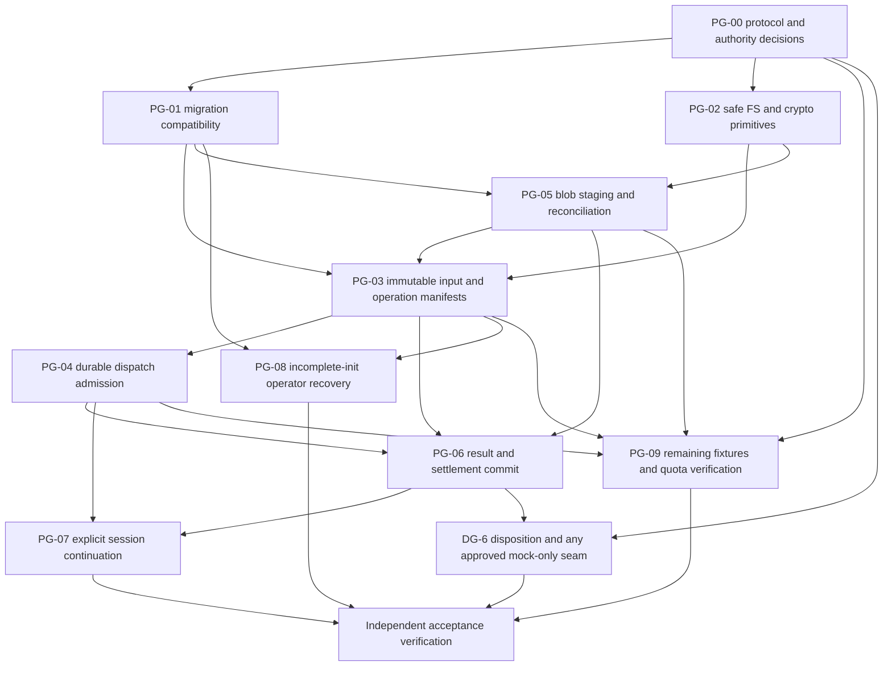

# Phase 1 Acceptance Criteria Gap Analysis & Remediation Planning

Date: 2026-11-07. **Planning only. Phase 1 remains NOT APPROVED.** No remediation, experiment, production/test/API/schema/dependency/configuration change or Phase 2 work is implemented or authorized by this document. Proposed states, records and test IDs below describe missing work, not existing capabilities.

## 1. Executive summary

The [final independent verification](PHASE1_FINAL_VERIFICATION.md) correctly distinguishes the working Windows x64 foundation from full Phase 1 acceptance. The central gap is not SQLite transaction atomicity: it is the absence of a durable operation identity and recovery protocol spanning session continuation, dispatch, blob promotion, result admission and settlement. Current restart safety preserves committed sessions, grants, audits and conservative budgets, but cannot reconstruct a complete interrupted operation or its immutable inputs/results.

Remediation should extend the existing Core/repository boundaries in small slices, preserving the accepted local SQLite/blob architecture. No ORM, second database, distributed workflow service, host execution fallback or universal exactly-once claim is needed. Real target execution remains disabled even while trusted synthetic fixtures validate the recovery protocol.

The recommended order is: approve recovery/compatibility decisions and critical dependency/FS prerequisites; establish compatible migrations and safe content-identity primitives; implement blob staging/reconciliation needed to retain immutable inputs; persist input and operation bindings; add durable dispatch intent; atomically admit results and settle budgets; add explicit session continuation and incomplete-init operator recovery; close remaining path/quota/process-tree verification gaps; obtain independent closure verification. Some storage/identity preparation can run independently; the dependency graph below prevents dependent work from outrunning its evidence.

**F-611-02 remains open** before Phase 2 production readiness. Preferred initial direction: **explicit operator recovery**, not an automatic delete/recreate procedure. Atomic staging remains an alternative with additional Windows publication/durability obligations. **OQ-25 remains open**; single-foundation-session identity is a bounded architectural limitation, not an independently demonstrated original Phase 1 requirement for multiple sessions per repository. Resume of the same session is required; multi-session expansion is not silently added.

## 2. Authority, provenance and baseline

### 2.1 Source hierarchy and exact original criteria

The first Phase 0 baseline containing ROADMAP and REQUIREMENTS is commit **`52eed96dd49b41240ac58ab07f17374daf0888e1`**, inspected with read-only `git show`/history commands. Its ROADMAP § Phase 1 is lines **11–24**: delivery wording at line 15 and six acceptance bullets at lines 19–24. The same six bullets remain verbatim in the [current ROADMAP](../../ROADMAP.md#phase-1--technical-validation-and-local-foundation). REQUIREMENTS has not changed since that baseline. The added F-611-02 bullet first appears in commit `354021954f33768a76d6dbecfc1f37b7fed41a60`; it is a later explicit readiness requirement, not an invented seventh original criterion.

Further sources are [REQUIREMENTS](../../REQUIREMENTS.md), [ARCHITECTURE](../../ARCHITECTURE.md#shared-workflow-and-persistence), [DATA_MODEL](../DATA_MODEL.md), [VALIDATION](../VALIDATION.md), [CORE_ENGINE_DESIGN §14](CORE_ENGINE_DESIGN.md#14-acceptance-criteria-for-implementation-sub-increments), ADRs and dated implementation/review evidence. The requirements' own qualifier remains: “Phase references identify the earliest delivery gate, not automatic approval to begin it.” The matrices retain P1, shared P1/P2 and later gates separately; they do not convert every future release requirement into mandatory Phase 1 product functionality.

The analysis labels RM-*, REQ-*, CD-* and PG-* are traceability/planning labels only; they do not replace or change the acceptance text. Every quoted requirement below is repository text. The plan addresses the existing closure rejection without using the prior report's possible scope-rebaseline route: **no original criterion is changed or waived here**.

### 2.2 Actual entry state and inspection

Entry: clean **`develop`**, HEAD **`a752449fc25002fa7d839624cec8b3a37b0f082e`**, locally recorded `origin/develop`, **0 ahead / 0 behind**, **281 index entries**, 0 staged/modified/untracked. Physical index SHA-256: **`844d2998329431c4693629fe148184eac5bab074066d7bc402a1aba345f20b8d`**. All tracked-file hashes, index entries/bytes, reference targets and reachable history were captured in memory before edits.

The intervening owner commit relative to the final verification baseline contains only PROGRESS and PHASE1_FINAL_VERIFICATION; no production/test changes are inferred from it. Actual current source was nevertheless inspected: session/domain models, all six schema tables, migration validation, persistent context/grant/budget operations, CoreService preparation/dispatch/evidence/settlement, LocalWorkspace and CLI, execution/result types and evidence verifier. Existing native process-recovery tests and the sandbox timeout fixture were read. Installed Rust std filesystem documentation was read locally; no network lookup or Windows behavior experiment was performed.

Historical [5.6.2.2 remediation](INCREMENT_5_6_2_2_SECURITY_REMEDIATION.md), [policy hardening](INCREMENT_5_6_2_2_2_POLICY_AND_VALIDATOR_HARDENING.md), their independent reviews, [6.1](INCREMENT_6_1_LOCAL_CLI_FOUNDATION.md), [6.1.1](INCREMENT_6_1_1_INDEPENDENT_REVIEW.md), [6.1.2](INCREMENT_6_1_2_STORAGE_SEMANTICS_DOCUMENTATION.md) and the final assessment are consistent about the restricted profile. No current evidence contradicting their bounded approvals was found. Missing recovery was already disclosed, not newly reclassified as implemented.

## 3. Acceptance traceability matrix

Classification names are **Implementation Gap**, **Verification Gap**, **Design Gap**, or **Satisfied**. Where a criterion has several clauses, rows split them explicitly; a satisfied clause does not pass its incomplete parent. Existing evidence below was inspected, **not rerun in this planning task**.

### 3.1 Original ROADMAP Phase 1

| ID / exact source location | Original requirement, verbatim | Current implementation and existing validation | Missing work / final classification | Required closure evidence |
| --- | --- | --- | --- | --- |
| RM-D, baseline ROADMAP:15 / current Phase 1 delivery paragraph | “Deliver a reusable Rust-core candidate and Windows CLI foundation for discovery, session manifests, policy decisions, local storage, inspection, cancellation, and recovery. Validate core-language and process/storage choices before expanding the workspace. Design extension schemas before loading third-party plugins.” | Rust Core and CLI, metadata discovery, policy, SQLite and inspection exist. Contract documents precede plugin loading; no plugin loader exists. Final assessment verifies restricted x64 behavior. | **Implementation Gap:** durable manifests, continuation and recovery; cancellation remains simulated in the service. No need to build plugins or a general scanner. | PG-03–PG-09 evidence for the missing foundation clauses; preserve extension design and disabled unsupported capabilities. |
| RM-1, baseline ROADMAP:19 | “Build and run the candidate on Windows x86_64 MSVC with documented linker/SDK prerequisites; record exact toolchains. If the Rust gates fail, compare a small Go or C# alternative and supersede ADR-0002 before continuing.” | Recorded x64 compile/link/run and current final verification/native build pass; exact tools recorded. ARM64 compile attempt failed because target was unavailable. | **Satisfied** for the expressly named x64 candidate. Full ADR-0002 suitability review remains open; ARM64 is not substituted for this criterion. | Retain exact x64 evidence; rerun after authorized changes. No Go/C# fallback is triggered by a passed x64 gate. |
| RM-2a, baseline ROADMAP:20, first clause | “Pass path fixtures covering spaces, Unicode, CRLF, junction/symlink escapes, case collisions, archive traversal, and dirty Git inputs.” | Workspace static containment, Unicode/spaces, aliases/case, symlinks/junctions and metadata canaries have tests; CRLF evidence also exists in the Rust spike. No archive ingestion or immutable dirty-input acquisition exists; case-alias resolution does not prove every manifest case-collision behavior. | **Verification Gap** for end-to-end archive/dirty-Git and canonical input collision coverage; associated snapshot implementation is separately missing under REQ-F01/F02. Metadata-path success alone does not pass this entire clause. | PG-09 hostile archive/explicit dirty-worktree and canonical-collision fixtures through the actual approved input boundary. Rejection/no-extraction is a valid proposed narrow capability only with explicit unsupported behavior and assertions; not assumed to pass today. Unsupported filesystem prerequisites remain explicitly untested, not silently passed. |
| RM-2b, same bullet, second sentence | “No target build scripts execute during discovery.” | Metadata discovery never runs Git, package managers, target hooks/builds or executables; existing canary fixtures pass. | **Satisfied** for current metadata-only discovery. New acquisition/parser code must preserve it. | Regressions proving no target process/import/hook execution after PG-02/03/09. |
| RM-3, baseline ROADMAP:21 | “Persist and resume a session; interrupt at task dispatch, blob promotion, and result commit; show no lost committed events and no repeated sensitive side effects.” | Committed session/security/audit/approval/budget state survives native process termination. Post-prepare crash tests preserve consumed grant/hold and reject replay. No task/outbox, durable execution/result records or blob store exists. | **Implementation Gap**, with missing crash proof: reopening/inspection is not complete continuation, and no blob/result boundary exists to test. | PG-04–PG-07: real owned process kills before/after every commit/promotion/dispatch boundary, restart discovery, explicit resume, conserved events/identity, no duplicate controlled effect, repeated recovery no-op. |
| RM-4a, baseline ROADMAP:22, first sentence | “Reject expired, replayed, out-of-scope, and revision-mismatched approval records.” | Canonical operation/context/revision/provenance checks and atomic single use are implemented; negative A-to-B, stale/expiry/replay and cross-process tests pass. | **Satisfied** for the current trusted local boundary; not worker/human authentication. | Preserve all existing cases and extend binding to the new immutable operation/input records; no upgrade of legacy unbound grants. |
| RM-4b, same bullet, second sentence, first clause | “Bound tasks, output, and storage;” | Fixed-point cost reservations, discovery bounds, resource-limit validation and post-allocation 50-MiB evidence checks exist. No durable task admission/queue cap, streamed input/blob quota or complete persistent-storage bound exists. | **Implementation Gap:** validated numbers are not enforcement of future buffers, queue fanout or disk growth. | PG-04/05/09 atomic quota reservations, bounded readers/writers, task/output/storage exhaustion and overflow tests; preserve conservative usage. |
| RM-4c, same sentence, last clause | “show cancellation reaches a process tree in the platform spike.” | Sandbox PROTO-09 kills a container running `sleep 30` and reaps the client; PROTO-10 checks no leftover containers. Service cancellation is explicitly synthetic. | **Verification Gap:** the inspected spike does not enumerate/assert parent-child-grandchild termination. A single sleeper/cleanup does not establish the full tree property. | PG-09 trusted, owner-controlled descendant fixture with readiness barriers and termination evidence for all descendants, late result denial and uncertain cleanup. This is not a new host execution fallback or a demand to run untrusted code. |
| RM-5, baseline ROADMAP:23 | “Meet or explain/revise Q-05 with measured hardware, repeated runs, and raw results. A failed performance target is recorded rather than concealed.” | Final verification records three 10,000-file runs: 9481/8836/8796 ms, complete=true, under 512 MiB, declared CPU/RAM and source/output evidence. | **Satisfied** for the bounded reference fixture; not every repository or the future snapshot path. | Retain denominator/raw results and rerun the affected benchmark after authorized boundary changes; report failures rather than revising implicitly. |
| RM-6, baseline ROADMAP:24 | “Demonstrate an authenticated control-channel prototype to a disposable Linux VM candidate, or record a blocking prerequisite before any untrusted execution feature is enabled.” | Hyper-V permission/backend prerequisite is recorded, and shipped backends/CLI keep untrusted execution fail-closed. ARCH socket/VHDX entries are design-only. | **Satisfied by the explicit blocked-prerequisite alternative**, not by a proven guest channel. | Keep the feature disabled. Dedicated VM/authentication/containment/cancellation evidence is mandatory before its later enablement, not silently added to this alternative. |

### 3.2 Required input/recovery contracts and design-checklist gaps

| Source / original requirement, verbatim | Current implementation and validation | Missing work / final classification | Required closure evidence |
| --- | --- | --- | --- |
| REQUIREMENTS F-01: “MUST ingest an authorized local source snapshot and identify project roots, manifests, languages, and unsupported components without executing target code.” | Canonical root/entry names and Cargo filename markers; discovery has no source-content access authority or immutable snapshot. | **Implementation Gap:** admitted local content snapshot, narrow tested technology inventory, explicit unsupported scope. | PG-02/03 immutable-byte/path/inclusion tests; narrowly declared language/manifest detection and unsupported cases, no target tool invocation. |
| REQUIREMENTS F-02: “MUST record canonical input identity, scope, exclusions, operator, authorization reference, policy digest, and budgets before planning work.” | SessionId, canonical workspace string, operator label, policy label/effective identity, epoch, supplied revision and budget exist. CLI revision is `local:unversioned-metadata-only`; no source digest/scope/exclusion/authorization manifest. | **Implementation Gap:** complete persisted binding before any plan/admission. `policy_digest` field naming and canonical action strings are not cryptographic evidence. | PG-03 versioned canonical manifests, immutable content references, explicit authorization/scope/classification, exact policy/budget association and pre-admission rejection of missing fields. |
| REQUIREMENTS F-14: “MUST offer session inspection, cancellation, crash recovery, and bounded retry.” | Inspection and SQLite retry/rollback work; session states persist; synthetic cancellation and conservative settlement exist. | **Implementation Gap:** explicit safe continuation plus durable application recovery. Process-tree spike verification remains RM-4c; real VM cancellation is later gated. | PG-04–PG-09 state-by-state process restart, uncertainty, no duplicate effect, cancellation and bounded complete-operation retry tests. |
| REQUIREMENTS F-16: “MUST define versioned tool, language, execution, provider, and integration adapter contracts before third-party loading.” | [EXTENSIONS](../EXTENSIONS.md) and the related design contracts define version/capability boundaries; third-party loading is not implemented. | **Satisfied** for the P1 design-before-loading obligation, not implemented adapters/SDK conformance. | Retain the contracts; actual loading and conformance remain later gates. Recovery must not introduce an unreviewed plugin bypass. |
| REQUIREMENTS Q-03: “MUST support deterministic replay of recorded decisions without reissuing side effects. Live model reruns are not guaranteed deterministic.” | Approval/budget history is durable, but complete immutable requests/decisions/results are not. | **Implementation Gap:** read-only reconstruction of past decisions and effect-free replay distinct from dispatch retry. | PG-03/04/06/07 replay produces the same decision trace with zero backend calls, grant consumption, budget change or duplicate success audits. |
| REQUIREMENTS S-09: “MUST retain append-only logical events and content-addressed evidence; MUST NOT claim resistance to a compromised storage administrator without an external trust anchor.” | Transactional audit events exist; evidence is an in-memory object, no content-addressed persisted store. | **Implementation Gap** for evidence; administrator-tamper limitation is already correct. Shared P1/P2 requirement, not proof all future exports must ship now. | PG-02/05/06 verified content addressing, reference/retention accounting and atomic event/result association; no tamper-proof claim. |
| REQUIREMENTS Q-04: “MUST version schemas, preserve provenance across migrations, and reject incompatible writers.” — existing foundation | Version-1 exact-DDL/history validation and newer-schema rejection work. | **Satisfied** for the existing v1 envelope; this is not validation of a future upgrade. | Preserve the passing v1 integrity/drift/newer-version cases. |
| Same Q-04 requirement — required recovery extension | Current validator intentionally accepts only one exact v1 history/schema; new recovery records are not defined. | **Design Gap:** extension versioning/compatibility contract requires authority. | Approved PG-01 migration plan; preserve old history, atomic upgrades, unknown-newer/old-writer refusal and interrupted-upgrade tests. No unapproved version/DDL chosen here. |
| CORE_ENGINE_DESIGN §14 / 5.2: “Approvals verify action digests, revision hashes, and expiration timestamps.” | Exact supplied revision/action/expiry binding passes tests; supplied revision is not independently verified content identity. | **Implementation Gap** for input-derived revision truth, not a new failure of string-binding tests. | PG-03/04 bind verified snapshot/version to context; revision/input substitution invalidates admission even when caller repeats an old string. |
| CORE_ENGINE_DESIGN §14 / 5.4: “Session, audit event, approval, and evidence tables created with versioned schemas.” | Six actual tables contain sessions/snapshots/audits/approvals/budgets/migrations, but no evidence references. | **Implementation Gap:** evidence/reference persistence; approved six-table foundation was an increment, not this whole design item. | PG-01/05/06 compatible persisted evidence/provenance/reference records and tested FK/uniqueness/upgrade rules. |
| CORE_ENGINE_DESIGN §14 / 5.4: “Startup reconciliation identifies and prunes unreferenced blob files.” | No blob directory/registry/reconciler or safe GC exists. | **Implementation Gap**; cleanup authority/concurrency must first be designed and approved. | PG-05 distinguish staged/unreferenced/in-flight/referenced/corrupt files; prune only proven eligible owned data under approved policy, never active references or uncertain files. |
| CORE_ENGINE_DESIGN §14 / 5.5: “Evidence verifier independently computes SHA-256 and verifies envelope length and media types.” | Length/media checks work. `is_crypto_available()` is false; declared SHA fails closed. | **Implementation Gap**, blocked by audited crypto approval/availability. A rejection because crypto is absent is not computed-integrity validation. | PG-02 approved implementation, independent known-answer and corruption tests; PG-05 hash actual stored bytes; retain structural-versus-crypto status. |
| CORE_ENGINE_DESIGN §14 / 5.5: “Corrupted or mismatched evidence envelopes rejected with typed verification errors.” | Structural mismatch cases pass; cryptographic comparison is unavailable. | **Implementation Gap** for content-corruption detection; structural portion Satisfied. | PG-02/05/06 same-length substitution, corrupted content/digest mismatch, foreign provenance and typed redacted errors. |
| CORE_ENGINE_DESIGN §14 / 5.6: “Unified `CoreEngine` struct orchestrates session, workspace, policy, persistence, provider, and execution.” | CoreService provides the shared coordinator and provider-free CLI. The 62-test mock gateway remains a separate experiment. | **Design Gap:** reconcile the optional provider seam with this design item; renaming CoreService is not remediation. REQUIREMENTS F-15's two real backends are P2, not a new P1 demand. | PG-00 owner disposition of an optional/mock-only core seam, if required, and its tests. No SDK/transport or arbitrary adapter loading is assumed authorized. Keep this item open until resolved with evidence. |
| VALIDATION V-02: “Interrupt before/after outbox commit, blob promotion, result commit, checkpoint, and backup; restore and reconcile orphaned artifacts” | Native checkpoint/migration/commit crash tests exist; Bun T07 verifies VACUUM INTO snapshot backup/restore. No outbox/blob/result integration exists. | **Implementation Gap** for missing boundaries; integrated/native restore proof is also missing. Engine-only backup is not application recovery proof. | PG-04–PG-07 native recovery/consistent owned backup-restore fixtures including referenced blobs. ADR-0003's P2 backup/upgrade product gate remains separate; a full backup CLI is not added to P1. |
| VALIDATION V-05: “Exercise expiry, revocation, revision change, concurrent reservations, lease loss, and idempotency” | First four have native regressions; no execution lease/outbox or complete-operation idempotency exists. | **Implementation Gap** for lease/attempt recovery; Verification Gap at future crash boundaries. | PG-04/06/07 lease expiry must not infer termination; same-attempt duplicate delivery/result and stale-owner tests. |
| Later ROADMAP readiness bullet / F-611-02 | “Resolve **F-611-02 / OQ-25 incomplete initialization recovery before Phase 2 production readiness**” | 6.1.2 records crash windows and two alternatives; current init still writes destination and rejects incomplete stores. | **Design Gap**, with subsequent Implementation and Verification Gaps. This quoted prefix is identified as a later addition, not a replacement for RM-3. | Preferred operator-recovery decision and PG-08 evidence; entire current bullet, including separate authorization and original-file preservation, remains in force. |

Already satisfied foundation clauses—default-deny, explicit classification order, transaction rollback/WAL/FK checks, current exact approvals, metadata quarantine/limits, offline synthetic integration and CLI inspection—remain regression obligations. No new task/worker, source-read or provider feature may borrow those results as proof of its new boundary. ADR-0002/0007 stay Proposed; all other ADR statuses are unchanged.

## 4. Persistent session continuation

### 4.1 Current behavior

`sessions.state` can persist every defined state: Created, Scoped, Planned, Running, WaitingForApproval, Paused, Completed, Failed and Cancelled. The [state machine](../../crates/sentra-core/src/session/state.rs) allows Paused-to-Running and rejects transitions from terminal states. The [repository](../../crates/sentra-core/src/persistence/repository.rs) commits state transitions and audits atomically. A committed state survives ordinary process loss under the tested SQLite recovery envelope; no guarantee covers untested power/device failure.

A new controller can reopen storage and inspect a known SessionId through CoreService, or the sole valid session through LocalWorkspace/status/session-show. This is **reconstruction/inspection, not durable work continuation**. Session security snapshots preserve session identity, operator/root/mode, floor, effective policy identity, generation, supplied revision and budget limit; approvals/reservations/audits persist separately. Missing/corrupt snapshots, incompatible schema, policy mismatch, stale epochs, unknown provenance and expired/consumed receipts fail closed. New Arc seals do not make serialized receipt IDs trustworthy: only the privileged recovery API can reconstruct an issued grant after revalidation. Consumed grants stay consumed; uncertain spend stays held.

Current local inspection distinguishes valid single-session state from schema-only/Created-only/multiple-session incomplete state, but cannot establish whether a Running session was actually running work at death: no durable task/attempt/result registry exists. No CLI resume command, pending-work recovery queue or replayable plan exists. Current transition_session is a state transition API, not a restart/reconciliation protocol or proof that old grants/inputs are safe after a pause.

### 4.2 Proposed minimum continuation policy

1. Startup/status remains domain-state read-only and returns bounded inventory/recovery diagnostics; it never silently changes Running to a replayable state, consumes grants or dispatches work. SQLite/storage side effects disclosed by 6.1.2 remain applicable.
2. Introduce an **explicit trusted lifecycle operation** for recovery/resume, separate from ordinary task requests and read-only inspection. Its exact API/CLI syntax requires approval; do not add a caller-controlled resume-trusted flag.
3. Re-establish workspace and immutable input identity, schema/policy compatibility, operator authority, classification floor and budgets before planning continuation. Keep SessionId/creation identity stable; preserve history. Corrupt or incomplete bootstrap is handled separately under F-611-02, never adopted as a resumable session merely because a row exists.
4. Resolve or conservatively fence every outstanding attempt first. Terminal sessions remain immutable. Waiting-for-approval remains waiting until exact current approval; Paused requires explicit resume; an interrupted Running state does not authorize automatically restarting its last task. Uncertainty is an orthogonal recovery/attempt disposition, not a silent new terminal-session edge.
5. Recommended design: explicit resume/recovery advances the trusted authorization generation atomically with its lifecycle/audit decision, invalidating pre-resume dispatch contexts and unconsumed grants for new execution. A no-op equivalent-policy registration must not be abused to skip this boundary. Define this through the privileged lifecycle, not by weakening existing policy no-op or ABA protections. Historical consumed records remain immutable.
6. Reconstruct plan/decision history without executing effects; only a separately authorized current admission may select an unstarted eligible task. Completed tasks/results are not rerun. Current real/untrusted backends remain unavailable.

**Required planned tests:** S1 reopen each committed state and preserve identity/floor/policy/budget/grants; S2 valid record versus incomplete/corrupt/foreign/migrated state; S3 explicit Paused/Waiting/terminal rules; S4 old generation/revision/manifest or expired approval denied after resume; S5 two controllers compete for resume, one authoritative lifecycle result; S6 kill before/after resume commit and re-run recovery twice with no duplicate audits/dispatch/budget release; S7 completed first task plus unstarted second task resumes only the latter in an owned synthetic plan. These are proposed tests, not newly passed cases.

## 5. Dispatch recovery

### 5.1 Current failure windows

CoreService currently mints an authoritative ExecutionContext, then atomically reserves budget/consumes a supplied approval and inserts their audits. **Only after commit does it allocate ExecutionId and construct/dispatch ExecutionRequest.** Request/action, logical task plan, execution/lease/backend identity and a dispatch outbox are not durably recorded. A reservation/audit is evidence of preparation, not proof the backend started.

After a process dies, SQL can show consumed approval/held budget but cannot distinguish before-call, running, completed-with-lost-reply, failed or cancelled work. Existing actual post-prepare exit tests correctly preserve the pair and reject grant replay; they do not implement discovery and recovery of work. An automatic action with no grant also lacks a durable operation idempotency key: recovery must not infer deduplication from approval consumption alone.

### 5.2 Proposed minimal attempt protocol

Use a small durable logical-task/attempt ledger inside the existing repository, not a generic workflow rewrite. The exact tables, version numbers, fields and public API remain unapproved. Allocate durable operation/attempt/ExecutionId and canonical request identity **before any external execution**, with database uniqueness; identifiers are references, never authorization proofs. Bind immutable inputs, scope, target revision, resource/output policy, backend/tool version, classification, authoritative policy/generation, budget owner, reservation and grant reference to the same operation. A supplied label alone must not establish any binding.

Deduplication uses the persisted logical operation/attempt identity and its exact specification, not an action digest alone: two intentionally different operations may have identical parameters. An acknowledgement lost after recording must let the trusted client rediscover the same operation; a conflicting resubmission under that identity is denied. A backend release capability must be derived from the durable authorized release, not caller-constructed or inferred from a log message.

| Proposed attempt state | Meaning and permitted recovery |
| --- | --- |
| Recorded | Durable specification exists; no budget/approval/admission outcome yet. Fresh complete authorization is required. |
| Prepared | Same transaction validated current context, reserved budget, consumed any required grant, recorded attempt and audits. No dispatch-release transition has committed. Only protocol evidence—not absence of a result—can prove not released. |
| ReleaseRecorded / AwaitingOutcome | Durable release intent commits before calling/sending to the backend. A crash may occur before the actual call. Treat ambiguous release as possibly started, never automatically as not-started. |
| RunningConfirmed | Trusted correlated acknowledgement for this attempt/fence, when the approved receiver supports it. It is not a terminal result. |
| ResultRecorded | Correlated admitted terminal outcome and settlement disposition committed. Distinguish Completed, Failed, Cancelled and TimedOut; unknown usage may remain held even after known completion. |
| Uncertain / ReconciliationRequired | Release/start/completion/termination or provenance cannot be established. No automatic new effect attempt, refund, grant reuse or success claim. Preserve evidence/holds. |
| NotStartedConfirmed | A trusted, scoped reconciliation proof establishes no execution occurred. Any new attempt requires fresh policy/context and appropriate fresh approval; do not unconsume an old grant. |

Proposed flow: `Recorded -> Prepared -> ReleaseRecorded -> RunningConfirmed? -> ResultRecorded`; any ambiguous post-release interruption goes to reconciliation, not directly back to Prepared. Recovery state transitions and audit inserts are conditional/atomic and idempotent. The normal authorization checks apply to recovery at least as strictly as to first execution. Session/context transitions and dispatch-release use compatible lifecycle fencing. Lease expiry/PID absence is not termination proof; stale owners/replies cannot act under a new fencing epoch.

### 5.3 Delivery guarantees

- **At-most-once automatic effect admission** is the safe default for an ambiguous sensitive attempt. It may sacrifice liveness after release-intent commit but before the call. Do not market it as exactly once.
- ADR-0003's **at-least-once delivery** may redeliver the **same attempt** only to an approved receiver with durable deduplication/queryable execution identity and fencing. A repeated envelope is not a fresh authorization or a new logical attempt. Without those capabilities, transport retry stays disabled and ambiguity requires explicit reconciliation.
- Local conditional SQL can guarantee one accepted terminal record/reservation transition; it does not guarantee exactly-once external business effects. Neither a consumed grant, a lease nor a unique result row proves an effect happened once.
- A new attempt requires proven non-start or a separately approved safe/idempotent retry disposition, plus its own identity and fresh current authorization; the old approval remains consumed. Failed status alone may include partial external effects and is not retry permission. Completed or uncertain effects are never blindly replayed. Do not retry provider/network/filesystem effects inside database transaction closures.

**Required planned tests:** D1 kill before/after intent, prepare, release, call, start acknowledgement and result acknowledgement; D2 one reservation/consumption/audit set under concurrent processes; D3 no-grant logical operation duplicate admission; D4 receiver accepts duplicate same-attempt delivery once and rejects a stale fence; D5 controller restart with unknown backend outcome holds approval/budget and reports uncertainty; D6 fresh reads/recomputation after BUSY_SNAPSHOT and rollback after either audit failure; D7 budget exhaustion leaves a valid unconsumed grant reusable; D8 old context/manifest/backend/scope/cost substitution fails with zero mutation. Use only approved trusted synthetic receivers/effect counters for Phase 1 proof; real target/profile capability remains a separate gate.

## 6. Blob recovery

### 6.1 Current state

EvidenceEnvelope/Artifact are in-memory types. No production blob staging store, locator registry, reference table, promotion protocol or GC exists in schema_v1. The verifier checks lengths/media after Vec allocation; no crypto backend is available. There is therefore no current database/blob atomicity, orphan/dangling-reference reconciliation, partial-write classification or persisted content identity to validate. SQLite integrity alone cannot validate missing or substituted external files.

### 6.2 Proposed invariants and protocol

Preserve ADR-0003's **reconciliation**, not fictitious SQL/filesystem atomicity. After PG-02 approves safe FS access and audited hashing, use a bounded streamed staging writer owned by Core on protected local storage outside the workspace. Producer/caller paths are never trusted locators. Content addressing must use actual verified bytes with an algorithm-tagged cryptographic digest; canonical action IDs, FNV, byte counts or labels are not substitutes.

1. Record ownership, quota reservation and a bounded staging intent before creating a Core-selected file; use exclusive creation/no-follow and a verified storage boundary. Never reuse a caller-supplied path or overwrite an existing object.
2. Stream with byte limits and compute the approved digest; handle disk-full/I/O/flush/close failure explicitly. Partial/unflushed/unverified files remain staged or uncertain, never Ready/admissible. Do not read an arbitrary-length payload into Vec first.
3. Persist verified content/length and promotion intent. Promote using an approved same-filesystem no-replace protocol. Existing content-addressed destinations must be reverified/authorized for deduplication; matching names do not prove content. Conflicts preserve both evidence and the valid existing object, not overwrite it.
4. After durable promotion is established, mark Ready under a conditional repository transition. Results/manifests may create live references only to validated Ready data. A crash between promotion and SQL finalization is reconciliation work, not lost committed success.
5. Reconciliation separates partial stage, verified stage, promotion-in-progress, Ready-unreferenced, live-referenced, missing/dangling and corrupt/substituted states. Missing/corrupt referenced data makes its result/input unavailable or corrupt; never delete the reference to conceal the failure or silently restore from an untrusted file.
6. Pruning requires approved ownership/retention policy, no live **or pending** result/input reference, no staging/promotion lease, no protected backup/retention pin, and stable ownership/fencing across the final check and filesystem action. A GC candidate state must prevent concurrent reference attachment or atomically cancel GC before a writer attaches. Scan age or session-local reference counts are insufficient.
7. Startup may prune only proven eligible owned orphans under that approved policy. Unknown ownership, uncertain I/O or active references stop removal. Record quarantine/deletion state and audit consistently; interruption during cleanup must be recoverable. Keep the design-checklist pruning item open until this behavior is implemented/tested; a report-only scan is not that feature.

Cross-session deduplication must not disclose classified content existence or broaden read access; every reference retains session/input/result ownership and classification. SHA-256 transport/content integrity still does not establish producer honesty, vulnerability truth or semantic correctness.

The Ready transition must **not** drop the durable pending-reference/ownership pin before the result or input commits its live reference. Convert that pin atomically with reference admission or retain it for reconciliation; an unreferenced Ready file can otherwise be collected between promotion and result commit. Ownership-pin expiry alone cannot prove a live producer has stopped.

**Required planned crash points:** B1 before stage-intent commit; B2 after intent/before create; B3 mid-write; B4 after write/before successful flush/close; B5 after verification/before promotion; B6 after promotion/before Ready commit; B7 after Ready/before result/input reference; B8 during quarantine/prune before/after its SQL marker. For each, kill a real owned process, reopen, reconcile twice and compare acknowledged data/events. Also test same-length corruption/substitution, missing blobs, Unicode/long/alias/reparse paths, hash-name collisions with different bytes, two concurrent promoters, GC-versus-reference race and exhaustion/overflow. Physical power-cut/fsync-device tests require an independently approved safe environment and must remain unverified if unavailable.

## 7. Result recovery

ExecutionResult and TaskExecutionReport are returned in memory, not persisted as complete results. Validation correlates ExecutionId and outcome/exit/time consistency, but there is no durable original request/dispatch record to join after restart. Evidence descriptors are transient strings. Budget settlement/audit is transactional on its own; result/evidence admission and settlement do not share a durable result transaction. Death after effect/result receipt but before settlement can retain a hold with no retrievable result; death after settlement can lose the returned result.

Proposed minimum:

- Persist a canonical result receipt bound to session, logical task, exact attempt/ExecutionId, fencing epoch, original authoritative context/manifest, backend/tool identity and trusted producer. Validate those associations against durable intent, not caller metadata. A foreign session or merely matching ExecutionId cannot supply ownership.
- Separate `operation outcome` from `evidence completeness/integrity` and `usage known/unknown`. Completion with unknown actual usage retains the conservative hold. Partial output/cancellation is not a clean success; estimates never become measured usage.
- Bound/stage the receipt and its blob inputs; verify expected producer/context/classification and actual bytes before admission. Classification must not downgrade source/session/request floors. A valid digest is not producer authorization. Unverifiable/stale/conflicting receipts remain rejected/quarantined, not auto-admitted by restart.
- Commit terminal result identity/outcome, live evidence references, attempt state, budget settlement/held disposition and corresponding audits in **one** controlled SQLite transaction. Reuse existing validation through private transaction-level composition; do not call nested public write methods or hold a DB transaction during filesystem/network work.
- Unique attempt/result constraints allow one accepted terminal result. An exact repeated receipt returns the already committed outcome without another settlement/success audit. Different terminal data for the same attempt is a conflict requiring preservation/reconciliation, never last-write-wins. Delivery timestamps must not make an otherwise identical repeated receipt look different; canonical receipt semantics need approval.
- After commit/before acknowledgement, recovery redisplays the stored result, not redispatches the task. If commit failed, keep conservative reservation and bounded receipt evidence for explicit retry of **admission**, not execution. Preserve both typed operation and secondary persistence errors.
- Old-generation receipts may be retained as restricted historical reconciliation evidence under their original binding; they never authorize new current-context effects. The exact permitted historical-result reconciliation rule requires PG-00 approval; fail closed if provenance cannot be established.

**Required planned tests:** R1 death after execution/before receipt, mid-receipt, after verified blobs/before SQL, during SQL, after commit/before reply; R2 exact duplicate/contradictory duplicate and concurrent receivers; R3 injected result/evidence/audit/settlement statement failures roll back the whole database outcome; R4 foreign session/task/attempt/manifest/backend/fence/classification rejected; R5 changed policy/revision and late worker replies cannot authorize new work; R6 success/failure/cancel/timeout/partial/uncertain usage survive restart distinctly; R7 replay of a recorded terminal decision has zero backend calls and no additional charge/refund/grant consumption.

## 8. Input, manifest and reproducibility evidence

| Required evidence | What is actually recorded now | Minimum planned evidence / gap |
| --- | --- | --- |
| Original input identity | Canonical workspace string and supplied target_revision; foundation SessionId | Verified immutable selected-byte snapshot/reference with algorithm-tagged content identity. Path and repeated revision string do not prove immutable content. |
| Input content/reference | Metadata observation only; no source snapshot persistence | Stable read-only admitted snapshot, file lengths/digests/relative paths, acquisition provenance and exclusions; no reference to a mutable checkout as the input of record. |
| Input classification | Session floor, request/evidence classification labels | Authoritative per-input/snapshot classification and no-downgrade propagation to manifests/results; labels cannot be trusted merely because supplied by a producer. |
| Revision/version | `local:unversioned-metadata-only` in CLI; arbitrary registered revision in Core | Explicit revision kind and verified content version; Git object ID/algorithm only when verified by an approved adapter. Never relabel working-tree bytes as a clean commit. |
| Manifest identity/canonicalization | No persisted session/source/operation manifest | Versioned deterministic encoding with fixed field order, unambiguous optional/list representations, relative-path encoding and declared Windows comparison policy. Stable content identity must not depend on arrival time. |
| Manifest/content integrity | Canonical action string; no implemented SHA computation | Approved cryptographic implementation over canonical manifest and actual selected content; recomputation tests. Action v2/FNV retain their distinct non-cryptographic purposes. |
| Scope/exclusions/authorization | Root/operator/policy labels but no complete scope/authorization reference | Explicit include/exclude policy and unsupported entries, operator/authority reference and creation provenance bound before planning. Possession of a path is not legal/human authentication. |
| Tool/backend/version | Runtime trait name/capability declarations; not durable | Exact fixture/tool/backend build/version or image/config/rule references, verified by trusted composition; capability flags are not VM attestation. NotApplicable when absent. |
| Execution configuration | ResourceLimits, action arguments/scope in transient ExecutionRequest | Immutable canonical operation spec including limits, argv order, output/storage/egress policy and sanitized environment/secret references, not secret values. |
| Policy/generation/budget | Persisted v2 security snapshot, canonical effective rules, context_generation and fixed-point budgets | Preserve these and bind the manifest/spec and budget owner to the same immutable context; approved upgrade invalidates old unbound authorizations. No new crypto claim for policy labels. |
| Session/dispatch correlation | SessionId/TaskId/ExecutionId in memory; no durable attempt join | Durable non-substitutable session/task/attempt/fence and manifest/config references allocated before release. Cross-process uniqueness/collision rejection tested; identifiers never grant authority. |
| Result/evidence provenance | In-memory metadata and structural checks; no blob/result records | Durable source/operation/producer/lease/result/evidence chain with actual integrity status, scope/classification, timestamps, limits/outcome/usage uncertainty and independent verification basis. |

Minimum Phase 1 acquisition can remain narrow: an explicitly authorized local working-tree snapshot, tested language/manifest hints with unsupported/unknown components visible, no remote fetch, no two-revision review, no automatic archive extraction and no target tools. Dirty modified/untracked content requires explicit inclusion and its own content identity. Fixture tests must verify included/excluded bytes, out-of-scope links and no implicit assertion that the source is a clean Git revision. Requiring a proven clean Git input without an approved reader must fail closed; do not implement a broad Git parser or execute target Git configuration for convenience.

Canonicalization must preserve byte/path distinctions rather than silently folding Unicode/case. Record the host/path policy, reject ambiguous collisions or unsupported cases, and sort using the approved deterministic encoding. Hashing metadata is not hashing content. Distinguish content digest, manifest ID, operation canonical identity and policy/context epoch; bind all security-relevant values even when content is deduplicated across sessions.

Safe source-content reads are gated by OQ-22: current ResolvedWorkspacePath is a metadata observation, **not content access permission or a race-free file handle capability**. Before PG-03, approve a safe handle/identity strategy or a narrowly audited dependency consistent with forbid(unsafe_code). If containment/identity cannot be established, stop content admission; do not replace it with a string-prefix, lexical-normalization or check-then-open shortcut. Complex/native target-facing parsers remain isolated; minimal metadata inference must be bounded inert data, never tool execution.

Do not reinterpret `DiscoverMetadata` or its current approvals as permission to read source/evidence contents. DG-1 must approve the distinct bounded acquisition/read capability, inclusion scope, classification and byte/resource policy, then bind it to the canonical operation/context before any content handle is issued. Legacy operation identities/grants cannot gain that new permission by default.

**Required planned tests:** I1 repeat identical canonical manifests versus changed bytes/path/scope/exclusions/config; I2 dirty/Unicode/case/CRLF inputs and declared unsupported cases; I3 symlink/junction/reparse/hardlink/replacement races and no outside read; I4 source changes during copy are rejected or captured from the approved immutable view, never mixed-version success; I5 changing any bound input/config/policy invalidates an old approval; I6 independent audit reproduces content/decision references without executing the operation or exposing secrets.

## 9. F-611-02 design analysis

Current windows remain file/DDL interruption (storage failure 5), schema without session (incomplete 6), Created without Scoped (incomplete 6), and committed valid Scoped before reply/checkpoint (original identity can reopen, subject to integrity/permissions/checkpoint). SQL DDL is transactional; do not infer a logically valid half-schema. Orphan DB/WAL/SHM/journal states remain preserved. No current recovery command or atomic staging exists.

| Alternative | Merits | Obligations and limits |
| --- | --- | --- |
| A. Atomic staging | Initialize/schema/register/scope in an exclusively created temporary database on the same filesystem; validate, checkpoint, safely flush/close, then publish. Reduces incomplete final destinations. | Must prove no-replace publication, concurrent-init/collision and Windows sharing/flush/crash semantics. Main DB and WAL/SHM/journal cannot be independently renamed and called atomic; committed data must not be left behind. Abandoned staging still needs recovery. Namespace atomicity is not power-loss durability. |
| B. Explicit operator recovery — **preferred first direction** | Fits the existing conservative fail-closed model and avoids relying on atomic publication of a multi-file live SQLite store. Clearly distinguish diagnosis, verified recoverable state and nonrecoverable/uncertain state; require explicit trusted operator action. | Preserve original files/recovery evidence; no automatic delete/replacement/whole-file overwrite. Only a validated ownership/context/consistency proof can allow a reviewed logical recovery transaction and audit. Generic zero-byte/version-zero/unrelated/corrupt stores cannot be silently adopted. Safe consistent preservation and exclusivity must be designed, not assumed. |

The installed Rust 1.99 std::fs::rename documentation was inspected offline (`share/doc/rust/html/std/fs/fn.rename.html` in the installed toolchain). It documents replacement when the destination exists, failure across mount points, and platform-specific Windows behavior. Therefore `exists` followed by ordinary rename is **not** a no-replace publication proof. No particular Windows FFI/API, unsafe code or dependency is selected here; no runtime rename/flush test was performed. SQLite checkpoints and retained handles have their own sharing/failure behavior on Windows. A safe publication interface would require separate review and synthetic NTFS tests.

For B, diagnosis must not itself imply permission to modify or ownership. Prove quiescence across all relevant managed connections/controllers before consistent preservation or reconciliation; current CLI-local admission alone cannot stop arbitrary external writers. If original recovery files cannot be preserved consistently, or ownership/provenance is unknown, stop and retain them in place. An explicitly chosen new storage path is **fresh initialization**, not recovery of lost committed identity, and cannot be presented as satisfying RM-3.

For a verified Created-only store, a future approved operation may reconcile it to Scoped only after current root/input/policy/classification/ownership validation and atomic lifecycle/audit binding. A valid already-Scoped store must return its existing identity, never create a replacement. Unsupported legacy/incomplete states retain error categories and evidence. The precise logical mutations, preservation protocol and user command are unresolved authority gates; this recommendation does not approve them.

**Implementation/verification requirements:** state-specific typed diagnosis/redaction; explicit trusted local-controller authorization under the existing protected-store/authority-capability model (not a request boolean or a claim of human authentication); same-session/epoch/budget/approval preservation; exclusive ownership proof; DB/WAL/SHM/journal consistency; no existing-file replacement; repeat recovery idempotency; real kills before/after each initialization/recovery commit; contention, collisions, sharing denial, checkpoint failure, partial preservation and rollback-failure tests. B may later combine with A, but neither is implemented/accepted by this plan. F-611-02 remains mandatory **before Phase 2 production readiness**, independently of multi-session timing.

## 10. OQ-25 assessment

Current CLI project identity is the one foundation SessionId in a dedicated database. Zero/multiple-session existing stores are rejected; Core can store several sessions but CLI cannot select among them. Consequences include ambiguous project ownership if the model is extended, absent project-to-many-session listing/aggregation, and a migration decision for independent project identity. A workspace path alone is not a stable project identity.

**Original-requirement assessment:** RM-3 requires resuming a persisted session; no original Phase 1 bullet or F-01/F-02/F-14 explicitly requires several sessions in one repository/database. The conceptual Project and ResearchSession records in DATA_MODEL do not by themselves prove a Phase 1 multi-session API deadline. Therefore the multi-session part of OQ-25 is a **separately scoped Design Gap/architectural limitation, not an additional independent Phase 1 closure blocker**. Phase 1 continuation can preserve the same single foundation session and many internal task/attempt records without claiming multiple sessions or introducing ProjectId now.

This does not close OQ-25, waive canonical input identity, or remove F-611-02's later explicit readiness gate. Any future independent project/multi-session model needs its own approved identity/migration/ownership design and must retain current fail-closed behavior until implemented and tested.

## 11. Security invariants and threat analysis

| Threat | Required mitigation and denial condition | Planned evidence |
| --- | --- | --- |
| Process termination at a commit/file boundary | Persist intents before effects; distinguish committed, partial and uncertain; retain recovery sets and holds | S6, D1, B1–B8, R1, bootstrap kill matrix |
| Concurrent controllers / stale leases | Conditional SQL transitions plus appropriate OS/controller/attempt fences; no lease-expiry-as-termination inference | S5, D2/D4, R2, promotion/GC race |
| Replay / duplicate dispatch | Stable durable logical/attempt IDs, receiver dedup only where proven, no automatic uncertain retry | D3/D4/D5, R7 |
| Stale session/policy/revision/input | Owner-only epoch binding, fresh revalidation at every release/recovery boundary, preserve no-op and ABA protections | S4, D8, I5 |
| Approval misuse / cross-session attribution | One authoritative context, immutable request+manifest binding, same-session reservation/result joins, no legacy receipt uplift | D2/D8, R4/R5 |
| Budget inconsistency / uncertain usage | Atomic reservation/admission/settlement/audits, integer overflow checks, actual-versus-unknown distinction, no inferred refund | D6/D7, R3/R6 |
| Blob substitution / corruption | Hash actual bytes with approved crypto, verify locator/identity/length, no overwrite/dedup by name alone | B corruption/collision cases, I3/I4 |
| Path/FS race / partial write | Approved safe content-handle strategy; fail closed before content access if identity/containment unavailable; bounded staging/flush proof | I3/I4, B2–B6 |
| Cleanup of referenced data | All-session live/pending references and retention/backup pins; GC state/fence prevents attach/delete race | B7/B8, concurrent reference/GC tests |
| Uncertain external effect / late result | Separate outcome uncertainty from usage, reject stale producer/fence, require explicit reconciliation, never unconsume grant | D5, R4–R7 |
| Diagnostic/private-data exposure | Typed redacted errors, bounded protected receipts/manifests, secret references and classification floors | Error-composition and canary regressions through new paths |

New recovery must be no more permissive than normal execution. Preserve all previous classification, state, canonical grant, single-use, atomic rollback, typed primary/secondary error, redaction and workspace invariants. `status` and `session show` remain domain-state read-only with disclosed SQLite/lock effects. Do not turn a recovered record or valid hash into automatic execution, finding verification or operator authentication.

## 12. Decisions, schema compatibility and dependency graph

### 12.1 Authority gates — analysis stops short of selecting contracts

| Gate | Decision still requiring approval | Effect on implementation planning |
| --- | --- | --- |
| DG-1 recovery/authorization protocol | Durable task/attempt states, historical-result treatment, resume epoch, fencing/idempotency guarantees and typed uncertainty | Recommend one narrowly scoped recovery/provenance ADR extending ADR-0003/0006 without superseding their invariants. No proposed state is an accepted API. |
| DG-2 schema/migration compatibility | Exact records/constraints, migration versions/history, writer compatibility and legacy incomplete/approval handling | Additional architectural authority required: stop before choosing DDL/version numbers. Only additive/conservative candidates are described. No auto-backfill that invents source identity, results or approval scope. |
| DG-3 safe filesystem/content access | Safe handle/containment/promotion/GC strategy under Windows and forbid(unsafe_code), including any necessary dependency | OQ-22 gate; no string/check-then-open workaround. A material trust-boundary change needs a separate ADR/security decision, never a VM-boundary downgrade. |
| DG-4 audited crypto/identity dependencies | Existing maintained SHA-256 implementation, exact cached versions/features/licenses, identifier uniqueness and authority semantics | No custom hash or new dependency is authorized. If an approved package is unavailable offline, implementation remains blocked pending separately authorized provisioning; do not download here. Dependency audit/ADR-0006 validation evidence may suffice without a redundant ADR. |
| DG-5 bootstrap recovery | Approve B, A or a justified combination and the preservation/exclusivity protocol | F-611-02 remains open; no cleanup command or automatic repair is authorized. |
| DG-6 optional provider seam | Resolve design §14 coordinator wording against completed mock contract and P2 real-adapter requirement | No real provider work is assumed. Preserve provider-free Core; record the narrow mock/NotConfigured behavior and any actual required integration test before closing that design item. |

Current migration code expects exactly version 1, one matching history entry and the exact six-table/index set. Extra tables without an approved migration will fail validation. Future versions must retain v1 provenance/checksum semantics, atomically apply ordered changes, reject unknown/newer schemas and incompatible old writers, and prove interrupted upgrades leave a supported state. Preserve terminal state, snapshots, audit sequence, consumed grants and budget holds. Legacy records lacking new immutable bindings remain history/read-only or require explicit trusted rebinding; never authorize them by inserting permissive defaults. Backup/restore compatibility of DB plus blob generations must be explicit. No destructive migration or old-history rewrite is proposed.

### 12.2 Dependency graph

The PG labels below are planning slices, **not authorized increment numbers**. Arrows mean evidence/approval dependency, not permission to start.

PG-01 and PG-02 can be reviewed independently after their decisions. PG-05 storage preparation does not require PG-03's complete manifest service, but **PG-03 cannot complete immutable-content retention before PG-05**. The main critical path is PG-00 -> {PG-01, PG-02} -> PG-05 -> PG-03 -> PG-04 -> PG-06 -> PG-07. Bootstrap recovery can be developed independently of real worker/provider integration; the descendant-only cancellation fixture can be planned independently of new persistence. Any required authority decision pauses only its dependent implementation branch; this document is not a substitute for that approval.

If DG-6 confirms that a mock-only optional Core provider seam is required by the design checklist, schedule that as its own small reviewed implementation/contract-test slice before final verification: Core construction/status with no provider must remain available, explicit inference with none returns typed NotConfigured, and deterministic mock calls must use current authorization/budget/error/usage contracts. It must not add SDKs, real transport, secrets, mandatory AI or adapter loading. This conditional branch is not considered satisfied by PG-00's documentation or the existing standalone experiment; it stays blocked pending the scope decision.

DG-6 may select the smallest way to meet the existing coordinator clause; it may not simply delete/defer the provider clause and call the unchanged checklist satisfied. Final integrated mock-result/recovery proof depends on PG-06 even if provider-free construction tests can be prepared earlier. Real-provider conformance remains the distinct P2 requirement.

## 13. Recommended small remediation slices and acceptance

| Slice | Narrow proposed scope and predecessor | Measurable acceptance / review gate |
| --- | --- | --- |
| PG-00 | Approved recovery, ownership, binding and compatibility contracts; DG-1–DG-6 | Every uncertain state/retry/legacy rule has an owner and denial outcome. Close no implementation item by document alone. Security/architecture review before schema/API selection. |
| PG-01 | Versioned persistence extension framework, after approved DG-2 | Fresh v1 + populated/terminal/issued/consumed/held fixtures upgrade atomically; each upgrade kill/failure preserves supported state; old/unknown writers refuse; no history/FK/sequence loss. Schema versions/records chosen only here after approval. |
| PG-02 | Audited crypto and safe bounded content/storage primitives, after DG-3/4 | Independent hash vectors and same-length corruption; Windows no-follow/identity/no-replace/flush/share/race/size-limit fixtures. Any guarantee not established fails closed. Dependency/license/unsafe/feature graph reviewed offline. |
| PG-03 | Immutable source/session/operation manifests and current authorization binding, after PG-01/02/05 | I1–I6; narrow language/manifest/unsupported inventory, explicit dirty inclusion, no target tools; changed input/config invalidates old context/grants. Migration/default rules cannot fabricate identity. |
| PG-04 | Durable logical/attempt intent, atomic prepare, release/fencing and bounded admissions, after PG-03 | D1–D8 with two controlled processes; no-grant and grant paths both deduplicate/bind; unknown effects stay uncertain; no real/untrusted backend enabled. |
| PG-05 | Streamed staging, promotion, reference/retention ledger and reconciliation, after PG-01/02 | B1–B8 plus corrupt/dangling/orphan/GC races; only proven eligible owned orphan pruning; bounded storage before allocation/write; no referenced loss. Windows filesystem security review. |
| PG-06 | Durable result/refs/attempt/budget/audit commit, after PG-03/04/05 | R1–R7; restart can retrieve one original terminal record, exact duplicates idempotent, conflicts/cross-session data denied, secondary errors observable and holds conserved. |
| PG-07 | Explicit same-session resume/replay/reconciliation through shared Core, after PG-06/04 | S1–S7; real kill/reopen of a two-task synthetic plan proves completed work not repeated and only unstarted eligible work may continue under fresh authority. Read-only replay creates zero effects. No new global scheduler or researcher agents. |
| PG-08 | Explicit operator incomplete-init diagnosis/recovery, after DG-5 and PG-01/03 | All four initialization windows plus recovery re-entry, original-file/identity/sidecar preservation, no implicit adoption, contention and checkpoint errors. Preserve terminal/read-only CLI behavior; exact new command needs separate authorization. |
| PG-09 | Missing acceptance fixtures, enforced bounds and process-tree proof; staged with relevant predecessors | RM-2 archive/dirty fixtures through actual boundary; task/output/storage exhaustion including partial streams/overflow; known parent/child/grandchild stop evidence; no sleeps hiding races or ignored cases counted as passed. |
| Independent closure assessment | All applicable implementation and independent reviews complete | Rerun unchanged original RM-1–RM-6, F-01/F-02/F-14 and affected contract gates, reconcile evidence/versions/cases and remaining later prerequisites. Existing NOT APPROVED is not changed by this plan. |

Do not expand any slice into provider SDKs, VM orchestration, scanner workflows, multi-session projects or Phase 2 pilots. If a safe primitive cannot be established under approved dependencies/permissions, report that branch blocked instead of weakening it.

## 14. Independent reviews required

1. **Protocol/authorization review** of DG-1/2 and PG-03/04/07: complete canonical binding, no caller-owned context, old epochs/approvals denied, same-session budget/results, uncertainty and explicit resume.
2. **Migration/recovery review** of PG-01/06/08: old-writer refusal, legacy data/holds/grants, real commit kill points and rollback/audit consistency. Do not infer filesystem/worker atomicity from SQLite.
3. **Windows filesystem/evidence review** of PG-02/05: source reads, stable identity, sidecars, streamed bounds, promotion and deletion races, class/provenance/corruption handling and dependency safety.
4. **Integrated offline acceptance review** after PG-07–09: original fixture/process-tree/recovery requirements, exact crash evidence, no duplicate acknowledged events/effects and no unsupported execution fallback. Use a reviewer independent of implementation claims; preserve prior failures and raw records.

These can be small reviews at the appropriate slice boundary rather than another broad rewrite. Review decisions must identify which cases actually ran and which remain design-only, blocked or untested.

## 15. Verification strategy and evidence accounting

This task performed only source/history/document inspection and documentation checks. **No Cargo tests, validators, process-kill, filesystem mutation experiment, Docker/WSL2/Hyper-V operation or dependency operation was executed.** The final report's 290 runtime + 7 doctest passes, separately run three platform cases and separate 62-case mock corpus are earlier evidence, not new results here.

Future authorized verification should use owned disposable storage and trusted fixture executables only. Synchronize crash points through explicit acknowledgements/barriers; kill actual owned processes after each acknowledged boundary, restart with a new process/manager and compare persisted identities/events/results/refs/holds. A missing acknowledgement does not prove commit failure. Run concurrent owner, intake and cleanup cases through actual Core/repository paths, with separate connections/processes. No production fault-injection hook is needed merely to make a fixture pass; isolate controlled test faults and retain their raw output.

Rerun the existing offline fmt/check/Clippy/workspace suite and relevant persistence/authorization/workspace/CLI validators after authorized changes. Add the new acceptance suites only when their implementation exists. Record exact tools/commands/code, source hashes, fixtures, exit/results, unique case names, subprocess helpers, ignored/blocked tests, kill boundaries and cleanup state. Repeated executions and overlapping validators are not extra unique tests. Never convert a designed state machine, expected failure, metadata check or type declaration into runtime recovery success.

Some evidence is Windows-specific: replacement/sharing/flush/publish behavior, junction/reparse/case paths, process-tree termination and SQLite DB/WAL/SHM preservation. Most controlled data/SQLite/manifest/dedup tests can run offline. Real fsync/device/power-loss failures require a separately approved safe environment; retain an explicit limit if unavailable. Dedicated VM/real provider evidence cannot be manufactured from local fixtures. Generic unfiltered offline Cargo metadata still has the recorded uncached syn 2.0.119 limitation; do not download to hide it or claim cross-platform graph validation.

## 16. Deferred capabilities, blockers and preservation

Explicitly deferred: actual untrusted builds/tests/scans, dedicated VM provisioning/authenticated guest channel/real VM cancellation, Docker/WSL2 fallback, real providers/keys/egress/pricing, semantic vulnerability/patch verification, two-revision source review, hosted/MCP/dashboard integrations, multi-session project identity, universal filesystem/OS/language support, public-release licensing, physical power-loss certification and generic distributed exactly-once effects. A blocked VM remains a satisfied RM-6 alternative only while real execution stays disabled.

Remaining Phase 1 closure blockers are RM-3's implemented-and-tested continuation/dispatch/blob/result recovery; F-01/F-02 immutable input/manifest evidence; missing design-checklist evidence persistence/computed integrity/reconciliation; RM-4b actual task/output/storage bounds; RM-2 and RM-4c's missing boundary/descendant verification; and the approved dispositions/compatibility dependencies needed to implement those safely. DG-6 remains an explicit design-scope question, not a silent new real-provider requirement. F-611-02 stays open at its pre-Phase-2 production-readiness deadline; the multi-session portion of OQ-25 remains a separately scoped open architectural limitation.

No new ADR file is created: this report consolidates the proposals without accepting a new protocol. Owner/architecture decisions and implementation authorization are still required for every PG branch. The analysis stops at those authority gates rather than selecting a schema, adding a dependency, weakening the original criteria or claiming a recovery guarantee.

Final Git/content preservation is verified against the entry snapshot: same branch/HEAD/upstream relationship, reference targets/reachable history, 281 index entries and physical index SHA-256. All 280 pre-existing tracked files other than the narrowly authorized PROGRESS link remain unchanged, including every original criterion, ADR, implementation/test/schema/manifest/lockfile/configuration, historical review and raw evidence record. Retained changes are **1 modified file (PROGRESS.md), 1 untracked file (this analysis), 0 staged files**, on `develop` at `a752449fc25002fa7d839624cec8b3a37b0f082e`, locally recorded upstream 0/0. Physical index SHA-256 remains `844d2998329431c4693629fe148184eac5bab074066d7bc402a1aba345f20b8d`; no history/reference/index mutation, staging, restoration or network operation occurred.

Documentation verification: all six original ROADMAP acceptance bullets were matched verbatim (or as their explicitly split verbatim clauses) to baseline lines 19–24. Local Markdown checks covered **63 files and 544 relative file/heading links, with 0 errors**; 129 external or machine-absolute URLs were intentionally not contacted/validated. Referenced requirement IDs resolve; ADR/source preservation is covered by the tracked-file comparison. `git diff --check` passes. These are bounded syntax/link/provenance checks, not a new runtime security test or full Markdown-renderer validation.

**Phase 1 remains NOT APPROVED. No remediation or Phase 2 was implemented or started. Stop after this analysis.**
