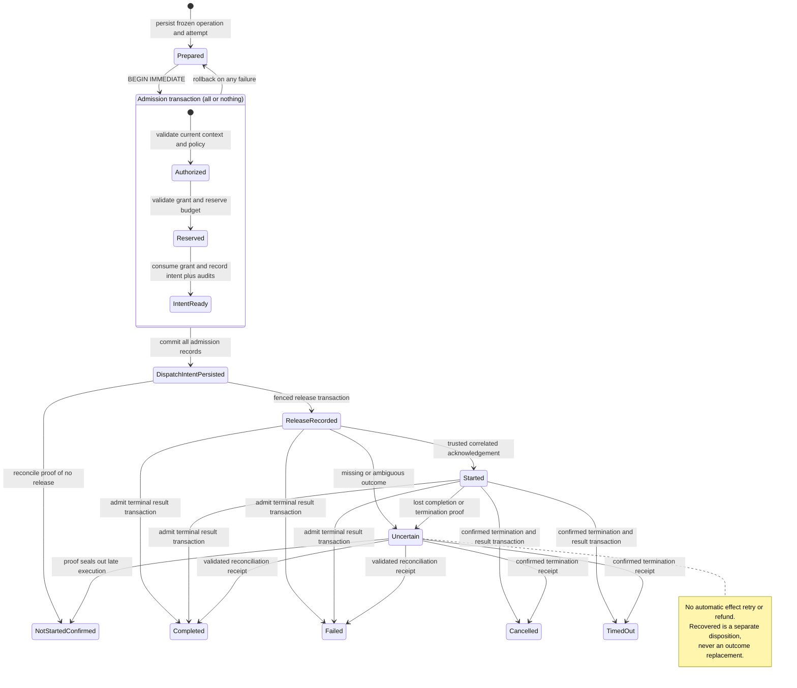
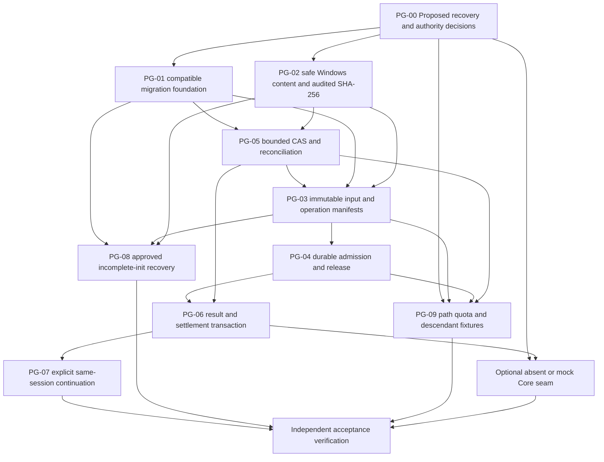

# Phase 1 Remediation — Increment 0: Recovery Architecture

Date: 2026-11-07. **Design proposal only. Phase 1 remains NOT APPROVED.** All new states, records, identifiers, protocols and tests below are proposed contracts, not implemented capabilities. No remediation, migration, dependency installation, closure attempt or Phase 2 work is authorized by this document.

## 1. Executive summary and authority

Extend the existing local Core/SQLite architecture with four separately recoverable boundaries: **session continuation, durable dispatch, blob promotion/reconciliation, and result admission/settlement**. SQLite owns logical state; Core owns authorization and reconciliation; the filesystem owns external bytes; an approved backend would own external execution. None is evidence that another boundary completed. Recovery must preserve uncertainty rather than replay a possibly completed sensitive operation.

This proposal implements the design step PG-00 of the [gap analysis](PHASE1_GAP_ANALYSIS.md), not its implementation steps. It extends, without superseding, accepted [ADR-0003](../adr/0003-local-modular-control-plane.md), [ADR-0004](../adr/0004-vm-boundary-for-untrusted-execution.md), [ADR-0005](../adr/0005-capability-scoped-process-adapters.md) and [ADR-0006](../adr/0006-evidence-and-independent-verification.md). Proposed [ADR-0008](../adr/0008-recoverable-local-operations.md), [ADR-0009](../adr/0009-verified-content-and-blob-reconciliation.md) and [ADR-0010](../adr/0010-explicit-initialization-recovery.md) require explicit acceptance and their verification gates. ADR-0002 and ADR-0007 remain Proposed. Existing approvals of restricted increments and the [final NOT APPROVED assessment](PHASE1_FINAL_VERIFICATION.md) remain historical authority.

### 1.1 Original acceptance contract

The original Phase 0 commit `52eed96dd49b41240ac58ab07f17374daf0888e1`, ROADMAP lines 11–24, remains the authority identified in the gap analysis. Its dispatch/blob/result criterion is unchanged:

> Persist and resume a session; interrupt at task dispatch, blob promotion, and result commit; show no lost committed events and no repeated sensitive side effects.

The other original gates remain: measured Windows x86_64 MSVC; spaces/Unicode/CRLF/junction/symlink/case-collision/archive/dirty-input fixtures without target build execution; approval rejection plus bounded tasks/output/storage and process-tree cancellation proof; measured Q-05; and the authenticated VM prototype **or documented blocking prerequisite** before untrusted execution. This proposal neither waives a gate nor replaces missing implementation with documentation.

| Source | Exact requirement / application here |
| --- | --- |
| [F-01](../../REQUIREMENTS.md#functional-requirements) | “MUST ingest an authorized local source snapshot and identify project roots, manifests, languages, and unsupported components without executing target code.” Sections 6 and 15 require retained immutable input, bounded inert discovery and explicit unsupported inventory. |
| F-02, same source | “MUST record canonical input identity, scope, exclusions, operator, authorization reference, policy digest, and budgets before planning work.” The persisted session manifest precedes task planning; the operation manifest binds each later authorization. |
| F-14, same source | “MUST offer session inspection, cancellation, crash recovery, and bounded retry.” Sections 3–8 separate inspection, continuation, cancellation proof and retry. |
| S-09 / Q-03 / Q-04, same document | Content-addressed evidence and append-only logical events; decision replay without effects; version/provenance and incompatible-writer rejection. Hashes/local events do not resist a compromised administrator. |
| [Core design §14](CORE_ENGINE_DESIGN.md#14-acceptance-criteria-for-implementation-sub-increments) | Persist evidence, compute integrity, reconcile blobs and prove recovery; resolve the optional provider coordinator through section 11 without claiming real-provider integration. |

The single-foundation-session model remains: project identity aliases that SessionId. Many task/attempt records do not imply many sessions. **OQ-25 remains open. F-611-02 remains open before Phase 2 production readiness.**

Dated design refinement, Increment 0.2: [IMPLEMENTATION_CONTRACTS](IMPLEMENTATION_CONTRACTS.md) makes filesystem, writer-fencing and explicit recovery handoffs concrete; [IMPLEMENTATION_READINESS](IMPLEMENTATION_READINESS.md) records decisions, blockers and ordered acceptance gates. Its persistent-guard proposal offers an alternative proof of old writers' logical retirement, not an assumption that version checks or new locks fence existing connections. Physical quiescence requirements for uncertain/raw family preservation remain. These refinements are Proposed and require explicit acceptance/runtime proof; they change no historical experiment, original criterion or closure decision.

### 1.2 Inspected baseline and evidence limits

Entry was clean `develop`, HEAD `8d36d43fd8572a526a1d2111e5caa1626d0992cf`, local upstream `origin/develop`, 0 ahead/behind, 282 index entries, no staged/modified/untracked files. Physical index SHA-256: `fa846e21e34632eacf03aada5ef9367ca112a168d800e6cd7a9742630bdb1bc7`. Reference targets, reachable history, staged entries and tracked-file hashes were captured in memory before editing.

*Historical state reconciliation note (Increment 0.3):* The entry baseline above reflects repository state at the beginning of Increment 0 (`8d36d43`). The verified subsequent commit ancestry across the remediation documentation sequence is `8d36d43` → `4bd8618` (Increment 0) → `d9cca25` (Increment 0.1) → `adc3cf2` (Increment 0.2). Where any earlier document or query referred to `8d36d43` as the starting HEAD prior to Increment 0.2, the subsequent read-only investigation established that two intervening commits (`4bd8618` and `d9cca25`) separate `8d36d43` from `adc3cf2`. Commit `adc3cf2` contains the seven Increment 0.2 documentation files; its provenance status is: "Unknown — commit and push are observed; initiating process is not established." Phase 1 remains NOT APPROVED; Phase 2 remains unauthorized.

Source inspection covered [CoreService](../../crates/sentra-core/src/service/core.rs), [LocalWorkspace](../../crates/sentra-core/src/service/local_workspace.rs), [lifecycle contracts](../../crates/sentra-core/src/service/lifecycle.rs), [repository](../../crates/sentra-core/src/persistence/repository.rs), [connection management](../../crates/sentra-core/src/persistence/connection.rs), [persistence models](../../crates/sentra-core/src/persistence/model.rs), [schema v1](../../crates/sentra-core/src/persistence/schema_v1.sql), policy, session, workspace, execution and evidence modules. The [gap analysis](PHASE1_GAP_ANALYSIS.md), [SQLite implementation](INCREMENT_5_4_2_SQLITE_IMPLEMENTATION.md), security remediation/reviews and CLI reports inform these contracts; their historical runtime results were not rerun here.

Current production storage has six tables: schema_migrations, sessions, session_security_snapshots, audit_events, approval_requests and budget_reservations. There is no durable task/dispatch/result/blob/reference ledger. CoreService atomically prepares approval/budget state, then allocates ExecutionId and dispatches a transient request. Results/evidence remain in memory; settlement is a separate transaction. Current SQLite recovery preserves committed metadata and conservative holds, but does not implement the four recovery lifecycles below.

The crate remains `forbid(unsafe_code)` with pinned rusqlite/serde/serde_json. That restriction does not apply to dependency internals. Canonical `action_digest`, effective policy identity and the migration's non-cryptographic drift checksum are not SHA-256 integrity proofs. No new crypto, safe filesystem implementation or runtime result is claimed by this design.

## 2. Recovery architecture and ownership

### 2.1 Authoritative records and boundaries

The following are logical records, not approved table definitions or API names. Exact DDL, version numbers, indexes and public API require PG-01 review.

| Boundary | Proposed persisted authority | Owner and permitted entry |
| --- | --- | --- |
| Store activation | Protected store incarnation/activation, compatible schema, current controller epoch/ownership, recovery run/checkpoint | Privileged local lifecycle authority; explicit activation/resume/recovery, never an execution-request field |
| Session continuation | Same SessionId/project alias, creation identity, state, security snapshot, policy identity/generation, context generation, budgets, grants, task references, audit sequence | Existing trusted session lifecycle; explicit continuation after validation, not `status` |
| Dispatch | Immutable logical operation and attempt specification, IDs, input/manifest binding, admission, release intent, reservation/grant, backend identity, outcome uncertainty | CoreService plus sealed authority/repository transaction; backend cannot mint grants or choose budget ownership |
| Blob | Core-generated staging ownership, quota, verified digest/length, promotion state, pending/live references, retention/GC disposition | Core evidence/storage service; arbitrary producer paths never become trusted locators |
| Result/settlement | Correlated canonical result, admitted blob references, terminal outcome, typed usage/settlement, audit linkage | Core result admission in one SQLite transaction; producer output is an untrusted claim |

Database state is authoritative only after integrity/foreign-key/schema validation and current-owner checks. It is not proof that a backend ran or that a file exists with matching bytes. Logical audit events are committed with each state transition and retain per-session sequence uniqueness; failed transactions publish no success event. Filesystem/backend observations become bounded, classified receipts with provenance, not free-form authority.

### 2.2 Recovery entry and ordering

Proposed separate operations are diagnostic inspection, explicit store/session continuation, dispatch reconciliation, blob reconciliation and result admission/settlement reconciliation. They share ownership/fencing but have different permissions and state machines. No `recover everything and run` operation is proposed.

1. Validate the protected storage boundary and acquire exclusive **cooperating-controller** ownership. Prove migration/restore compatibility before mutation. Do not steal a live owner based on PID absence or time alone.
2. Inspect schema/integrity/FKs and the database recovery family. Incomplete initialization enters section 9, not normal session continuation. Corruption or unverifiable ownership stops mutation and preserves data in place.
3. Record a fenced recovery run/epoch under the existing trusted lifecycle authority; validate the single session and historical security snapshots. No task may dispatch yet.
4. Inventory/reconcile owned staging/promotion records and validate pending/live content references. Dangling/corrupt content blocks the affected input/result; unknown files are not adopted or deleted. Eligible orphan pruning requires section 5's separate approved policy.
5. Classify interrupted dispatches against release records and trusted backend receipts. Resolve already durable results before selecting any new work. Release/termination uncertainty retains holds and blocks automatic effect retry.
6. Admit validated results and settlement dispositions idempotently; reconcile conservative holds, never infer final usage from elapsed time or an estimate.
7. Explicitly rebind the same session to current, validated input/policy/context; advance context generation and issue new transient authority. Select only eligible unstarted work through full normal admission. Completed/uncertain work is not replayed.

If an unresolved dispatch makes continuation unsafe, the session remains paused/blocked for execution while diagnostic/reconciliation access may remain available under policy. A recovery checkpoint records progress, but is not evidence that skipped validation occurred. Restarting recovery twice must reproduce the same disposition without duplicate success audits, refunds or effects.

## 3. Persistent session continuation contract

### 3.1 Minimum continuation state

Persist SessionId and unchanged foundation project alias, creation timestamp, session state, immutable input/session-manifest reference, policy identity **and proposed policy generation**, context generation, target revision, classification floor, operator/authorization references, budget policy/limit/usage/active holds, every approval's exact binding/provenance/expiry/consumption, active operation/attempt references, store activation/recovery epoch and last committed per-session audit sequence. Explicit unknown/legacy states are required; absent values cannot default to current authority.

The current implementation has immutable policy instances and a context-generation activation boundary, not an independent persisted policy-generation field. The proposal introduces the separate field to distinguish effective policy activation from input/context/recovery changes. A genuine policy change advances policy generation **and** context generation; unchanged effective policy is a no-op. Restart/resume advances recovery/context generation even if the policy is unchanged. Callers cannot supply or decrement these values. This extends the existing immutable-policy model; it does not introduce a dynamic rule engine.

### 3.2 Session transitions and restart behavior

Keep existing state-machine edges and terminal immutability. Only **Scoped, Planned and Running** are execution-eligible, after complete authoritative revalidation. Created, WaitingForApproval, Paused and all terminal states deny execution. Recovery is a separate lifecycle disposition; it does not fabricate a new permissive session state or transition Paused to Running implicitly.

| Condition | Proposed continuation behavior |
| --- | --- |
| Clean shutdown | Stop new admissions; retain all unresolved attempts/holds; persist lifecycle/audit disposition, checkpoint/close with explicit errors. Restart still validates context, policy and content; clean shutdown is not a guarantee that every external effect completed. |
| Process termination | Reopen same compatible store; discover original session/attempts; acquire new owner/epoch; run ordered reconciliation. Preserve identity, committed events and consumed grants. |
| Interrupted initialization | No normal resume. Diagnose/protect original family; section 9's explicit authorized recovery or blocked disposition applies. |
| Corrupt/incomplete/foreign persistence | Typed failure, no recreate/auto-repair/authorization uplift. Preserve DB and sidecars; incomplete versus valid interrupted session requires schema, identity, security snapshot and audit consistency proof. |
| Stale input/context or different effective policy | Do not use old authority. Explicit trusted validation/rebinding is necessary. Incompatible/missing policy identity blocks execution; a label alone is not equivalence. |
| Uncertain effects | Retain reservation and consumed grant; only scoped reconciliation may resolve. No automatic replay or implicit refund. |
| Concurrent resume | One exclusive owner wins the conditional epoch transition; others report busy/stale. No separate in-memory broker can create a second current context. |
| Terminal session | Inspect/reconcile existing evidence/holds only as permitted; never reopen it for new execution. |

Old unconsumed approvals become stale for **new execution** after resume/context activation. Consumed approvals stay consumed. The privileged broker may reconstruct only verifiably current issued records, preserving provenance, expiry and one-use checks; reopening a database or recovering an ID is not authentication. Historical receipts for an existing attempt follow section 7, not fresh grant consumption.

Decision replay reconstructs recorded decisions without backend calls or settlement changes. Continuation may run an unstarted second task only after new current authorization; it must not run the completed first task again. No multi-session API or independent ProjectId is introduced.

## 4. Durable dispatch state machine

### 4.1 State meanings

Use a durable logical OperationId and an AttemptId/ExecutionId allocated **before** admission commits. SessionId + OperationId identifies intentional work; equal action parameters alone do not deduplicate intentionally separate work. Prepared means a frozen persisted specification awaiting admission. This terminology refines the gap analysis's `Recorded` label; its admitted `Prepared` corresponds here to `DispatchIntentPersisted`.

**Authorized and Reserved are logical stages inside one admission transaction, not separately committed recoverable states.** Separating their commits would regress atomic approval/budget integrity. `Recovered` is an orthogonal recovery disposition/event retaining the original outcome, not a new success status.



### 4.2 Transition and atomicity table

| Transition | Authority / atomic operation | External work and recovery rule |
| --- | --- | --- |
| New -> Prepared | Persist canonical input/operation reference, attempt identity, bounded task/output/storage admission and audit; no execution grant implied | No external execution. Exact duplicate submission retrieves this operation; conflicting same key is denied. |
| Prepared -> Authorized -> Reserved -> DispatchIntentPersisted | **One BEGIN IMMEDIATE transaction:** authoritative eligible session, policy/context/epoch, target/action/paths/classification, input manifest, same-session budget owner/policy and optional grant; reservation, consumption, intent and all audits commit together | No external side effects in transaction/retry closure. Any failed statement/audit/constraint rolls back all mutations; budget exhaustion leaves the issued grant reusable. |
| DispatchIntentPersisted -> ReleaseRecorded | Conditional transaction rechecks full current context and owner; persists attempt release sequence/fence and audit | Only a private Core capability derived from this committed transition can invoke the approved backend. Hold the lifecycle admission guard through invocation; context update cannot race between check and release. |
| ReleaseRecorded -> Started | Idempotently validate receiver/attempt/fence/input correlation and record acknowledgement | Backend start is external, not SQLite-atomic. Missing acknowledgement does not prove no execution. |
| Released/Started -> terminal outcome | Section 7's single result/reference/settlement/audit transaction | Validate receipt/content first. Completed/Failed are facts about this attempt, not automatic retry permission. TimedOut/Cancelled require termination proof. |
| Any ambiguous released state -> Uncertain | Conditional reconciliation record and conservative hold/audit | Query approved backend if possible; otherwise block. Lease expiry and transport timeout do not prove termination. |
| Admitted but not released -> NotStartedConfirmed | Verify original owner is quiescent and release could not have happened under this protocol; persist reconciliation/audit and explicit settlement disposition | Do not unconsume the original grant. Any new attempt needs fresh current admission. Without proof, remain Uncertain. |
| Uncertain -> known disposition | Current recovery authority validates the original issued binding and scoped receipt, then performs conditional reconciliation/result transaction | A receiver's `not found` is insufficient unless it also seals out late/in-flight execution. No blind resend to find out. |

### 4.3 Termination boundaries

| Process dies... | Required restart disposition |
| --- | --- |
| Before intent commit | A rolled-back transaction creates no admission or effects. A durable Prepared spec may be freshly authorized; no inferred old approval. |
| After intent commit, before release commit | With exclusive old-owner quiescence and protocol proof, classify NotStartedConfirmed; retain historical consumed grant, explicitly account for hold, and require fresh admission for another attempt. Missing proof blocks. |
| After release commit, before invocation | Indistinguishable on restart from possible invocation. Uncertain; reconcile or operator-block. Sacrificing automatic liveness here is intentional. |
| During invocation / after start acknowledgement | Uncertain until trusted terminal/termination receipt. Repeated request must not create a second effect. |
| After completion, before result commit | Re-fetch the same correlated result where supported; otherwise preserve uncertainty and any staged evidence. Do not rerun the task. |
| After result commit, before reply | Return the stored result by idempotency key. Do not settle or execute again. |
| During cancellation | Persist request/acknowledgement separately from confirmed process-tree termination. Unknown termination remains Uncertain with a full hold. Late replies cannot manufacture new authority. |
| During settlement | Result/settlement transaction either commits together or rolls back. If content is promoted but SQL rolls back, pending pins preserve it for reconciliation. |

At-most-once **automatic release/admission** for a sensitive ambiguous attempt is the default. It does not promise that a backend itself executes effects once. ADR-0003's at-least-once envelope delivery is enabled only for the **same attempt** to a verified receiver with durable deduplication, status lookup and fencing; otherwise redelivery is disabled. A new attempt requires proven non-start or separately approved safe retry disposition and fresh authorization. Failed may include partial effects. Exactly-once external execution is not claimed.

## 5. Blob storage and recovery contract

### 5.1 Identity, layout and ownership

Propose SHA-256 over actual raw bytes, represented as algorithm-tagged lowercase hexadecimal plus verified byte length. This is content identity, not approval, producer authentication or semantic correctness. No weak checksum may fill the SHA-256 field. A hash is not permission to read another session's bytes.

Core selects opaque locations under protected local storage **outside the workspace**, for example `staging/<WriteId>.part` and `objects/sha256/<first-two-hex>/<remaining-hex>`. These are layout proposals, not created directories. Caller paths/evidence descriptor strings cannot become locators. A session-owned reference carries classification and purpose; deduplication never discloses classified content existence to unauthorized callers. Cross-classification reuse requires compatible protected storage and authorized access, not just equal hashes.

### 5.2 Promotion protocol

1. Atomically reserve bounded storage/output quota and persist WriteId, owner epoch, expected producer/attempt/input, classification, retention and **pending-reference pin** before creating bytes.
2. Exclusively create an owned staging file through the approved safe filesystem boundary. Stream bounded bytes while computing SHA-256. Enforce declared and absolute limits before allocation/write; error on overflow, short writes, unsupported paths or I/O failure.
3. Finish the digest/length; successfully flush and close with verified error handling. Revalidation must refer to the same object, not a newly resolved pathname. Persist verified content and promotion intent. Incomplete/unflushed data cannot be Ready.
4. Promote on the same supported filesystem using a verified **no-replace** primitive and publication durability contract. The current standard `rename` does not establish that contract. An existing destination requires secure open, full length/hash verification and authorization before deduplication; never overwrite a conflict.
5. Mark Ready only after promotion is established. Retain the pending pin until an input/result transaction atomically converts it into a live reference. SQL failure after promotion leaves recoverable pinned content, not a lost successful result.
6. A producer/recovery receipt is acknowledged only after its promised durability boundary. Record exactly which process-crash guarantees were tested; `sync_all` and SQLite FULL do not prove physical power-loss durability.

| State / interruption | Recovery action |
| --- | --- |
| Intent without file | Confirm owner quiescence; record absent/abandoned write and release quota only with proof. No unrelated file adoption. |
| Partial or unverified stage | Keep unavailable; verify or quarantine only owned bytes. Never infer completion from file length alone. |
| Verified stage / promotion intent | Revalidate identity/hash/length and current fence before completing a safe promotion. |
| Object exists, Ready transaction missing | Reconcile object with durable promotion intent and pin; verify bytes, then conditionally mark Ready. Unknown object ownership is not adoption permission. |
| Ready with pending reference | Preserve pin; resolve original operation/result, do not prune between Ready and reference commit. |
| Live reference missing/corrupt object | Mark affected input/result unavailable/corrupt, audit and stop dependent execution; preserve reference/evidence. Do not delete the reference to hide damage. |
| Unreferenced/unknown object | Candidate only. Prove ownership, all live/pending references, staging/retention/backup pins and retention authorization before cleanup. Unknown ownership stays preserved. |

### 5.3 Reconciliation and cleanup

Use all-store reference reachability, not only the current session or file age. GC must acquire a per-object mutation guard and conditional GC claim that excludes concurrent reference attachment; reference admission must reject a claimed deletion or atomically cancel it before touching bytes. Recheck epoch and references under the same guard immediately before filesystem mutation. A fence check followed by unguarded deletion is unsafe.

Deletion/quarantine has its own durable intent, receipt and completion audit. Interruption is reconciled idempotently; an unknown deletion outcome does not authorize deleting another pathname. Do not expire ownership pins while a live producer may still promote. Startup pruning applies only to proven eligible owned orphans under approved retention policy. Report-only scans do not satisfy the existing design's pruning criterion. No SQL transaction is described as atomic with file creation, rename or deletion.

## 6. Immutable input and manifest evidence

### 6.1 Minimum evidence and F-01/F-02 mapping

| Evidence | Minimum frozen fields / purpose |
| --- | --- |
| Input snapshot | InputId; verified SHA-256/length and immutable blob reference for each authorized source/metadata item; relative path identity; classification; source-revision kind/value and explicit dirty/unversioned status; scope/exclusions; discovery roots, manifests, inferred languages and unsupported entries. F-01 requires inert acquisition, not executing Git/tools or claiming all languages. |
| Session manifest | InputId and manifest reference; exact scope/exclusions; operator and authorization reference/provenance; policy canonical identity/generation; context generation; budget limits/policy; resource/task/output/storage limits; foundation SessionId/project alias. Persist **before planning**, satisfying F-02's ordering. |
| Operation manifest | Logical operation and attempt IDs; canonical action including arguments/ModifyCheckout paths; input/session-manifest identity; target revision; classification; tool/backend identity and version; execution profile/configuration; bounded environment allowlist and secret references; current policy/context/epoch; budget owner/reservation policy; approval requirement. |
| Result provenance | ResultId, original attempt/ExecutionId/session/input/manifest, issued authority/fence, producer/backend/tool identity/version, terminal outcome, typed usage, verified evidence references and audit links. Result cannot supply replacement input or budget owner. |

A mutable path, caller revision label, Git HEAD alone or advertised digest is not immutable input identity. Capture explicitly authorized dirty bytes and unsupported entries without invoking Git or target tools. A target/backend version that is unknown must be explicit and block any capability requiring it; no fabricated production tool identity. Metadata discovery grants do not imply permission to read all contents. Snapshot acquisition needs a separate authorized bounded read capability and safe content access; current ResolvedWorkspacePath is not a retained safe-open capability.

Acquisition authorization binds the intended verified root, selected scope/exclusions, classification, source observations and byte/resource limits **before reading**, without pretending the not-yet-computed digest is known. After capture, the trusted owner freezes the admitted byte set and activates its immutable manifest/context; only then may planning/execution approval bind that input. A capture approval never becomes execution approval. Retained bytes define the input of record, not a claim that a mutable working tree was globally atomic at one instant. Detected file/inventory changes invalidate the capture; any required stronger cross-file point-in-time consistency needs an approved snapshot strategy or remains blocked. Record acquisition provenance rather than falsely labeling dirty captured bytes a verified clean commit.

### 6.2 Proposed canonical format and bindings

Propose a versioned, narrowly scoped binary framing contract **SCF-1**, finalized with independent test vectors before implementation. It is not a generic configuration language or executable format. The proposed framing grammar is:

```text
uint   = canonical ASCII decimal followed by ':'
bytes  = uint(byte_length) followed by exactly byte_length octets
value  = 'B' bytes | 'U' uint | 'O0' | 'O1' value
       | 'L' uint(item_count) value{item_count} | record
record = 'R' bytes(domain) uint(schema_version) uint(field_count)
         (uint(field_tag) value){field_count}
```

Domain/field tags/types are fixed by each approved schema; tags are positive and strictly increasing, and every declared optional field is present as O0 or O1. For example `B0:` is empty bytes, `O0` is absent, and `U0:` is integer zero. Bounds reject length/count/recursion overflow and trailing bytes. There is no arbitrary map type: schema-defined key/value lists require canonical key ordering and duplicate rejection. Exact record schemas/digest domain labels remain acceptance gates; this grammar does not authorize an implementation or supply test evidence.

- Each record has a fixed domain/schema version, declared field tags in fixed order and length-prefixed UTF-8 byte strings. Integers use canonical nonnegative decimal without leading zeros except `0`; counts/lengths are bounded, explicit and checked. No floating-point costs, duplicate fields or ambiguous delimiters.
- Optional values have an explicit absent/present tag; absent, empty and zero are different. Lists include counts; preserve action-argument order. Explicit set-valued collections have a specified byte ordering and reject duplicates. Maps require defined keys/order; unknown mandatory fields and noncanonical encodings are rejected, not silently ignored.
- Manifest path identity uses validated relative components under an explicit supported filesystem/case policy. Reject absolute/drive/UNC/ADS/device/traversal/indirection paths as content-relative names. Preserve exact Unicode; do not silently case-fold or normalize distinct names. Reject lossy UTF-8/unpaired-surrogate input and unresolved case/normalization/alias collisions rather than inventing equivalence.
- Define distinct digest domains for input, session and operation manifests using SHA-256 over their exact canonical bytes. Blob hashes remain SHA-256 of raw content. Store schema/version and canonical bytes for independent recomputation; database IDs are not hashes or authentication tokens.
- Separate immutable content/specification from receipt/arrival metadata. Exclusions from an idempotency identity (for example a repeated receipt's arrival time) must be explicit in that schema; security-relevant action/target/configuration/classification/ownership fields cannot be excluded. No JSON reserialization-dependent signatures or unspecified map order.

Keep the existing length-framed `action_digest` as a canonical action identifier, **not cryptography**. Extend trusted approval context with the immutable operation/input manifest binding after explicit context activation; compare full canonical action and all existing session/revision/generation/classification/provenance fields. A cryptographic manifest digest complements this binding; it cannot grant authority. Changed bytes, scope, execution configuration, target paths or policy invalidate old authorization. Legacy grants lacking the new binding cannot be silently upgraded.

Transport/content integrity proves matching bytes under the chosen hash assumptions. It does not prove producer honesty, correct target scope, exploitability, semantic equivalence or a valid security finding. Those remain separate authorization/verification gates under ADR-0006.

## 7. Result persistence and settlement contract

### 7.1 Result admission

Persist ResultId, SessionId, logical OperationId, AttemptId/ExecutionId, InputId and exact manifest identity, original issued context/policy/epoch, trusted producer/backend identity and receipt identity, outcome/exit/time/resource observations, admitted blob references/classification, settlement disposition and audit sequence. The receiver cannot choose a new session, reservation, input or policy in its response.

Validate correlation, bounds, supported versions, producer provenance, output classification and bytes before SQL admission. An exact duplicate receipt for the same attempt is a lookup/no-op; a different terminal result under that identity is a conflict, never last-write-wins. Preserve the first accepted result and record the conflict without another settlement or successful execution claim. Partial output may be retained as explicitly partial evidence, not a completed result.

### 7.2 Atomic result transaction

One managed transaction revalidates current recovery owner plus the **original issued attempt binding**, verifies the same-session reservation and Ready content/pins, then atomically:

1. Inserts the canonical result (or proves the exact duplicate).
2. Creates live evidence/input references and converts pending pins.
3. Moves the dispatch to its validated terminal outcome and updates the relevant task by conditional transition.
4. Settles or conservatively retains the reservation using the typed disposition.
5. Inserts corresponding result/settlement/audit events with unique ordered sequence numbers.

Failure of any step rolls back all database mutations. File staging/promotion occurs outside the transaction and remains pinned/reconcilable. Backend calls, filesystem mutation and provider requests are never repeated inside SQLite retries. A committed result with a lost reply is rediscovered, not re-executed. A database failure during error handling retains typed primary and secondary errors and the full conservative reservation.

Recovery of a historical attempt is not permission to execute with an old grant. The current owner must validate its immutable original issued receipt/provenance and a narrowly scoped reconciliation action. A late receipt rejected for current dispatch cannot become fresh authorization. If historical producer/fence validity or current evidence-access classification cannot be established, preserve it as unavailable/untrusted and keep the hold; do not weaken normal checks. This distinction needs independent API review before implementation.

### 7.3 Preserve typed usage and cancellation uncertainty

Retain existing `SettlementStatus` variants and fixed-point micro-dollars:

| Existing type | Recovery rule |
| --- | --- |
| `Completed(CostUsd)` | Only verified final actual usage; release unused difference transactionally. Not an estimate. |
| `CancelledWithUsage(CostUsd)` | Confirmed cancellation and verified final usage; conditional one-time settlement. |
| `CancelledUncertain` | Retain full charge/hold when final usage is unknown; never infer zero. |
| `UncertainPartial` | Completion or usage unconfirmed; reservation remains active at its full bound. |

Outcome, cancellation phase and settlement are separate axes. `CancellationReport::uncertain` currently also carries `CancelledUncertain`; therefore `SettlementStatus::is_terminal()` alone must **not** establish confirmed termination or dispatch completion. Preserve the existing conservative behavior; new durable outcome transitions require the correlated termination phase/proof. Known completion with unknown usage may retain `UncertainPartial`; an estimate cannot become actual cost. Synthetic cancellation remains explicitly simulated and does not prove VM/process-tree termination.

A failed/timed-out outcome cannot be relabeled successful to fit a settlement variant. If no existing variant faithfully represents its usage/termination proof, retain the conservative hold and require explicit contract review rather than inventing a permissive conversion. Actual usage exceeding the reserved bound or the supported integer range is an explicit error/uncertain reconciliation case, never a negative refund, silent clamp or authorization to increase budget. A terminal session state stays terminal even if a separately authorized historical reservation/result needs reconciliation; no recovery state transition reopens execution.

## 8. Epoch, fencing and idempotency model

### 8.1 Proposed ownership tuple

The trusted controller constructs an immutable binding from protected persisted state:

`(store_incarnation, activation_id, SessionId, recovery_epoch, context_generation, policy_identity, policy_generation, InputId/manifest, OperationId, AttemptId, target/action/classification, budget_owner/policy)`.

Store incarnation/activation are internal recovery references, **not a new project identity**. Their allocation/uniqueness needs the approved identifier source and uniqueness checks; no `uuid` dependency or caller-selected identity is assumed. DB-local IDs may use checked persisted sequences. Cross-restore activation identity must not rely on resetting a copied counter.

- One privileged lifecycle authority owns activation and generations. A single mutating controller holds an OS ownership guard for the protected store; its threads use the existing serialized writer and session admission guards. Concurrent recovery workers compete for this guard and a conditional persisted owner/epoch transition; losers fail busy/stale.
- Advance recovery epoch on explicit resume, owner handoff or recovery activation, not per retry, inspection or clock tick. Context generation advances on resume/security rebinding; policy generation only on effective policy activation. Checked overflow fails closed.
- Every mutating repository operation re-reads and conditionally checks the expected activation/epoch/context/policy inside its whole transaction. Retry after BUSY_SNAPSHOT re-reads all values and re-evaluates authorization; no stale captured decision survives by retrying one statement.
- Context updates and dispatch release use the same lifecycle exclusion boundary, retained through backend invocation. Filesystem promotion/GC holds the owner/per-object guard from final fence check through mutation. A separate epoch query followed by an unguarded external action is not fencing.
- A future receiver must enforce attempt/fence deduplication itself. Fencing the database does not revoke an already delivered command, stop a running process or prevent a backend from duplicating an effect.

Locks are cooperating-process coordination, not OS authentication against a compromised administrator or arbitrary program. TTL is useful for diagnosis but not authority to steal a live lock. Existing pre-upgrade open connections do not know the new fence: migration requires verified quiescence and retirement of old controllers, not just changing a schema version.

### 8.2 Restore and rollback boundary

A restored DB can contain lower counters and older release records. **No global anti-rollback guarantee is claimed.** An explicit restore/activation protocol must retire the prior active controller/store, validate the recovery set, allocate a fresh activation identity and invalidate old execution contexts/grants. Previously unsettled inherited attempts are uncertain unless independently sealed by backend proof; an old `Prepared` row in a backup does not prove the original store never released it later.

Backups/clones are inactive evidence, never automatically live stores. One active incarnation is a protected-store operational invariant, not something SQLite can prove across copied machines/volumes. If retirement, identity uniqueness or restore lineage cannot be established, block activation and preserve the originals. Do not reset epochs or accept old authorization by treating a backup as a fresh database.

### 8.3 Idempotency scopes and limits

| Boundary | Stable key / proposed guarantee | Limit |
| --- | --- | --- |
| Database transition | Activation + session + operation/attempt + transition kind; expected state and canonical specification checked | One committed transition/audit set under conditional SQL. Same key with different content is denied; not an external-effect guarantee. |
| Blob write/promotion | Owned WriteId plus SHA-256/length and promotion identity | Reconcile same bytes to one validated object; independent no-replace filesystem proof required. Equal digest does not grant access. |
| Dispatch submission | Session + OperationId + frozen specification; distinct monotonic attempt identity for an explicitly approved retry | Repeated client submission recovers prior state. Automatic no-approval operations also require this key; grant ID alone is insufficient. |
| Backend delivery/effect | Same AttemptId + activation/fence + immutable manifest | At-least-once envelopes only with proven receiver deduplication/query/sealed cancellation. Otherwise one automatic release and uncertainty blocking. Exactly-once external effects unproven. |
| Result/settlement | Session + AttemptId + canonical terminal receipt identity | Exact duplicate returns existing result with no second refund/audit. Conflict is denied/preserved; differing arrival timestamps do not create a new result. |
| Recovery action | RecoveryRunId + original object/transition + expected state | Repeated reconciliation is a no-op or explicit unchanged disposition, not repeated mutation/effect. |

## 9. F-611-02 initialization recovery decision

**Preferred proposal: explicit operator recovery (B), ADR-0010. Not Accepted or implemented.** It reduces initial publication complexity and can preserve the same foundation session, but does not waive filesystem, ownership, WAL or authorization requirements.

| Driver | A — Atomic staging/promotion | B — Explicit operator recovery |
| --- | --- | --- |
| Windows publication | Needs tested same-volume atomic **no-replace** publication, sharing/alias/identity semantics and directory-entry durability | Avoids publishing a replacement live DB for the initial approach; preservation/working-copy paths still need safe identity/no-overwrite semantics |
| SQLite WAL | Complete schema/session, checkpoint all committed frames, flush/close and prove safe publication set; independent DB/WAL/SHM renames are not atomic | Preserve original DB/WAL/SHM/journal set before recovery opens can checkpoint it; analyze only under proven quiescence |
| Crash windows | Stage, schema/session, close, publish and orphan-stage windows remain to reconcile | Existing direct-init windows remain detectable; recovery has explicit preservation, plan, approval and commit boundaries |
| Existing files/concurrent init | Destination collisions must fail without replacement; serialize init/publish and revalidate | Serialize diagnose/recover/init; never overwrite original family or adopt an unrelated DB |
| Authorization/deletion | Atomic rename is not authorization; abandoned staging still needs ownership/retention proof | Explicit trusted recovery plan; no automatic delete/reset, consumed-grant reset or caller boolean approval |
| Operational cost | Better eventual first-use experience; higher initial platform/durability proof burden | Operator intervention and typed blocked states; smaller initial change with auditable conservative decisions |
| Testability | Kill around every staging/checkpoint/close/publication, collision, sharing and sidecar boundary | Kill around every preservation/diagnosis/approval/commit boundary; prove idempotent state-specific recovery and original preservation |

### 9.1 Current windows and proposed B behavior

| Existing init window | Current failure/result | Proposed authorized recovery |
| --- | --- | --- |
| Database creation / DDL interrupted | Invalid/version-zero/partial schema may fail storage validation (exit 5) | Preserve original family. If ownership/structure cannot be proved, block; no automatic recreate or speculative repair. |
| Schema committed before session | Supported schema with zero sessions is incomplete (exit 6) | A missing session identity cannot be invented as continuation. Diagnose; a separately approved fresh initialization at a different unused location is a new operation, not recovery of an existing session. |
| Created session before Scoped | Single session exists but bootstrap is incomplete (exit 6) | Only if full original identity/input/authorization can be verified: explicitly approve a bounded Core lifecycle completion transaction preserving SessionId, budget and provenance. Otherwise block. |
| Scoped committed before termination/reply | Valid store may already be initialized; reply was lost | Re-discover the same identity and state. No second session or replacement; unfinished subordinate work follows its own lifecycle. |

Proposed operator recovery first proves exclusive ownership and a stable, complete inventory of present **DB/WAL/SHM/journal plus relevant control metadata**, recording absent sidecars too. Preserve a consistent recovery set before opening the original in a mode that may recover/checkpoint it. Current inspection is domain-state read-only but can change SQLite/filesystem bytes; it is not a forensic acquisition tool.

Create a bounded recovery plan bound to the source family identity, current epoch/state, exact proposed action and preservation receipt. Existing trusted authority and an explicit operator decision authorize that plan; it is not human-identity authentication. Recheck all bindings before application. Analyze a preserved working copy only when source quiescence/identity and copy consistency are proved; do not activate it as a concurrent clone. Partial preservation, filename collision, unknown ownership or a live external writer stops the operation without deleting source data.

Apply only approved Core logical changes in a managed transaction; preserve a pre-recovery copy and audit outcome. Logical SQLite changes differ from filesystem replacement: neither automatic replacement/deletion nor direct raw SQL bypass is permitted. Invalid/unowned/corrupt legacy data may remain permanently blocked. B is not a promise that every incomplete file is recoverable. Repeat approved recovery returns the prior result without a second session or event. A may later be added, but would require its own platform proof.

This increment selects a **recommendation**, not operational permission. F-611-02 remains open until acceptance, implementation and real Windows crash/concurrency/sidecar/preservation verification before Phase 2 production readiness. OQ-25 remains open independently; recovery does not enable multiple sessions.

## 10. Filesystem and cryptography prerequisites

### 10.1 Windows filesystem gate — unresolved

Current workspace canonicalization, retained metadata checks and timestamp-independent name inventory protect bounded discovery but do not establish race-free stable content handles. Source acquisition, CAS promotion and cleanup need a safe strategy for handle identity, no-follow containment, reparse/junction/symlink rejection, case/alias resolution and same-object revalidation. Permission/inspection failure denies; no string-prefix/lexical or unchecked canonicalize-then-open substitute is allowed. UNC/network storage remains unsupported unless separately validated. No Linux/macOS/ARM64 claim follows from Windows x64.

Installed Rust documentation was read as inert local text with rustc `1.99.0 (b940084d7 2026-09-28)` and cargo `1.99.0 (5f94df478 2026-08-27)`. Local sources under `C:/Users/Taiizor/.rustup/toolchains/stable-x86_64-pc-windows-msvc/share/doc/rust/html/`:

| Local primary documentation | Observed constraint / decision gate |
| --- | --- |
| `std/os/windows/fs/trait.MetadataExt.html` | `file_index` and `volume_serial_number` are documented nightly-only (`windows_by_handle`, #63010). Do not assume those methods are available as stable safe identity primitives in this toolchain. |
| `std/fs/fn.rename.html` | Replacement/cross-filesystem/platform behavior does not establish the required no-replace publication contract. `exists` followed by `rename` is not an acceptable substitute. |
| `std/fs/struct.File.html` (`sync_all`, close/drop, locking) | Synchronization attempts are not proof of directory publication or physical power-loss durability; drop can ignore close errors, and locks coordinate cooperating actors. Verify actual supported flush/share/close behavior separately. |

Possible paths are an audited safe handle/filesystem dependency, a separately reviewed safe abstraction compatible with the toolchain, or a narrower demonstrably safe supported filesystem/storage profile. No exact wrapper is selected. Direct unsafe Windows FFI in Sentra is forbidden; raw `windows-sys` availability does not solve that. A locked-directory trust assumption must be explicit and proven, not passed off as a stable-handle guarantee against arbitrary mutation.

**Stop gate:** safe identity, no-replace publication and required process-crash durability semantics are not established in this increment. Dependent content-read/promotion/recovery implementation is blocked until verified. No filesystem experiment, power cut, Windows feature change or fallback was used to bypass this gate. Flush/close/parent-directory requirements must be specified and tested per supported filesystem; unsupported guarantees remain unverified.

### 10.2 Offline cryptography/dependency assessment

Inspected local Cargo registry source/cache inventory on this host, without resolving/downloading packages. This is an availability/manifest assessment, not a security or upstream-maintenance audit.

| Candidate/evidence | Local availability and limits |
| --- | --- |
| Minimal Rust SHA-256 implementation (for example sha2 family) | No cached `sha2`, `digest`, `crypto-common`, `block-buffer` or `cpufeatures` source/archive was found in the inspected registry roots. Exact version, transitive features/licenses, maintenance, advisories and Windows build remain unverified. Preferred evaluation direction, **not an approved dependency**. |
| Broader crypto/native implementations | No cached `ring`, OpenSSL or AWS-LC package found. No reason to add native/platform complexity before evaluating a minimal implementation; licenses/build/maintenance not assessed here. |
| Windows CNG through an audited safe wrapper | Raw `windows-sys 0.61.2` and `windows-link 0.2.1` sources are cached, manifest license MIT OR Apache-2.0, rust-version 1.71. They do not themselves provide a selected safe SHA-256/containment API. Unsafe FFI is not an acceptable shortcut. No suitable cached wrapper was established. |
| Identifier entropy | `getrandom 0.4.3` source/archive cached, manifest MIT OR Apache-2.0, rust-version 1.85, edition 2024. It is entropy, **not SHA-256**. No dependency approval, complete target/feature/license audit or Sentra build was performed. |
| Standard/library/host alternatives | Existing canonical action/FNV checksums are unsuitable. No custom SHA-256, host subprocess/Bun/.NET hashing bridge or weak placeholder is proposed for production. |

Future audit must pin exact versions; inspect actual source/feature/transitive graph, licenses and private-project suitability; establish maintained upstream/advisory evidence when separately permitted; build offline on MSVC; run independent known-answer, streaming/chunk-boundary/empty/large-input and same-length-corruption tests. A missing approved crate requires separately authorized provisioning; no download is authorized here. Dependency unsafe code must be explicitly audited separately from `forbid(unsafe_code)` in Sentra-owned crates. SHA-256 content verification, authorization and producer provenance remain distinct.

## 11. Optional Core provider boundary

Resolve DG-6 by proposing the smallest **provider-free or deterministic mock-only** Core seam required to demonstrate the existing coordinator contract. This is a proposal for later scoped implementation, not proof that the standalone experiment is integrated. Real SDKs, transports, credentials, egress and agents remain absent/unverified.

Core application services own a provider-neutral versioned request/result port; provider implementations cannot choose policy, grants, classifications, budget owner or storage locators. A deterministic in-process mock is a test fixture, not replacement of ADR-0005's future out-of-process production adapters. Construction without a provider permits unrelated init/status/inspection/recovery and returns typed `NotConfigured` on explicitly requested inference; it never fabricates a successful AI result.

| Contract area | Proposed required behavior |
| --- | --- |
| Lifecycle/capabilities | Explicit initialization/close, model/capability set, structured-output/streaming/cancellation/context-size flags. Unsupported means typed Unsupported, not silent emulation or identical-provider assumptions. |
| Authorization/correlation | Explicit Core initiation under current policy; SessionId/OperationId/AttemptId/input+manifest/policy+context/fence/resource limits bound to request and validated reply. Default egress denied; metadata approval cannot authorize content export. |
| Mock | Fixed deterministic success/structured/invalid/timeout/cancel/rate-limit/auth/unavailable/usage scenarios; configurable capabilities; synthetic inputs only; no API key, network, telemetry or mandatory AI dependency. |
| Errors/cancellation | Normalized typed provider and typed compound settlement failures; redacted Debug/Display/source accessors. Deterministic clock for test timeout/retry; mock cancellation is not OS termination proof. Partial stream is not a final result. |
| Usage/budget | Integer token counts/limits and optional verified actual micro-dollar cost with explicit unknown/uncertain status. Mock cost is synthetic, not real pricing. Reserve before invocation; settle through result transaction, never infer unknown = zero. |
| Retry | Bounded contract policy; no call inside a database retry closure. A rate-limit/timeout/transport error is not proof of no external effect. Real-provider retry/dedup semantics require separate evidence; they stay disabled here. |

The existing [provider validation](PROVIDER_VALIDATION.md) proves standalone mock contracts only. Later mock-only Core contract tests must prove provider-absent operation, actual policy/budget/error integration, complete correlation and result recovery through section 7. Documentation cannot close that implementation checklist item. Real-provider conformance remains the separate P2 requirement, not an invented Phase 1 obligation.

## 12. Migration and compatibility strategy

Keep SQLite and the existing managed writer/transaction boundaries. Do not add a second database, ORM, runtime or database abstraction layer. The logical records above require reviewed schema evolution; no exact schema version, DDL, index or migration is selected in this document.

1. Approve exact records, constraints, writer compatibility and legacy dispositions under ADR-0008/0009 before PG-01 implementation. Preserve all six v1 tables/history and its existing accidental-drift checksum semantics. If future history gains cryptographic verification, version that mechanism rather than relabeling FNV as cryptography.
2. Quiesce **all** managed old writers before upgrade and preserve a consistent DB/WAL/SHM/journal recovery set plus relevant blob references/pins. A user_version change rejects later incompatible opens but cannot fence an already open legacy connection. If quiescence/ownership or safe preservation cannot be established, stop the upgrade; never overwrite/reset the DB.
3. Apply deterministic ordered migrations and metadata updates in managed SQLite transactions, checking supported snapshot formats, constraints, integrity and FKs before activation. No external side effects inside a retryable migration closure. An interrupted transaction must leave a supported old or fully committed new schema, never a purported success with missing metadata.
4. Preserve audit sequence/provenance, terminal state, consumed grants and conservative holds. Legacy session snapshots lacking input manifests/policy generation/recovery lineage become explicitly **LegacyUnbound** for execution, while retaining historical inspection. Do not fabricate digests, default generation to current, clear holds or revive consumed approvals. Current issued grants without the new immutable binding cannot authorize new work.
5. Explicit trusted reactivation may bind verifiable legacy input/policy and advance context/epoch, preserving the same SessionId. Missing proof remains blocked. Unknown/newer schema or incompatible writer fails closed; no automatic down-migration, database recreation or destructive repair.
6. Upgrade backup/rollback is an explicit operational recovery path, not silently restoring old bytes under live connections. Preserve original and backup generations; couple database references with blob retention/pins. Restore needs section 8's fresh activation and uncertain-attempt treatment. Multi-file restore/publication is not atomic merely because individual renames are.

PG-01 acceptance needs fresh and populated v1 fixtures, issued/consumed/expired grants, terminal/nonterminal sessions, unknown snapshots/newer schemas, concurrent old-controller refusal, kill/rollback failures and audit/FK/budget equivalence. Full production upgrade/backup/restore remains a broader Q-04/P2 gate; this design cannot imply it was executed.

## 13. Security invariants and threats

| Threat / invariant | Required enforcement and denial |
| --- | --- |
| Caller-controlled context or policy | Existing privileged owner/seals plus activation/epoch checks; immutable canonical bindings. No public constructor, clone, database ID or boolean creates authority. |
| Cross-session grant/budget/result | Same-session ownership checked in the transaction across attempt, approval, reservation, result, references and audits; mismatch rolls back everything. |
| Stale/replayed approval | Complete action/arguments/paths, target revision, input/manifest, session, context/policy generations, provenance, expiry via existing clock and one-use state. Failed mismatch never consumes a legitimate grant. |
| Classification downgrade | Preserve Bell-LaPadula and authoritative session floor; output/reference/diagnostic access requires current classification as well as original issued binding. Hash deduplication cannot lower classification. |
| Termination/concurrent recovery | Conditional commit/audit, exclusive owner and object guards, checked fences. No TTL/PID-only takeover; crash at every boundary must be reconciled twice. |
| Repeated sensitive side effects | Durable release before backend call; ambiguity blocks automatic retry. Sealed backend dedup/non-start/termination proof required for any safe redelivery/retry. Fencing alone is insufficient. |
| Blob substitution/partial write/path race | Safe same-object content access; SHA-256/length over actual bytes; no-replace promotion; pinned references; no arbitrary locator adoption. Missing proof blocks dependent operation. |
| GC race/data loss | All-store live/pending/retention/backup reachability and fenced exclusive deletion claim. Unknown ownership preserves data. |
| Budget overflow/unknown usage | Checked fixed-point arithmetic, atomic admission/result settlement, full conservative holds; no automatic zero-cost assumption or duplicate refund. |
| Error/confidentiality loss | Typed primary+secondary preservation on every failure branch; safe diagnostic accessors; protected classified receipts, no sensitive paths/tokens/payload in ordinary output. |
| VM bypass | BuiltinFailClosed remains the CLI/default backend. Synthetic fixture scope cannot become untrusted scope; no host/Docker/WSL2 fallback, native target parser, VM provisioning or worker execution is introduced. |

No additional authorization engine is proposed. Recovery authority is purpose-bound within the existing Core policy/broker/service boundary. Exactly-once effects, human identity authentication, administrator-resistant integrity and strong filesystem isolation remain unclaimed.

## 14. Dependency graph, decisions and implementation order

Arrows mean evidence dependencies, **not authorization to implement**. PG labels match the gap analysis. Independently reviewable slices retain separate tests/reports.



PG-08 is shown before the comprehensive readiness review because it has an explicit pre-Phase-2 production-readiness gate; it is not retroactively declared an original Phase 1 acceptance bullet. Schema compatibility and filesystem/crypto audit may proceed as separately authorized independent work. No branch bypasses its unresolved safe-FS/dependency prerequisite. PG-09 can prepare descendant-fixture design independently, but executing any fixture requires its own permitted trusted environment and no target fallback.

| Decision gate / owner | Proposed selection and acceptance needed | Blocked dependent work / required proof |
| --- | --- | --- |
| DG-1 — Core architecture + security | ADR-0008 lifecycle/epoch/historical reconciliation and provider seam contracts | Admission/dispatch/result/resume APIs; independent review of races, no replay, context and typed-error preservation |
| DG-2 — Persistence owner + security | Conservative versioned records/legacy/old-writer retirement; exact schema still to approve | Migration implementation; populate/kill/FK/audit/compatibility fixtures and safe preservation proof |
| DG-3 — Windows platform + security (OQ-22) | Safe identity/content/no-replace/flush/GC strategy; **unresolved** | Source-content/CAS/recovery mutation blocked pending supported-filesystem/runtime evidence; no unsafe shortcut |
| DG-4 — Dependency/license owner + security | Exact audited SHA-256 and ID source; **unavailable/unapproved offline** | Hash/CAS activation blocked; cached versions/features/license/maintenance/MSVC vectors required before use |
| DG-5 — Project owner + Core/platform | ADR-0010 B recommended, A retained alternative | F-611-02 remains open; approve bounded recovery authority/preservation and verify real crash windows |
| DG-6 — Core/product owner | Optional provider absent/explicit mock-only seam in section 11 | Existing coordinator clause not closed until authorized integration/tests; real adapters remain out of scope |
| OQ-25 — Product/architecture | Preserve single-foundation-session alias; independent project/multi-session model not selected | Multiple sessions remain rejected; not an additional original P1 requirement |

These rows carry forward the owners/gates from [OPEN_QUESTIONS](../OPEN_QUESTIONS.md) and the gap analysis. No existing question is silently closed and no accepted ADR is changed. Windows durability/identity, exact migration compatibility and uncertain-effect reconciliation remain explicit stop gates, not assumed implementation details.

## 15. Required acceptance and crash-recovery evidence

All following tests are **planned / Not Tested in this increment**. Use controlled synthetic input/processes/receivers, real termination of the owned test process, readiness barriers and raw outputs; no timing sleeps or simulated crash-success claim. Distinguish process termination from power loss, logical cases from repeated executions, and platform fixtures from ignored tests. Independent reviews must inspect actual assertions/call paths, not only green suite totals.

| Test group / original mapping | Required evidence |
| --- | --- |
| A0 authority and compatibility — Q-04, existing security fixes | Competing controllers/resume workers; live-owner denial; stale epoch/policy/context/target/input rejection; unchanged policy no-op; Paused/Waiting/terminal denial; restore/clone stale-state refusal; legacy issued/consumed/held records retained. Migration kill before/after DDL+history commit, FK/integrity/sequence validation; already-open legacy writer must be quiesced or upgrade blocked. |
| S1–S7 continuation — RM-3/F-14/Q-03 | Reopen every committed state; distinguish incomplete/corrupt/valid interrupted state; explicit resume same identity; context/policy/expiry invalidation; one winner concurrent resume; kill around resume commit; recover twice without duplicate events; two-task plan continues only unstarted work. Decision replay creates zero effects. |
| D1–D8 dispatch — RM-3/RM-4 | Kill before/after Prepared/admission/intent/release/invocation/start receipt/result acknowledgement; same-session atomic grant/reservation/audits; no-approval dedup; stale context between evaluation/reservation/release; exact A-to-B mismatch; budget exhaustion; each audit insertion and transition fault rolls back. Controlled durable receiver counts one effect under repeated envelopes; absent dedup/non-start proof remains Uncertain. |
| B1–B8 blobs — RM-3/S-09/Core §14 | Kill before intent, after intent/before create, mid-write, before successful flush/close, before promotion, after promotion/before Ready, Ready/before live reference, and during GC marker/action/receipt. Reconcile twice; no referenced or pending data loss; same-length corruption/substitution, missing object, concurrent promoter, GC/attach race, collision, sharing/permission, reparse and alias fixtures; bounded disk usage/overflow. |
| I1–I6 inputs — F-01/F-02/RM-2 | Recompute canonical bytes/digests independently; freeze authorized dirty bytes and metadata; altered source/path/config/policy invalidates context/grant; narrow language/manifest/unsupported inventory without tools. Spaces/Unicode/CRLF/case collisions/archive traversal/dirty Git fixtures through actual boundary, no target execution. Denied arbitrary content reads and noncanonical manifests. |
| R1–R7 results — RM-3/F-14 | Kill before/after promotion, result insert, ref conversion, attempt terminal, settlement, audits and commit/reply; one atomic durable result/outcome/hold/audit disposition. Duplicate no-op; conflicting/cross-session/input/producer result denied; late/stale receipts blocked or explicitly reconciled, never reauthorized. Typed dual failures and confidential Debug/Display/accessors; unknown usage retains hold. |
| INIT — F-611-02 | Four current bootstrap windows plus preservation/plan/approval/recovery commit kill points. Source-family bytes/identity/sidecars preserved before explicit approved mutation; no unknown-file adoption/overwrite/delete; busy/sharing/collision/partial preservation/checkpoint/rollback failure; repeat recovery returns same identity/disposition. |
| LIMIT/CANCEL — RM-4b/c | Enforced task admission, bounded streaming/output/storage/retention quotas, concurrent reservation and overflow. Owner-controlled parent/child/grandchild readiness and termination assertions for the platform spike; lost cancellation/late result preserves uncertainty. Synthetic synchronous cancellation alone is insufficient. |
| MOCK — Core design §14 | Provider-absent Core works; explicit inference returns NotConfigured; deterministic mock uses real policy/reservation/result contracts, capabilities and typed cancellation/error/usage handling. No secret/network/telemetry, no real-provider claims. |

Physical disk exhaustion, real fsync IOERR, power-loss durability, supported Windows filesystem crash guarantees, real VM supervision/termination, ARM64, real provider conformance and distributed/administrator-resistant trust require their own environments/evidence and remain unverified. Database/blob backup reconciliation is not passed by an SQLite integrity check. A failure or unavailable prerequisite is Failed/Blocked/Not Tested, never an inferred Passed result.

Independent reviews are required after authority/migration contracts; safe filesystem/crypto/CAS implementation; dispatch/result/session integration; and the final original-criteria acceptance run. Existing approval, policy, persistence, workspace, execution, evidence and CLI regressions remain mandatory at each affected implementation step. No implementation starts under this design increment.

## 16. Increment verification and Git preservation

This increment uses source/document/cache inspection and documentation validation only. Cargo suites, crash experiments and validators are **not rerun**: no implementation changed and the task authorizes design only. Prior runtime results retain their dates and limitations. Validation here checks relative links/headings, fenced blocks, exact requirement quotations, new ADR Proposed status, unchanged original ADR/acceptance files and `git diff --check`.

Expected retained changes are this document, three Proposed ADRs, their ADR index entries, and a narrow PROGRESS reference. No production/test/schema/dependency/configuration, accepted ADR, original criterion or historical report is changed. The final preservation check compares all other tracked-file hashes, complete reference/history snapshots, physical index checksum and staged entries against the entry baseline. Detailed final results are recorded below after those checks; unexpected changes would stop work without restoration.

### Final check record

- **Passed — documentation:** a read-only in-memory script executed with Bun (PowerShell here-string piped to `bun run -`) checked all **67 Markdown files**, **581 relative/local links**, **106 heading links**, balanced fenced blocks, verbatim F-01/F-02/F-14 quotations, and all required sections/Proposed status of the **3 new ADRs**; zero problems, exit 0. Mermaid diagrams were source-reviewed, not rendered by an installed Mermaid validator.
- **Passed — whitespace:** `git --no-optional-locks -c core.safecrlf=false diff --check`, exit 0.
- **Passed — preservation:** `develop` and HEAD `8d36d43fd8572a526a1d2111e5caa1626d0992cf` unchanged; `origin/develop` remains 0 ahead / 0 behind. Complete locally recorded reference targets and reachable commit history match entry. Physical index SHA-256 remains `fa846e21e34632eacf03aada5ef9367ca112a168d800e6cd7a9742630bdb1bc7`, with 282 entries and no staged change. All **280 other tracked-file hashes** match entry, including original ADRs, criteria, source/tests/dependencies and historical reports.
- **Final working tree:** 2 modified files (`PROGRESS.md`, `docs/adr/README.md`), 4 untracked files (this report and ADR-0008/0009/0010), 0 staged files. Only documentation is retained; no existing user work was overwritten or removed. Git history, references and physical index were not modified.
- **Not Tested / unresolved:** every proposed runtime, crash, filesystem and cryptographic contract in this document. No Cargo/runtime/validator, dependency resolution, power-loss or target-workload experiment ran here. Windows strong identity/no-replace/durability and exact approved SHA-256 availability are implementation stop gates; this document does not turn them into passes.

**Phase 1 remains NOT APPROVED; F-611-02 and OQ-25 remain open. No remediation implementation or closure attempt occurred. Phase 2 was neither started nor authorized.**
