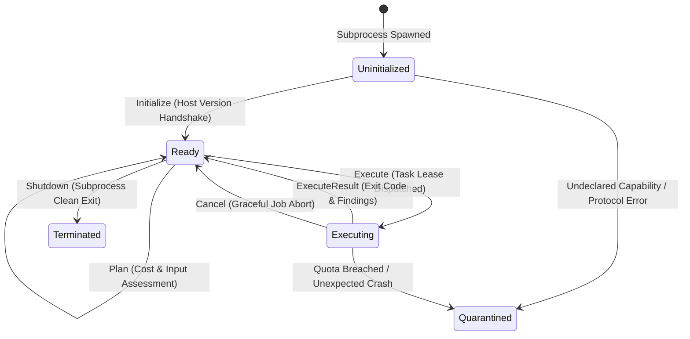

# Sentra Subprocess Adapter SDK & Reference Examples

This directory contains protocol examples and documentation for extending the **Sentra Security Platform** with the **Subprocess Plugin Architecture** (`REQ-F16`, [`docs/EXTENSIONS.md`](../../docs/EXTENSIONS.md)).

> **These adapters are examples, not production integrations.** They return simulated or synthetic results, including placeholder evidence labels; the Snyk example always reports the same two sample vulnerabilities and never calls Snyk. Treat their output as test data.
>
> **Nothing loads them implicitly.** To try them, pass this directory explicitly (`sentra plugin list --dir examples/adapters`) or point `SENTRA_PLUGIN_DIR` at it. Running `probe` or `run` starts the adapter process with your user's privileges.
>
> **What the host enforces:** the session deadline (`max_execution_time_secs`), the frame size (`max_frame_bytes`), the cumulative stdout + stderr volume (`max_total_output_bytes`), a cleared environment and process-tree termination. `max_memory_mib` and `egress_policy` are declared only and are **not enforced**; the Semgrep example's `p/security-audit` ruleset is downloaded from the Semgrep registry despite `strictly_denied`. See [`docs/PLUGINS_GUIDE.md`](../../docs/PLUGINS_GUIDE.md#7-security-model-and-residual-risks).

---

## Architectural Principles

1. **Process Isolation (`#![forbid(unsafe_code)]`):**
   External tools and plugins do NOT run inside Sentra's memory space via dynamic linking (`.so` / `.dll`). Instead, adapters execute as supervised subprocesses with a session deadline, bounded output and a cleared environment. They are not sandboxed: memory and network egress are not restricted.
2. **Polyglot Extensibility:**
   Adapters can be authored in any language (**Python, TypeScript/Bun, Go, Rust, C++**).
3. **Structured JSON-over-stdio (Newline-Delimited IPC):**
   The host orchestrator writes a single-line JSON request (`PluginRequest`) to the adapter's `stdin`, and the adapter replies with a single-line JSON response (`PluginResponse`) to `stdout`. Diagnostic logs are sent to `stderr`.

---

## Reference Adapters in this Directory

| Adapter | Language / Runtime | Family | Declared Capabilities | Use Case |
| :--- | :--- | :--- | :--- | :--- |
| [**`sentra-adapter-semgrep`**](./sentra-adapter-semgrep/) | Python 3 | `analysis_tool` | `source_discovery`, `static_analysis` | Static taint analysis & rule matching via Semgrep CLI |
| [**`sentra-adapter-snyk`**](./sentra-adapter-snyk/) | TypeScript ([Bun](https://bun.sh)) | `analysis_tool` | `dependency_audit` | Software composition analysis (SCA) via Snyk CLI |
| [**`sentra-adapter-ollama`**](./sentra-adapter-ollama/) | Python 3 | `ai_provider` | `patch_generation` | Local LLM inference (Llama 3, DeepSeek) via a loopback Ollama daemon |

---

## Protocol Lifecycle State Machine



---

## Manifest Specification (`manifest.json`)

Every adapter must be packaged with a `manifest.json` conforming to `sentra_core::plugin::PluginManifest`:

```json
{
  "id": "org.sentra.adapter.example",
  "name": "Example Security Adapter",
  "version": "1.0.0",
  "interface_version": 1,
  "family": "analysis_tool",
  "executable_path": "python adapter.py",
  "declared_capabilities": [
    "source_discovery",
    "static_analysis"
  ],
  "quotas": {
    "max_memory_mib": 1024,
    "max_execution_time_secs": 60,
    "max_frame_bytes": 1048576,
    "max_total_output_bytes": 10485760
  },
  "egress_policy": "strictly_denied"
}
```

### Egress Policies (declared, not enforced)
The host records the declared policy but does not restrict the adapter's network access.
- `"strictly_denied"`: the adapter declares that it needs no network access.
- `"whitelisted_local_only"`: the adapter declares that it only talks to loopback endpoints (`127.0.0.1`, e.g. a local Ollama or Docker daemon).
